<!-- course-site-backlink:start -->
[This lesson on the website](https://AntonC9018.github.io/uniCourse_dataStructuresAndAlgorithms/en/cpp/labs/array-practice/)
<!-- course-site-backlink:end -->
# Array practice

## Practice

Use the concepts from the earlier labs to model each problem and write procedural functions.
Use `std::array` for fixed-size storage.
Do not use loops.
Assume supplied indices are valid and quantities are sufficient unless the problem says otherwise.
All positions are supplied; no search is needed.
The first three problems and the advanced byte-storage problem have possible solutions.
Solve the remaining problems yourself.

### 1. Rebuilding a matchstick display

Digits are built from matchsticks in the shape of a seven-segment display.
Digits 0–9 need 6, 2, 5, 5, 4, 5, 6, 3, 7, 6 sticks respectively.
A display shows 208.
Rebuild it as 731 using those sticks.
How many sticks remain unused?
Write a function that counts the sticks needed for any three supplied digits.

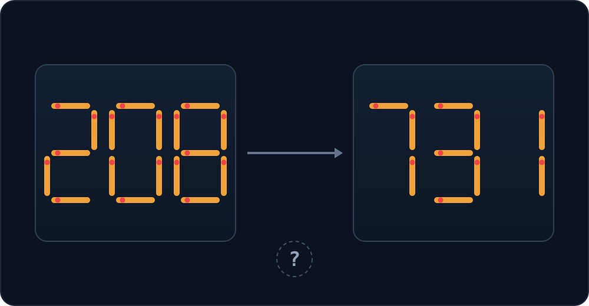

<details>
<summary>Possible solution</summary>

```cpp
#include <array>
#include <iostream>

struct DigitConfig
{
    std::array<int, 10> matchsticksPerDigit;
};

struct DigitDisplay
{
    std::array<int, 3> digits;
};

int countMatchsticks(DigitConfig config, DigitDisplay display)
{
    return config.matchsticksPerDigit[display.digits[0]]
        + config.matchsticksPerDigit[display.digits[1]]
        + config.matchsticksPerDigit[display.digits[2]];
}

int main()
{
    DigitConfig config{ .matchsticksPerDigit{ 6, 2, 5, 5, 4, 5, 6, 3, 7, 6 } };
    DigitDisplay original{ .digits{ 2, 0, 8 } };
    DigitDisplay replacement{ .digits{ 7, 3, 1 } };
    int available{ countMatchsticks(config, original) };
    int needed{ countMatchsticks(config, replacement) };
    std::cout << available - needed << std::endl;
}
```

It prints `8`.
The digits in 208 need `5 + 6 + 7 = 18` sticks; the digits in 731 need `3 + 5 + 2 = 10`.
Each digit selects its count from the lookup table.
For the original display, `display.digits[0]` gives `2`, and `config.matchsticksPerDigit[2]` gives `5`.

</details>

### 2. Compiling source code

Source code has a line count, and machine code has an instruction count.
There are three optimization levels: no optimization, basic optimization, and full optimization.
The ratio of machine instructions per source line depends on the compiler and optimization level.
In this simplified model, MSVC uses 2.5, 1.5, and 1.25; GCC uses 3, 1.75, and 1.
Compile 101 source lines with each compiler at full optimization, keeping only whole instructions.

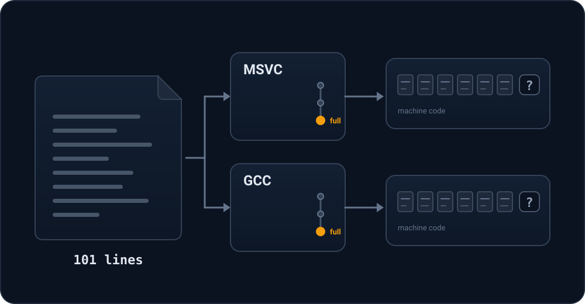

<details>
<summary>Possible solution</summary>

```cpp
#include <array>
#include <cstddef>
#include <iostream>

struct SourceCode
{
    int lineCount;
};

struct MachineCode
{
    int instructionCount;
};

struct OptimizationLevel
{
    size_t index;
};

struct Compiler
{
    std::array<double, 3> instructionsPerLine;
};

MachineCode compile(Compiler* compiler, SourceCode source, OptimizationLevel level)
{
    double coefficient{ compiler->instructionsPerLine[level.index] };
    double estimate{ static_cast<double>(source.lineCount) * coefficient };
    return MachineCode{ static_cast<int>(estimate) };
}

int main()
{
    Compiler msvc{ .instructionsPerLine{ 2.5, 1.5, 1.25 } };
    Compiler gcc{ .instructionsPerLine{ 3.0, 1.75, 1.0 } };
    SourceCode source{ 101 };
    OptimizationLevel level{ 2 };
    MachineCode msvcResult{ compile(&msvc, source, level) };
    MachineCode gccResult{ compile(&gcc, source, level) };
    std::cout << msvcResult.instructionCount << std::endl;
    std::cout << gccResult.instructionCount << std::endl;
}
```

It prints `126` and `101`.
For MSVC, the level selects `1.25`; multiplication gives `126.25`, and conversion to `int` discards the fraction.
For GCC, the same level selects `1`, producing `101` instructions.
The cast changes the expression's type.
The type of `source.lineCount` remains `int`.

</details>

### 3. Fridge slots

A fridge has three slots, each holding one milk bottle.
The bottles contain 100 ml, 300 ml, and 200 ml.
Pour 120 ml from the second bottle into an empty cup.
Report the milk left in that bottle, the cup's contents, and the milk in the first bottle.

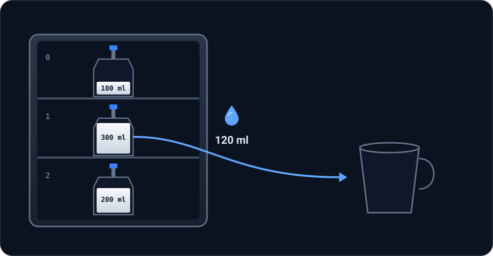

<details>
<summary>Possible solution</summary>

```cpp
#include <array>
#include <cstddef>
#include <iostream>

struct MilkBottle
{
    int milkMl;
};

struct Fridge
{
    std::array<MilkBottle, 3> slots;
};

struct Cup
{
    int milkMl;
};

void pourMilk(Fridge* fridge, size_t slotIndex, Cup* cup, int amountMl)
{
    fridge->slots[slotIndex].milkMl -= amountMl;
    cup->milkMl += amountMl;
}

int main()
{
    Fridge fridge{
        std::array<MilkBottle, 3>{ MilkBottle{ 100 }, MilkBottle{ 300 }, MilkBottle{ 200 } }
    };
    Cup cup{};
    pourMilk(&fridge, 1, &cup, 120);
    std::cout << fridge.slots[1].milkMl << std::endl;
    std::cout << cup.milkMl << std::endl;
    std::cout << fridge.slots[0].milkMl << std::endl;
}
```

It prints `180`, `120`, and `100`.
The function changes the selected slot and the caller's cup through pointers.
The other bottles remain unchanged.

</details>

### 4. Editing a file

A file contains five lines, each with a character count.
Add characters to one selected line and swap two selected lines.

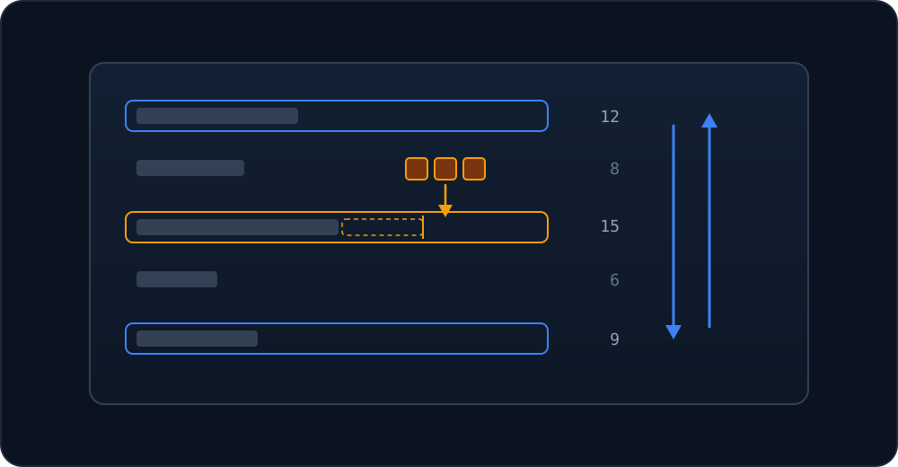

### 5. Bus fares

A bus service has a table of fares for three passenger categories.
Buy a given number of tickets for a selected category and calculate the money remaining from a supplied payment.

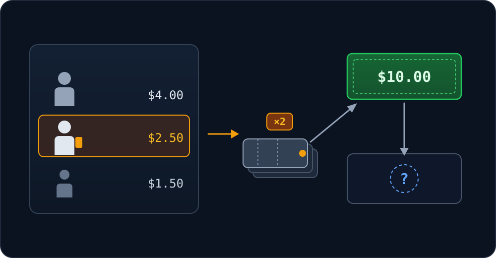

### 6. Bakery batches

A bakery has three recipes, each describing flour and sugar needed per batch.
Choose a recipe and prepare a given number of batches, updating the ingredient store and the count of finished batches.

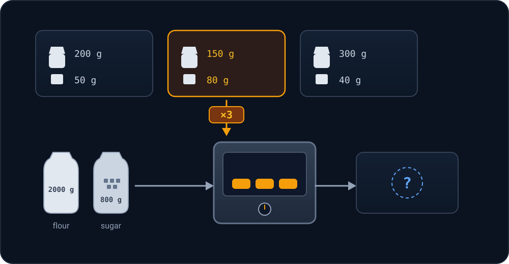

### 7. Screw drawers

A cabinet has four drawers containing screws.
Move all screws from a selected drawer into a supplied empty drawer, leaving the original drawer empty.

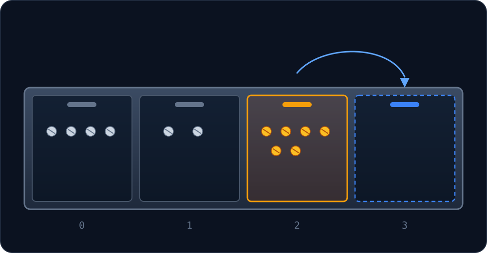

### 8. Train carriages

A train has three carriages, each with a seat capacity and a passenger count.
Transfer as many passengers as possible from one selected carriage to another and report both carriages' free seats.

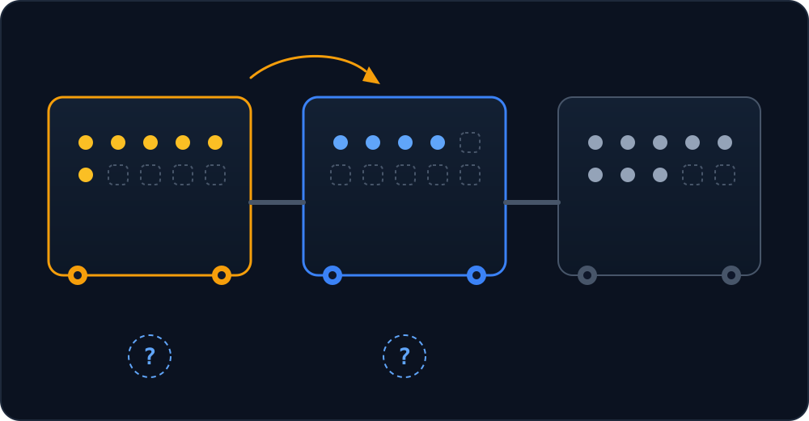

### 9. Game score replay

A game records the player's total score after each of five rounds.
Calculate how many points were earned during a selected round other than the first.
Correct the recorded total for a supplied round and recalculate that round's earned points.

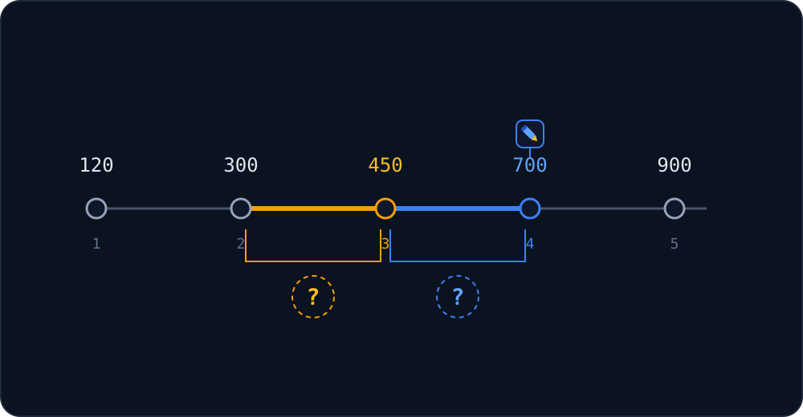

### 10. Hotel minibar

A hotel room has a minibar with four product slots, and the hotel has a price table.
Take specified quantities from two selected slots and update both their stock and the room's bill.

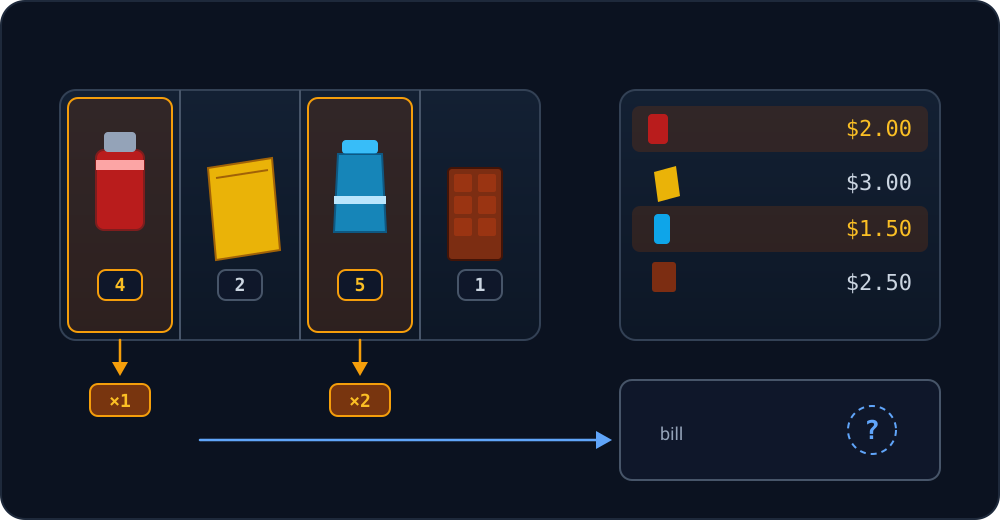

### 11. Playlist playback

A playlist holds five tracks with durations in seconds.
A player records which track is playing and the elapsed time within it.
Seek to a supplied time in the current track and report how many seconds remain.
Select another track and start it from the beginning.

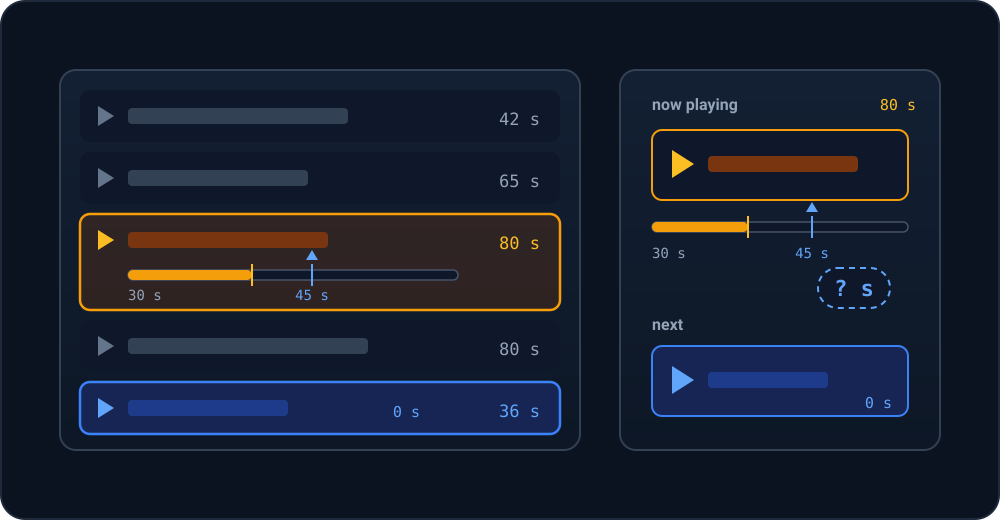

### 12. Mixing short recordings

Two short recordings each contain three sound samples, with values between -1 and 1.
Mix them into a new recording using 25% of the first recording and 75% of the second at each sample position.
Keep the original recordings unchanged.

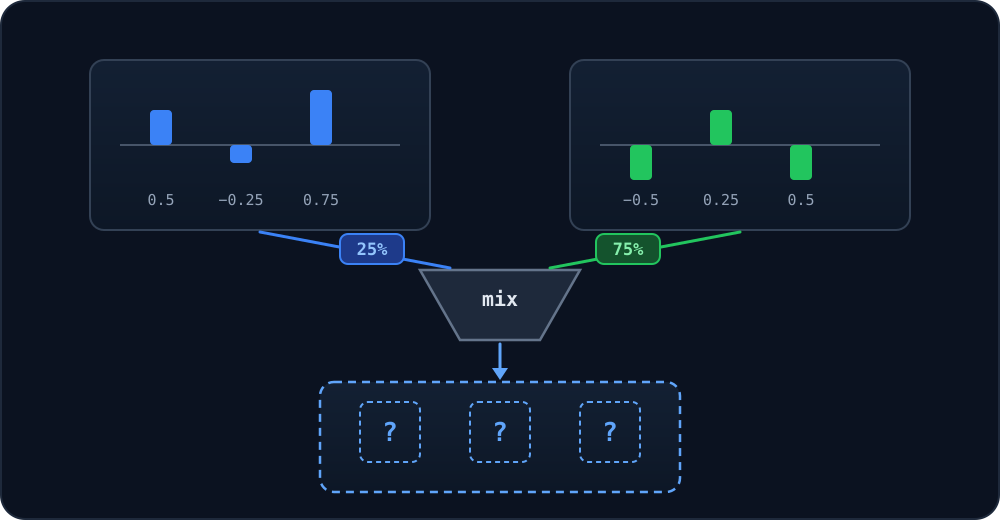

### 13. Theater seating

A theater has three rows of four seats; each seat stores a ticket number, with zero meaning empty.
Put a supplied ticket number in a supplied empty seat, then move it to another supplied empty seat.
Both seats are given by row and column; no search is needed.
Leave the original seat empty.

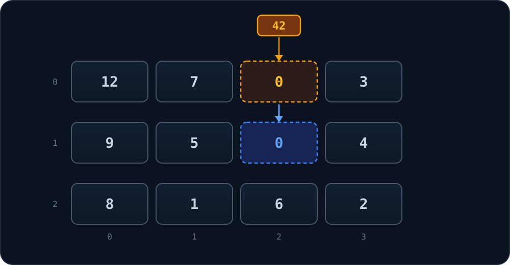

### 14. Robot delivery route

A robot starts at a given x/y position, and a delivery map stores four destinations as x/y coordinates.
Move to two destinations chosen by index, in order.
For each of the two moves, report the change in x and the change in y (the movement vector).
Report the final position too.

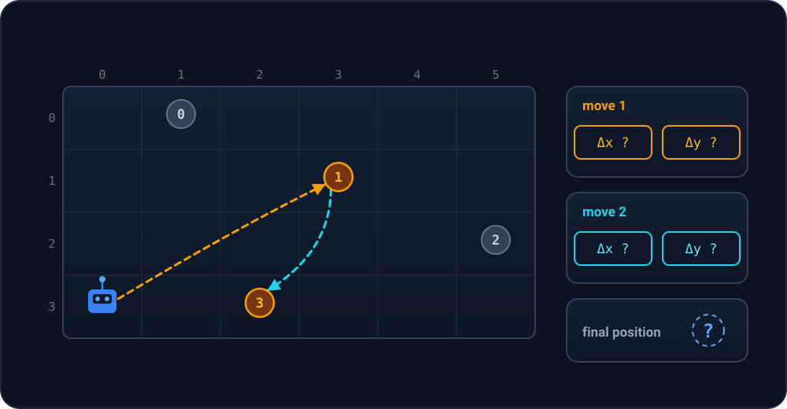

### 15. Race finish photo

Three runners cover 100 meters in 10, 12, and 15 seconds.
Assume each runs at a constant speed.
A photo is taken when the fastest runner crosses the finish line, 10 seconds after the start.
How many meters does each of the other two runners still have to run?

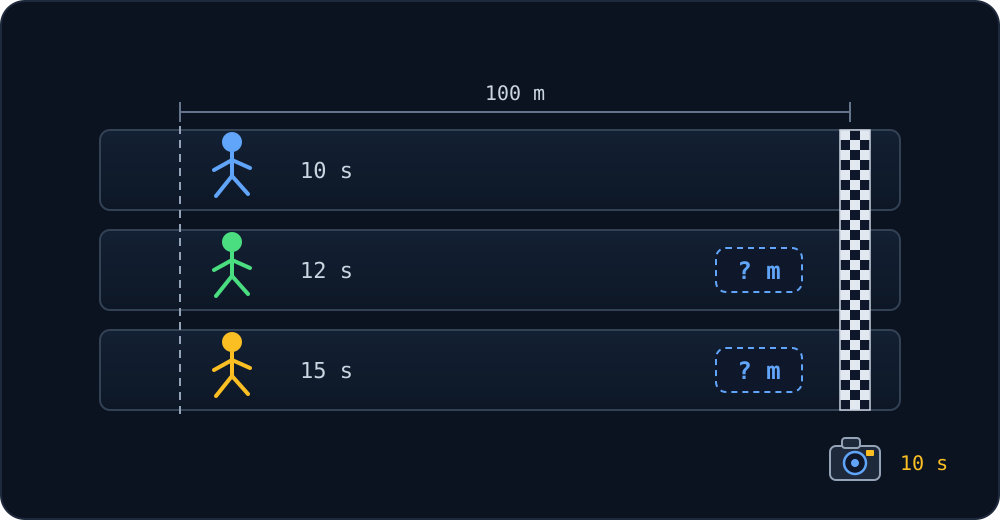

### 16. Connecting two freight wagons

Two freight wagons have cargo weights and are stored together.
Connect the first wagon to the second using a pointer.
Through that connection, add cargo to the second wagon and report its new cargo weight.
Only one connection needs to be followed.

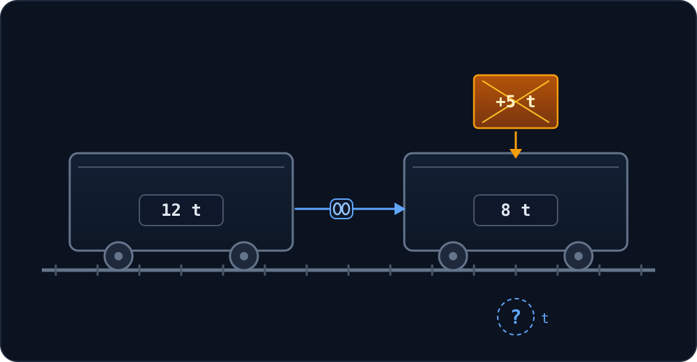

### 17. Game hotbar

A backpack holds tools with durability, and three hotbar slots refer to those tools.
Assign the same tool to two slots.
Use it through one supplied slot, reducing its durability by a supplied amount.
Show that both slots observe the change to the tool in the backpack.

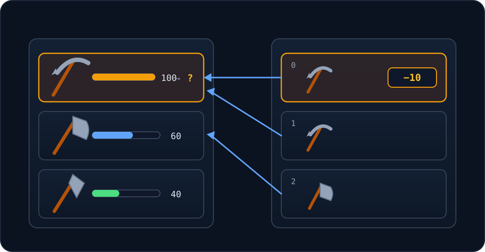

### 18. Lighting panels

Two control panels each refer to three installed lamps with adjustable brightness.
Let one lamp appear on both panels.
Change its brightness through a supplied position on one panel, then read it through the other panel.


### 19. Sports podium

Three podium positions refer to racers in a roster; each racer has a money balance.
Swap the first two positions, then award a supplied prize to the racer in a supplied position.
Report that racer's balance from the roster.

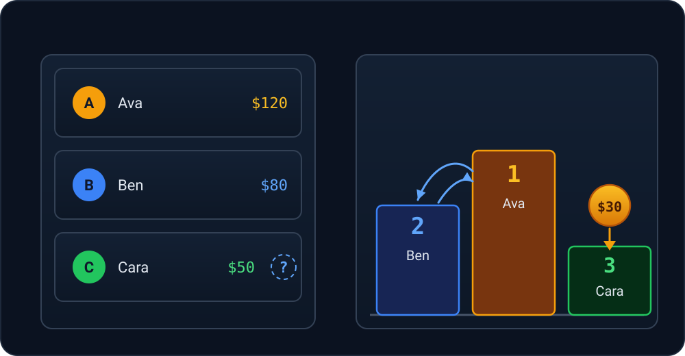

### 20. Battery charger

Three occupied charger slots refer to existing batteries with charge amounts and capacities.
Add a supplied charge amount to the battery in a supplied slot, then exchange two supplied slots.
Report the charge of the moved battery.
Assume the added charge fits within the battery's capacity.

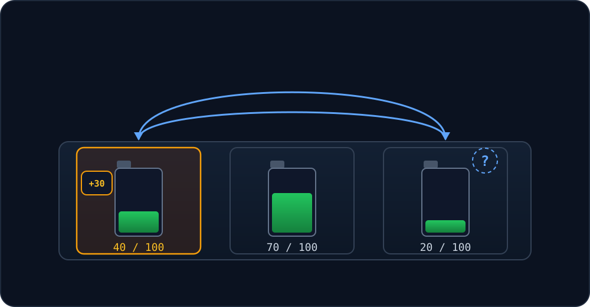

### 21. Photo albums

Two albums each refer to three photos from a shared library; each photo has a width and height.
Let one library photo appear in both albums.
Rotate that photo through a supplied album position by swapping its width and height.
The rotation edits the library photo; show the new dimensions through the other album.

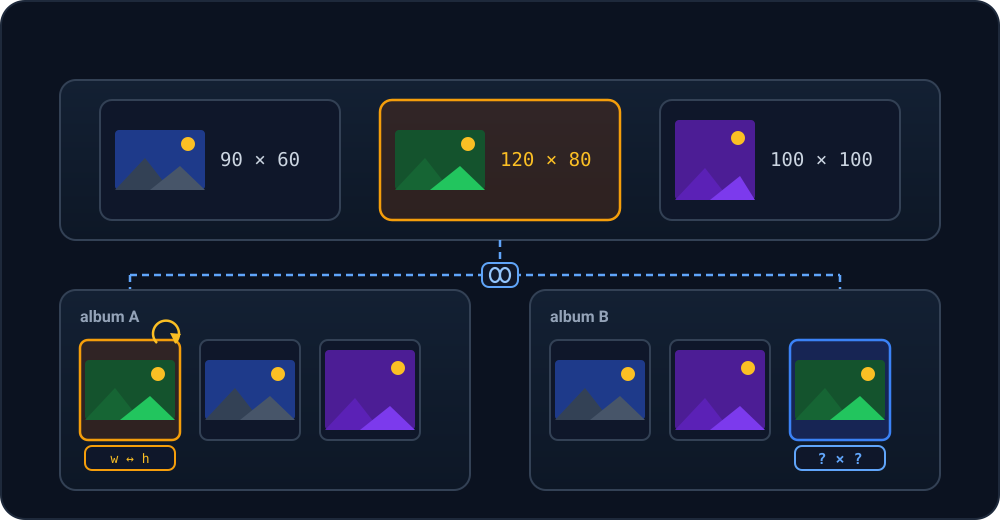

### 22. Shop displays

Two shop displays each refer to three product stock records with prices and available quantities.
Let one product appear on both displays.
Sell one unit selected by a supplied display position, decreasing its stock and adding its price to the shop's cash.
Report that product's remaining stock through the other display.

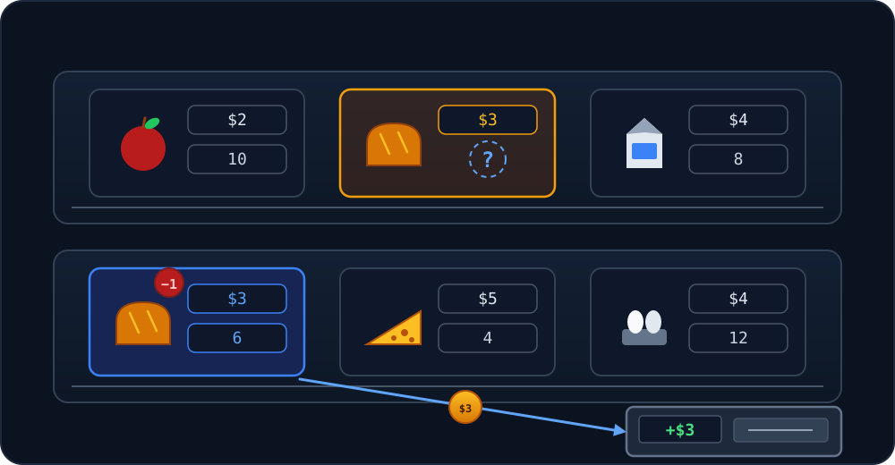

### 23. Raw-byte storage (advanced)

Store a coin and a measurement in a fixed byte buffer, recording the used byte count with a `size_t` position.
Reserve space using the item's size and alignment,
and return an address that the caller converts with `reinterpret_cast`.
Assume the buffer has enough room for both items and any alignment padding.

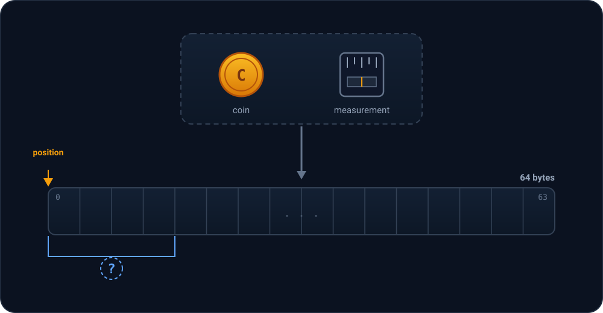

<details>
<summary>Possible solution</summary>

```cpp
#include <array>
#include <cstddef>
#include <iostream>
#include <memory>
#include <new>

struct Storage
{
    alignas(std::max_align_t) std::array<std::byte, 64> bytes{};
    size_t position{};
};

void* reserve(Storage* storage, size_t itemSize, size_t itemAlignment)
{
    void* address{ storage->bytes.data() + storage->position };
    size_t remaining{ storage->bytes.size() - storage->position };
    [[maybe_unused]] void* aligned{ std::align(itemAlignment, itemSize, address, remaining) };
    storage->position = storage->bytes.size() - remaining + itemSize;
    return address;
}

struct Coin
{
    int value;
};

struct Measurement
{
    double value;
};

int main()
{
    Storage storage{};
    void* coinAddress{ reserve(&storage, sizeof(Coin), alignof(Coin)) };
    Coin* coin{ reinterpret_cast<Coin*>(coinAddress) };
    [[maybe_unused]] Coin* createdCoin{ new (coin) Coin{ 5 } };

    void* measurementAddress{ reserve(&storage, sizeof(Measurement), alignof(Measurement)) };
    Measurement* measurement{ reinterpret_cast<Measurement*>(measurementAddress) };
    [[maybe_unused]] Measurement* createdMeasurement{ new (measurement) Measurement{ 2.5 } };

    std::cout << coin->value << std::endl;
    std::cout << measurement->value << std::endl;
    std::cout << storage.position << std::endl;
}
```

It prints `5`, `2.5`, and typically `16` used bytes.
`sizeof` supplies the object size, and `alignof` supplies the required alignment.
`std::align` moves `address` forward if padding is needed and reduces `remaining` by that padding.
The new position includes both the padding and the reserved object size.
`reinterpret_cast` supplies the pointer type; placement `new` begins the object's lifetime and initializes its fields.

> This advanced example introduces alignment and object lifetimes beyond the earlier labs.
> Assume every reservation fits; a reusable allocator would also handle `std::align` returning a null pointer.
> The exact used byte count depends on sizes and alignment; these trivial objects need no explicit destruction.

</details>
