<!-- course-site-backlink:start -->
[This lesson on the website](https://AntonC9018.github.io/uniCourse_dataStructuresAndAlgorithms/en/cpp/labs/advanced-practice/)
<!-- course-site-backlink:end -->
# Advanced Practice

> This is a continuation of [Practice with Simple Problems](08_basic_practice.md).

## What you will develop in this assignment

- More advanced domain modeling;
- Storing a fixed number of items in `std::array`, including an array inside a struct;
- Using `std::optional`;
- The idea of ownership;
- Naming things with `std::string_view`;
- Changing objects through pointers and references, reading them through `const` references and `std::span`;
- Writing small functions that return `bool` or a count, using `if` with guard clauses and `switch` on `enum`;
- Function preconditions (`assert`), explained here;
- Modeling the result of an operation and planning a mutation as values;
- Looping over objects, counting empty places, finding the first empty place.

## Tools you'll need

- `std::string_view` kind of represents a constant string.
  Use it for titles and names.

  Minimal example:
  ```cpp
  std::string_view s{ "Hello, world!" };
  std::cout << s << std::endl;
  ```

- `std::optional<T>` either holds a `T` or is empty.

  Minimal example:
  ```cpp
  std::optional<int> slot{ std::nullopt };
  slot = 42;
  bool taken{ slot.has_value() };
  slot.reset();
  ```

## Preconditions and results

A **precondition** is something that must already be true when a function is called.
For example, a function that updates an array element needs the index of an existing element.
Passing an out-of-range index is a mistake in the calling code.
Use `assert` to catch that mistake.

An **ordinary result** can be a failure even when the calling code is correct.
A booking can fail because all tickets have been sold, but that's just a normal behavior of the program.
Return that result so the caller can respond to it.

### Example: Saving a player's score

A game stores three players' scores at indices 0, 1, and 2.
`record_score` updates an existing player's score:

```cpp
#include <array>
#include <cassert>
#include <cstddef>

void record_score(std::array<int, 3>& scores, std::size_t playerIndex, int score)
{
    assert(playerIndex < scores.size());
    scores[playerIndex] = score;
}
```

<details>
<summary>What happens if the game calls <code>record_score(scores, 3, 10)</code>?</summary>

There is no player at index 3, so `assert` fails.
The calling code confused player number 3 with index 2.
Returning `false` instead would let the game ignore the failed update and continue
with the old score. The mistake might only become visible when it announces the wrong winner.
The index needs fixing in the calling code; a failed score update is not a normal game outcome.

</details>

> Assertions are a debugging tool: with `NDEBUG` defined, they are compiled out.
> The calling code must still pass valid arguments.
> An assertion never replaces validation of user input.

### Example: Booking a cinema ticket

A cinema can sell out. `book_ticket` reports whether it reserved a ticket:

```cpp
#include <cassert>

bool book_ticket(int& ticketsLeft)
{
    assert(ticketsLeft >= 0);
    if (ticketsLeft == 0)
    {
        return false;
    }
    ticketsLeft--;
    return true;
}
```

A negative number of remaining tickets would be a bug, which `assert` checks for here.
Zero tickets left is still valid - that just means the cinema has sold out.

<details>
<summary>There is one ticket left. What happens when two customers book in turn?</summary>

The first call changes `ticketsLeft` from 1 to 0 and returns `true`.
The second leaves it at 0 and returns `false`.
The caller can display "sold out" or offer another screening.
Replacing the `if` with `assert(ticketsLeft > 0)` would stop a working program
just because the last ticket had been sold.

</details>

Other checks that should **not** be assertions:

- A login form receives the wrong password.
  `assert(enteredPassword == savedPassword)` would stop the program on a normal failed login.
  The program should report that the password did not match and let the user try again.
- A search for student `"Mira"` finds nobody.
  `assert(found != nullptr)` would treat an ordinary absence as a programming error.
  Return `nullptr` and let the caller display "student not found".
- An age field receives `-5` from a user.
  `assert(age >= 0)` would stop the program instead of handling invalid input.
  Report the invalid age and ask for another value before using it.

### Example: `take_out` and `try_take_out`

The same action can have two functions with different expectations:

- `try_operation` is the soft version: it allows an ordinary failure and returns a result to check.
- `operation` is the hard version: the action must be possible. A missing prerequisite is a bug,
  caught with `assert`.

A microwave holds one meal or is empty.
Use `take_out` when the calling code already knows there is a meal inside.
It returns the meal and empties the microwave; calling it on an empty microwave is a bug.
Use `try_take_out` when an empty microwave is expected and should be handled normally.
It returns `std::optional<Meal>`: a meal on success, or `std::nullopt` if there is nothing to take.

```cpp
#include <cassert>
#include <optional>
#include <string_view>

struct Meal
{
    std::string_view name;
};

struct Microwave
{
    std::optional<Meal> meal;
};

Meal take_out(Microwave& microwave)
{
    assert(microwave.meal.has_value());
    Meal meal{ *microwave.meal };
    microwave.meal.reset();
    return meal;
}

std::optional<Meal> try_take_out(Microwave& microwave)
{
    if (!microwave.meal.has_value())
    {
        return std::nullopt;
    }
    return take_out(microwave);
}
```

`try_take_out` checks for an empty microwave before calling `take_out`.
Both functions remove a meal when one is present; only the empty case is different.

```cpp
Microwave microwave{ .meal = Meal{ .name = "soup" } };
Meal soup{ take_out(microwave) };
std::optional<Meal> second{ try_take_out(microwave) };
```

<details>
<summary>What do the calls return? What if the second call used <code>take_out</code>?</summary>

`take_out` returns the soup and leaves the microwave empty.
`try_take_out` then returns `std::nullopt`, leaving it empty.
The caller can check `second.has_value()` and decide to cook something else.
A second `take_out` would fail its assertion: the calling code tried to remove a meal
without ensuring that one was present.

</details>

Choose the function whose expectations match the calling code.
Do not call `take_out` just to check whether there is a meal inside;
that is what `try_take_out` is for.

## Practice tasks

- **Bookshelf.** A shelf holds 5 books. Each book has a title.
  Put the Atlas at shelf 2 and remove the book from shelf 0.
  Count how many shelves are empty.

  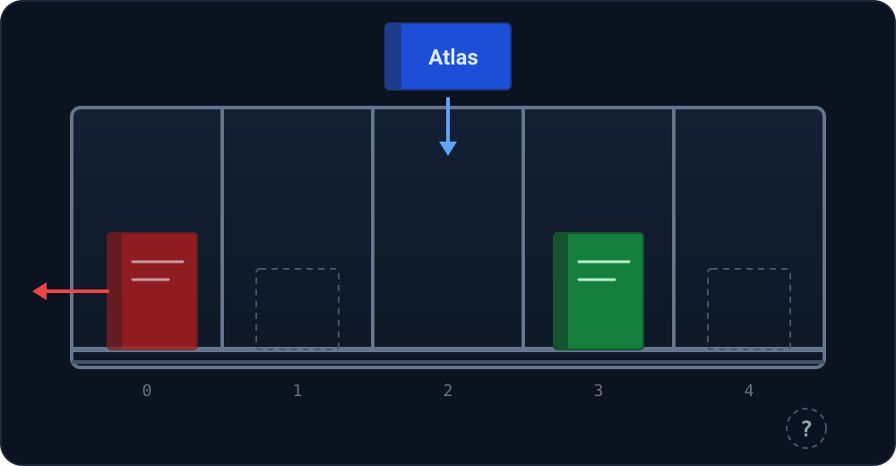

  <details>
  <summary>
  Possible solution
  </summary>

  A shelf slot either holds a book or is empty, so the slot type is
  `std::optional<Book>` — an empty shelf is `std::nullopt`.
  The structs group each book's title and the shelf's slots:

  ```cpp
  #include <array>
  #include <optional>
  #include <string_view>

  struct Book
  {
      std::string_view title;
  };

  struct Bookshelf
  {
      std::array<std::optional<Book>, 5> slots;
  };
  ```

  Say slots 0 and 3 hold books and the rest are empty.
  Putting the Atlas at slot 2 checks two things.
  The caller must choose an index inside the array.
  `assert` catches an index such as 5: there is no such slot on this shelf.
  Slot 2 must have no value — that is ordinary data,
  so an occupied slot is reported with `false`.
  The shelf pointer must point at a shelf; `assert` also catches a missing shelf.
  At slot 0 the slot is occupied, so the book is refused and nothing changes:

  ```cpp
  #include <cassert>

  bool shelve_book(Bookshelf* shelf, size_t index, Book book)
  {
      assert(shelf != nullptr);            // shelve_book expects shelf to never be null
      assert(index < shelf->slots.size()); // and index to be inside the shelf
      if (shelf->slots[index].has_value())
      {
          return false;
      }
      shelf->slots[index] = book;
      return true;
  }
  ```

  A reference cannot be null, so taking the shelf by `&` instead of by `*`
  enforces that it is never null.

  Taking a book also requires an existing slot, so `assert` checks the index;
  slot 0 has a book, so clear it with `reset()` and return `true`;
  an empty slot is ordinary data, so it refuses:

  ```cpp
  bool take_book(Bookshelf& shelf, size_t index)
  {
      assert(index < shelf.slots.size());
      if (!shelf.slots[index].has_value())
      {
          return false;
      }
      shelf.slots[index].reset();
      return true;
  }
  ```

  Counting empties just visits each slot in turn with a range-based `for`
  and adds 1 for each slot without a value:

  ```cpp
  int empty_count(const Bookshelf& shelf)
  {
      int count{ 0 };
      for (const auto& slot : shelf.slots)
      {
          if (!slot.has_value())
          {
              count++;
          }
      }
      return count;
  }
  ```

  Usage from `main`:
  ```cpp
  Bookshelf shelf{};
  shelve_book(&shelf, 2, Book{ .title = "Atlas" });
  take_book(shelf, 0);
  int free{ empty_count(shelf) };
  ```
  </details>

- **Fridge to freezer.** A fridge holds 3 foods, a freezer holds 2 foods.
  Each food has a name.
  Move the pizza from fridge shelf 1 to freezer shelf 0.
  The old place becomes empty.

  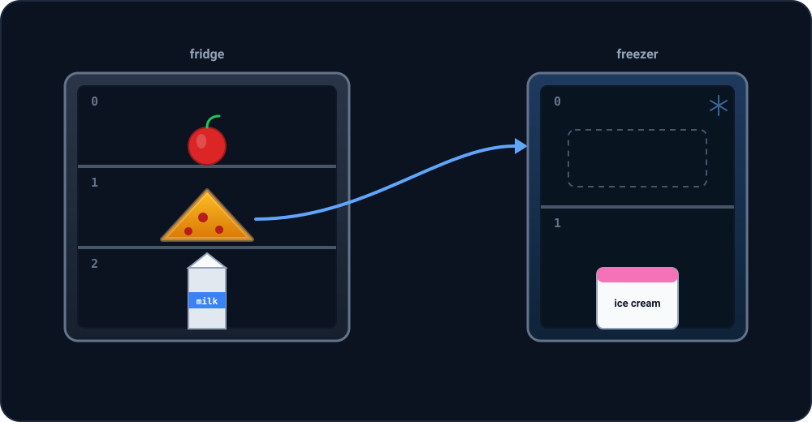

  <details>
  <summary>
  Possible solution
  </summary>

  Same shelf idea, two containers: the fridge has 3 shelves, the freezer 2,
  each slot either holds food or is empty:

  ```cpp
  #include <array>
  #include <cassert>
  #include <optional>
  #include <string_view>

  struct Food
  {
      std::string_view name;
  };

  struct Fridge
  {
      std::array<std::optional<Food>, 3> shelves;
  };

  struct Freezer
  {
      std::array<std::optional<Food>, 2> shelves;
  };
  ```

  Say fridge shelf 1 holds the pizza and freezer shelf 0 is empty.
  The caller must choose existing shelves in both containers.
  The two assertions catch an index that points outside either array.
  The source holding food and the target being free are ordinary data,
  so those checks return `false`.
  Then two steps: copy the food into freezer shelf 0,
  clear fridge shelf 1 with `reset()`.
  From then on the pizza lives in exactly one place —
  that is the whole ownership idea.
  A failed data check returns `false` and nothing is touched:

  ```cpp
  bool move_food(Fridge& from, size_t fromIndex, Freezer& to, size_t toIndex)
  {
      assert(fromIndex < from.shelves.size());
      assert(toIndex < to.shelves.size());
      if (!from.shelves[fromIndex].has_value())
      {
          return false;
      }
      if (to.shelves[toIndex].has_value())
      {
          return false;
      }
      to.shelves[toIndex] = from.shelves[fromIndex];
      from.shelves[fromIndex].reset();
      return true;
  }
  ```

  Usage from `main`:
  ```cpp
  Fridge fridge{};
  fridge.shelves[1] = Food{ .name = "pizza" };
  Freezer freezer{};
  bool moved{ move_food(fridge, 1, freezer, 0) };
  ```
  </details>

- **Heat soup.** A microwave holds one meal or is empty.
  Each meal has a name and warmth: cold or hot.
  Put the cold soup in, heat it to hot, then take it out.

  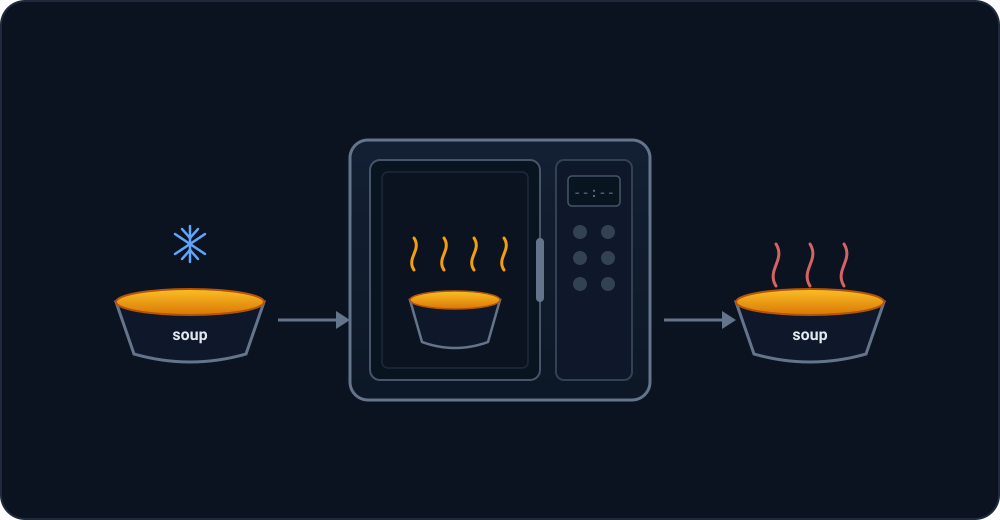

  <details>
  <summary>
  Possible solution
  </summary>

  Here there is only one slot — the tray — plus a new thing to track:
  warmth, which is either cold or hot:

  ```cpp
  #include <optional>
  #include <string_view>

  enum class Warmth
  {
      Cold,
      Hot,
  };

  struct Meal
  {
      std::string_view name;
      Warmth warmth;
  };

  struct Microwave
  {
      std::optional<Meal> tray;
  };
  ```

  The tray starts empty. Putting the cold soup in finds a free tray,
  so store the meal and return `true`;
  a second put would find a busy tray and refuse:

  ```cpp
  bool put_meal(Microwave& m, Meal meal)
  {
      if (m.tray.has_value())
      {
          return false;
      }
      m.tray = meal;
      return true;
  }
  ```

  Heating finds a meal inside, so flip its warmth to hot.
  Heating an empty microwave finds nothing and returns `false`:

  ```cpp
  bool heat_meal(Microwave& m)
  {
      if (!m.tray.has_value())
      {
          return false;
      }
      m.tray->warmth = Warmth::Hot;
      return true;
  }
  ```

  Taking out copies the hot soup for the caller,
  clears the tray, and returns the copy:

  ```cpp
  std::optional<Meal> take_meal(Microwave& m)
  {
      if (!m.tray.has_value())
      {
          return std::nullopt;
      }
      std::optional<Meal> result{ m.tray };
      m.tray.reset();
      return result;
  }
  ```

  Usage from `main`:
  ```cpp
  Microwave mw{};
  put_meal(mw, Meal{ .name = "soup", .warmth = Warmth::Cold });
  heat_meal(mw);
  std::optional<Meal> lunch{ take_meal(mw) };
  ```
  </details>

- **Drink potion.** A hero has health and shield.
  A potion is red, blue, or spoiled.
  Give the hero 1 red potion.
  Red adds 20 health, blue adds 10 shield, spoiled does nothing.

  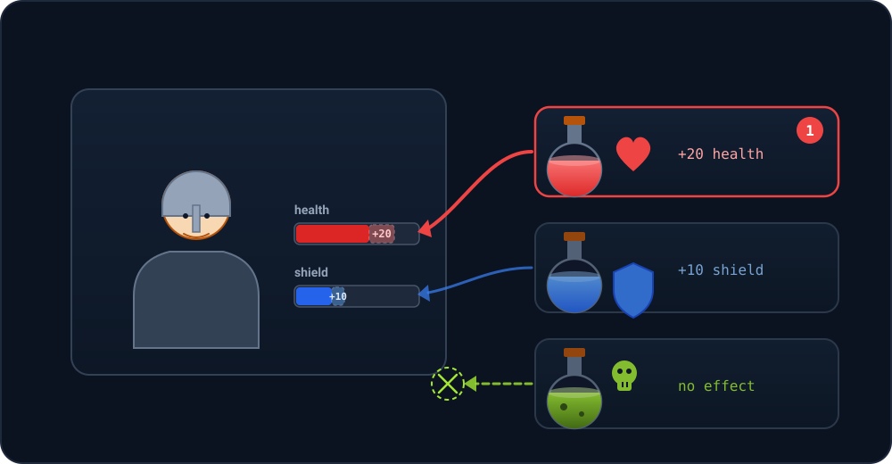

  <details>
  <summary>
  Possible solution
  </summary>

  The potion kind decides the effect, so it becomes an `enum`.
  Hero and potion are plain grouping:

  ```cpp
  #include <cassert>

  enum class PotionKind
  {
      Red,
      Blue,
      Spoiled,
  };

  struct Potion
  {
      PotionKind kind;
  };

  struct Hero
  {
      int health;
      int shield;
  };
  ```

  A red potion raises the hero's health from 50 to 70:
  the `Red` branch adds 20 and returns `true`.
  A blue potion would take the next branch and add 10 shield instead.
  A spoiled potion takes the last branch and returns `false`
  without touching the hero.
  Every `PotionKind` is handled, so falling out of the `switch`
  means the value is corrupt — the assert catches it:

  ```cpp
  bool drink_potion(Hero& hero, Potion potion)
  {
      switch (potion.kind)
      {
          case PotionKind::Red:
              hero.health += 20;
              return true;
          case PotionKind::Blue:
              hero.shield += 10;
              return true;
          case PotionKind::Spoiled:
              return false;
      }
      assert(false); // every PotionKind is handled above
      return false;  // unreachable
  }
  ```

  Usage from `main`:
  ```cpp
  Hero hero{ .health = 50, .shield = 0 };
  drink_potion(hero, Potion{ .kind = PotionKind::Red });
  ```
  </details>

- **Soak laundry.** A basket holds 3 pieces of clothing.
  A laundry has 2 baskets.
  Each piece has a label and is dirty, soaked, or clean.
  Take out every clean shirt from basket 0, then soak every dirty shirt in basket 0.
  Count how many were taken and how many were soaked.

  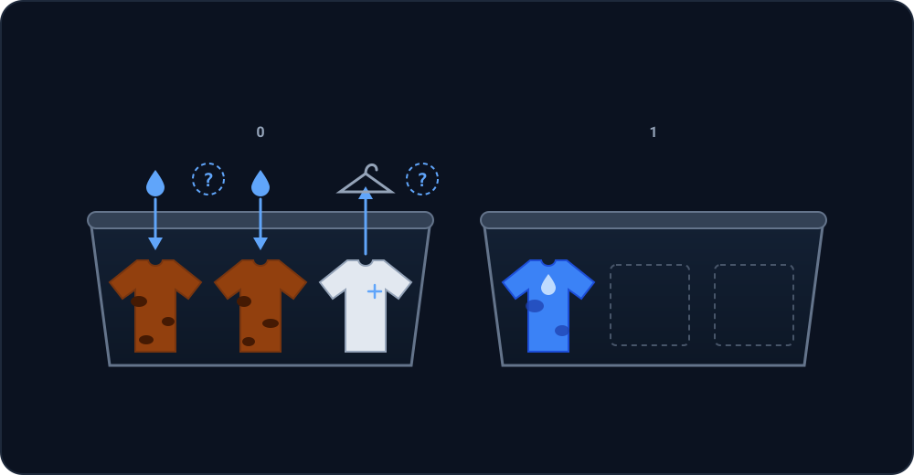

  <details>
  <summary>
  Possible solution
  </summary>

  The new shape here is nesting: a `Basket` holds an array,
  a `Laundry` holds baskets:

  ```cpp
  #include <array>
  #include <optional>
  #include <string_view>

  enum class ClothState
  {
      Dirty,
      Soaked,
      Clean,
  };

  struct Cloth
  {
      std::string_view label;
      ClothState state;
  };

  struct Basket
  {
      std::array<std::optional<Cloth>, 3> slots;
  };

  struct Laundry
  {
      std::array<Basket, 2> baskets;
  };
  ```

  Say slots 0 and 1 of basket 0 hold dirty shirts and slot 2 holds a clean shirt.
  First take out the clean ones: the loop borrows each slot in turn
  and clears every slot that holds a clean piece, counting 1.
  Then soak the dirty ones: a second loop over the same slots
  marks every dirty piece soaked, counting 2.
  An empty slot is skipped in both loops.

  ```cpp
  int take_clean_shirts(Basket& basket)
  {
      int taken{ 0 };
      for (auto& slot : basket.slots)
      {
          if (!slot.has_value())
          {
              continue;
          }
          if (slot->state != ClothState::Clean)
          {
              continue;
          }
          slot.reset();
          taken++;
      }
      return taken;
  }

  int soak_basket(Basket& basket)
  {
      int soaked{ 0 };
      for (auto& slot : basket.slots)
      {
          if (!slot.has_value())
          {
              continue;
          }
          if (slot->state != ClothState::Dirty)
          {
              continue;
          }
          slot->state = ClothState::Soaked;
          soaked++;
      }
      return soaked;
  }
  ```

  Usage from `main`:
  ```cpp
  Laundry laundry{};
  laundry.baskets[0].slots[0] = Cloth{
      .label = "shirt",
      .state = ClothState::Dirty,
  };
  int taken{ take_clean_shirts(laundry.baskets[0]) };
  int n{ soak_basket(laundry.baskets[0]) };
  ```
  </details>

- **Tune car.** A garage holds 4 cars. Each car has a model, power, and price.
  Tune car 2: add 10 power, add 1000 to the price for each added power.

  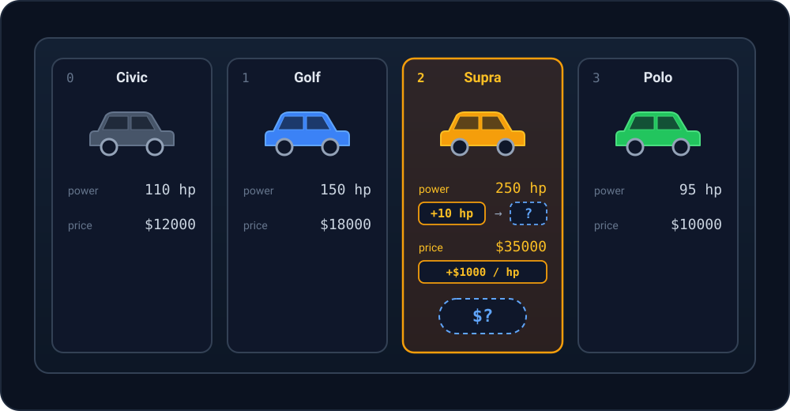

- **Wash cars.** A car wash holds 3 cars. Each car is clean or dirty.
  Wash every dirty car. Count how many were washed.

  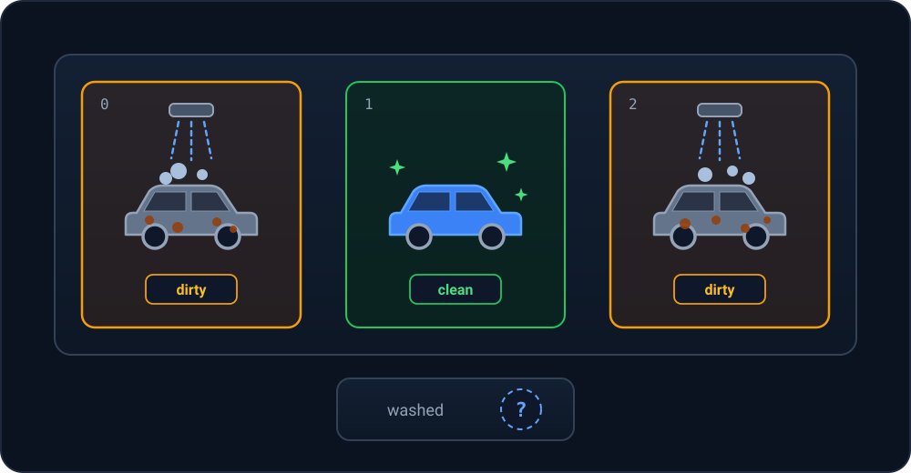

- **Parking lot.** A parking lot has 2 floors with 4 spots each.
  Each spot holds a car or is empty.
  Put the new car on the first empty spot. Walk the spots with pointer arithmetic.

  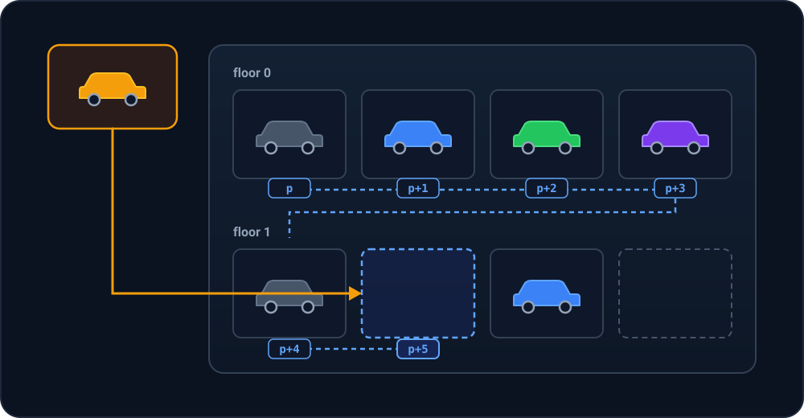

- **Car engine.** A garage holds 4 cars. Each car has its own engine. The engine has wear from 0 to 100.
  Check the engine through car 1 and repair the engine of car 1 to wear 0.

  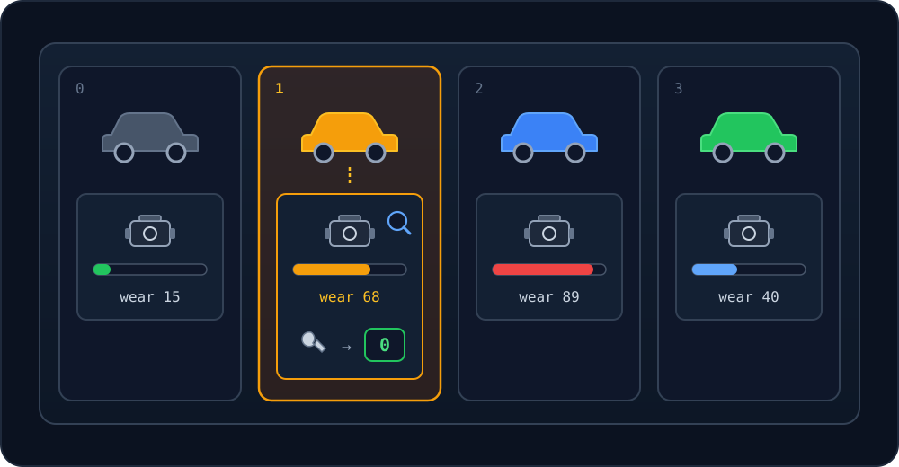

- **Cup rail.** A rail holds 4 cups. Some hooks are empty.
  Put a new cup on the first empty hook and take the cup from hook 1.
  The cup moves with ownership: copy it over, then clear the old spot.

  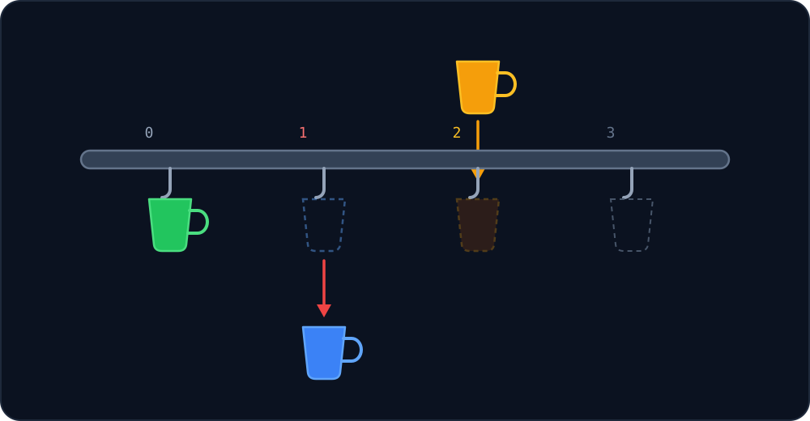

- **Hero party.** A squad holds 3 heroes. Each hero has health and shield.
  Heal hero 1 by 20. Count how many heroes still need healing.

  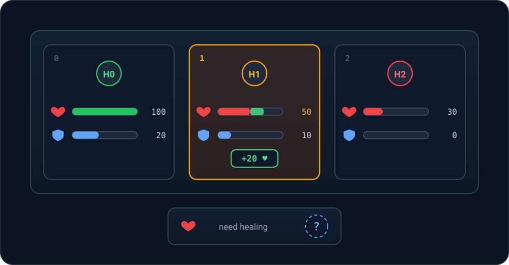

- **Active buff.** A player holds a pointer to the active buff. No buff means an empty pointer.
  Give the player 1 shield buff before the fight and take it away after.

  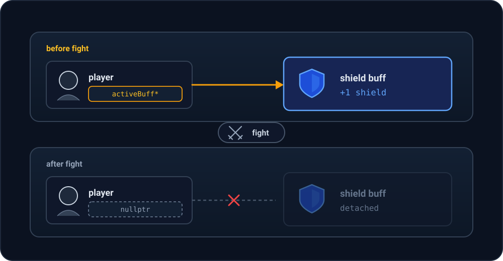

- **Classroom.** A room has 2 rows with 3 desks each. Each desk holds a pupil or is empty.
  Count empty desks. Seat the newcomer at the first empty desk.

  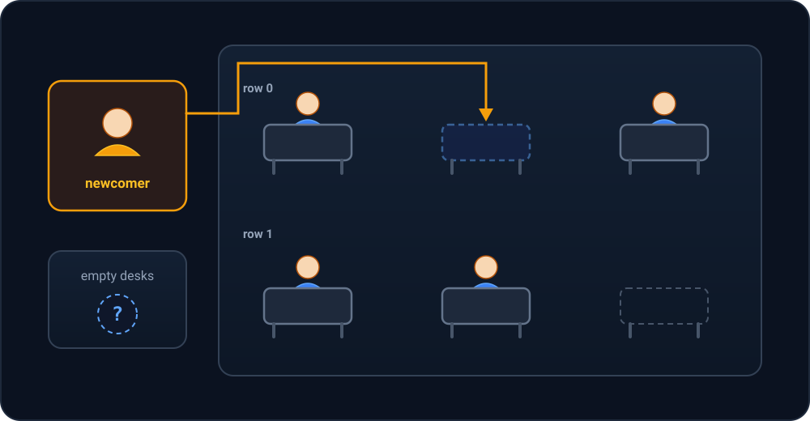

- **Find pizza.** A fridge holds 3 foods with names.
  Find the pizza and move it to freezer shelf 1. Return if it was found.
  Look at the shelves through a span.

  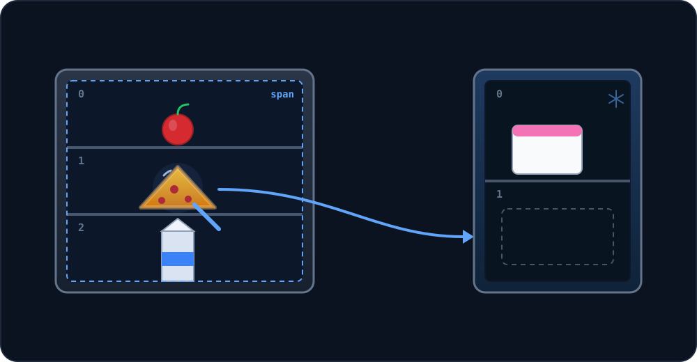

  <details>
  <summary>
  Possible solution
  </summary>

  Same fridge and freezer as before, but the search goes through a `span` —
  a view over the shelves array instead of the array itself.
  Same name as the earlier `move_food`, but different parameters (an overload):
  what to find and where to put it are grouped into their own request struct:

  ```cpp
  #include <array>
  #include <cassert>
  #include <optional>
  #include <span>
  #include <string_view>

  struct Food
  {
      std::string_view name;
  };

  struct Fridge
  {
      std::array<std::optional<Food>, 3> shelves;
  };

  struct Freezer
  {
      std::array<std::optional<Food>, 2> shelves;
  };

  struct FoodMove
  {
      std::string_view name;
      size_t toIndex;
  };
  ```

  Say fridge shelf 1 holds the pizza and freezer shelf 1 is free.
  The caller packs `"pizza"` and `1` into a `FoodMove`.
  The function does not need the whole fridge, only a view of its shelves,
  so it accepts a `std::span` of them. The same function can move food
  out of any contiguous shelf array, not just this fridge.
  The target index must name an existing freezer shelf; `assert` checks that.
  An occupied target shelf is an ordinary result, reported with `false`.
  The `span` borrows each shelf slot in turn: slot 0 has no pizza, so skip it;
  slot 1 has the pizza, so copy it into the freezer and clear the old slot,
  then report success with `true`.
  If no slot holds a food with that name, report `false` and touch nothing:

  ```cpp
  bool move_food(
      std::span<std::optional<Food>> shelves,
      Freezer& to,
      FoodMove move)
  {
      assert(move.toIndex < to.shelves.size());
      if (to.shelves[move.toIndex].has_value())
      {
          return false;
      }
      for (auto& slot : shelves)
      {
          if (!slot.has_value())
          {
              continue;
          }
          if (slot->name != move.name)
          {
              continue;
          }
          to.shelves[move.toIndex] = slot;
          slot.reset();
          return true;
      }
      return false;
  }
  ```

  Writes through the span reach the fridge itself, because the span
  stores the address of the shelves, not a copy of them.

  Usage from `main`:
  ```cpp
  Fridge fridge{};
  fridge.shelves[1] = Food{
      .name = "pizza",
  };
  Freezer freezer{};
  bool moved{ move_food(fridge.shelves, freezer, FoodMove{
      .name = "pizza",
      .toIndex = 1,
  }) };
  ```
  </details>

- **Soak dishes.** A kitchen has 2 racks with 3 plates each. Each plate is dirty or soaked.
  Soak every dirty plate in rack 0.

  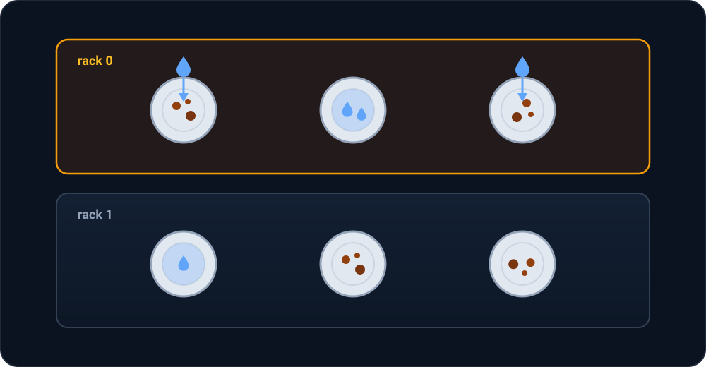

- **Library rooms.** A library has 2 rooms with 3 slots each. Each slot holds a book or is empty.
  Put the Atlas in the first empty slot of room 1.

  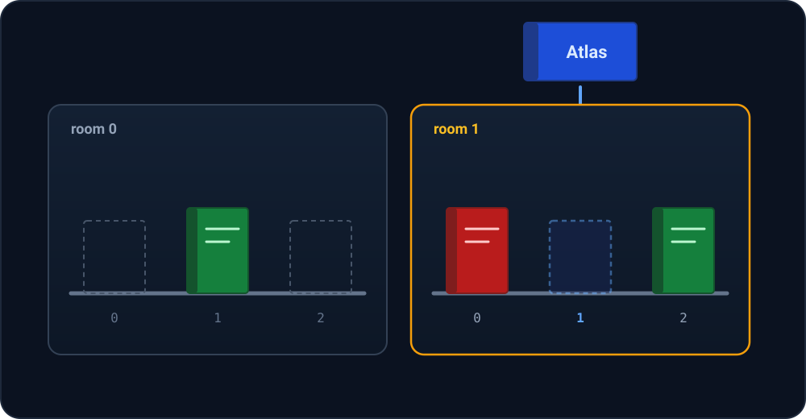

- **Traffic light.** A crossing has 3 lights. Each light is red, yellow, or green.
  Step light 2 to the next color with switch.

  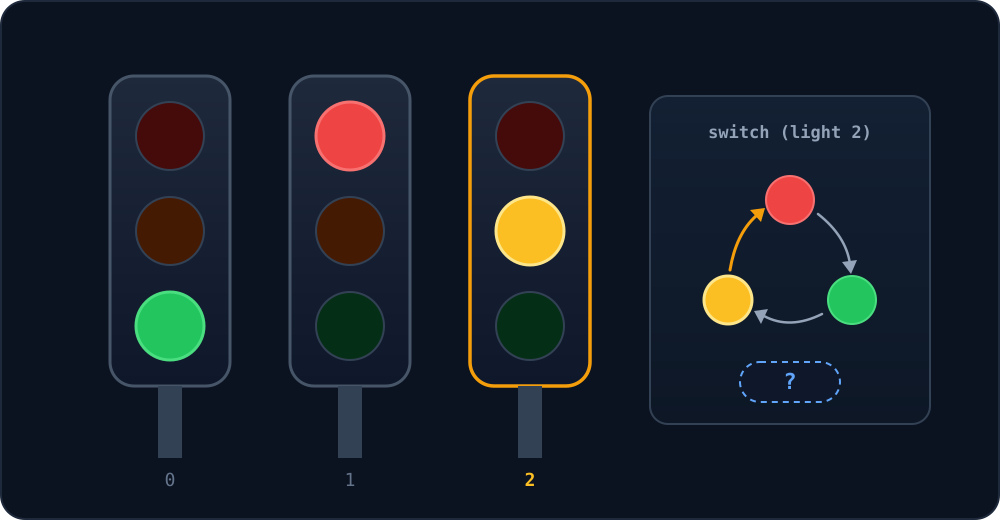

- **Medicine cabinet.** A cabinet holds 4 boxes. Each box is fresh or expired.
  Return if box 1 can be used. Throw box 1 away if expired.

  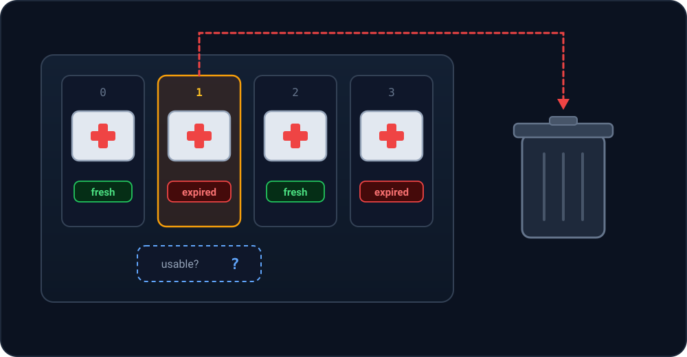

- **Canteen.** A canteen holds 3 soups and 3 breads.
  Serve soup 1 with bread 1. The serving takes both out.

  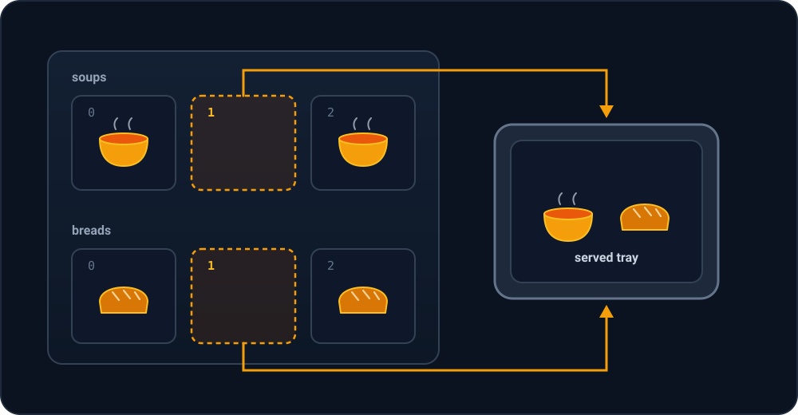

- **Hot chain.** A kitchen has a fridge, a freezer, and a microwave.
  Put the pizza from fridge shelf 0 into the microwave, heat it,
  then move it to freezer shelf 1. Each step returns if it worked.

  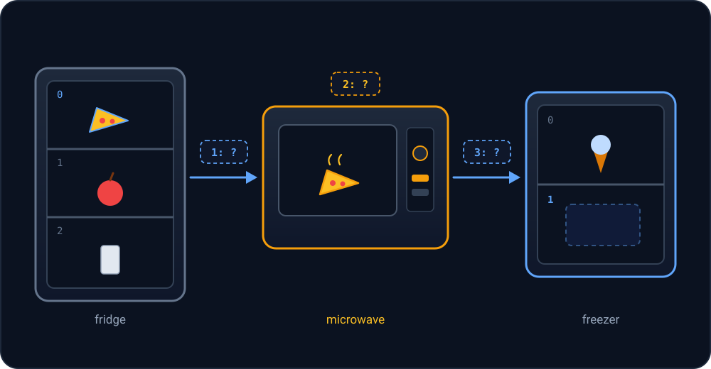

- **Barbershop.** A shop has room for 4 waiting clients and 2 workers.
  Each client has a label and hair left to cut, in minutes.
  Clients are created separately in `main` and only referenced by the shop.
  Add each client to the first free spot in the queue.
  Assign idle workers to waiting clients.
  Each tick every busy worker cuts 1 minute.
  When a client is fully cut, the worker becomes free.
  Simulate with a `while` loop until all clients are done.

  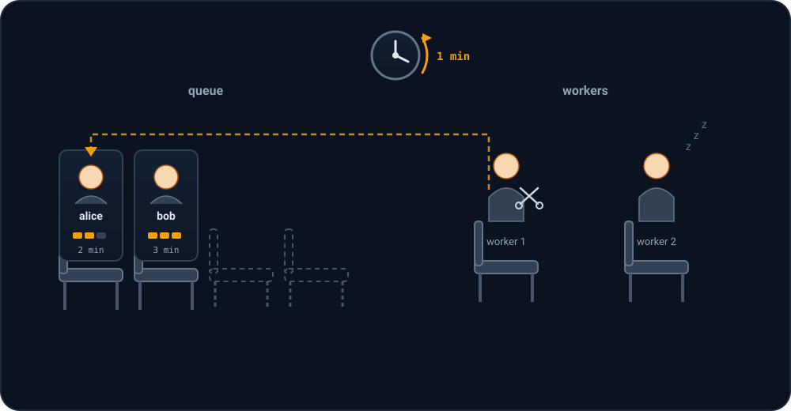

  <details>
  <summary>
  Possible solution
  </summary>

  Clients live in `main`, the shop only borrows them —
  that is why both the queue and the workers store pointers, not copies.
  A cut through a pointer is visible in the client itself,
  and the same client is first referenced from the queue, then from a worker.

  ```cpp
  #include <array>
  #include <cassert>
  #include <string_view>

  struct MinutesLeft
  {
      int value;
  };

  struct Client
  {
      std::string_view label;
      MinutesLeft hairCompletion;
  };

  struct Worker
  {
      Client* assignedClient{ nullptr };
  };

  struct Shop
  {
      std::array<Client*, 4> queue{};
      std::array<Worker, 2> workers{};
  };
  ```

  Adding puts the pointer into the first free queue spot.
  Finding that spot is its own function:
  it hands over a pointer to the slot, or `nullptr` when the queue is full.
  Adding then just fills that slot.
  The client must never be `nullptr`, so it is enforced with an assert;
  a full queue is a normal failure reported through the result:

  ```cpp
  enum class AddClientResult
  {
      Added,
      FailedQueueFull,
  };

  Client** find_free_slot(Shop& shop)
  {
      for (auto& slot : shop.queue)
      {
          if (slot == nullptr)
          {
              return &slot;
          }
      }
      return nullptr;
  }

  AddClientResult add_client(Shop& shop, Client* client)
  {
      assert(client != nullptr); // add_client expects client to never be null
      Client** slot{ find_free_slot(shop) };
      if (slot == nullptr)
      {
          return AddClientResult::FailedQueueFull;
      }
      *slot = client;
      return AddClientResult::Added;
  }
  ```

  Taking the first waiting client is its own function:
  finding the first taken queue spot hands over a pointer to the slot,
  taking clears that slot and hands the client pointer over.
  Assigning then just gives every idle worker whatever that function returns —
  a `nullptr` result simply leaves the worker idle:

  ```cpp
  Client** find_taken_slot(Shop& shop)
  {
      for (auto& slot : shop.queue)
      {
          if (slot != nullptr)
          {
              return &slot;
          }
      }
      return nullptr;
  }

  Client* take_first_waiting(Shop& shop)
  {
      Client** slot{ find_taken_slot(shop) };
      if (slot == nullptr)
      {
          return nullptr;
      }
      Client* found{ *slot };
      *slot = nullptr;
      return found;
  }

  void assign_workers(Shop& shop)
  {
      for (auto& worker : shop.workers)
      {
          if (worker.assignedClient != nullptr)
          {
              continue;
          }
          worker.assignedClient = take_first_waiting(shop);
      }
  }
  ```

  `cut_one_minute` needs a non-null pointer and a positive number of minutes left.
  Its assertions catch a missing duration or an attempt to cut after the haircut is finished.
  `tick_worker` allows zero minutes: that client is already done.
  A negative duration is a bug, caught before it can leave the worker busy forever:

  ```cpp
  void cut_one_minute(MinutesLeft* minutes)
  {
      assert(minutes != nullptr);
      assert(minutes->value > 0);
      *minutes = MinutesLeft{ minutes->value - 1 };
  }

  bool client_done(const Client& client)
  {
      return client.hairCompletion.value == 0;
  }

  enum class TickResult
  {
      Unassigned,
      StillWorking,
      Done,
  };

  TickResult tick_worker(Worker& worker)
  {
      Client* client{ worker.assignedClient };
      if (client == nullptr)
      {
          return TickResult::Unassigned;
      }
      assert(client->hairCompletion.value >= 0); // a negative haircut would never finish
      if (client->hairCompletion.value > 0)
      {
          cut_one_minute(&client->hairCompletion);
      }
      if (client_done(*client))
      {
          worker.assignedClient = nullptr;
          return TickResult::Done;
      }
      return TickResult::StillWorking;
  }

  void tick_all_workers(Shop& shop)
  {
      for (auto& worker : shop.workers)
      {
          tick_worker(worker);
      }
  }

  bool has_waiting_clients(const Shop& shop)
  {
      for (const auto& slot : shop.queue)
      {
          if (slot != nullptr)
          {
              return true;
          }
      }
      return false;
  }

  bool has_busy_workers(const Shop& shop)
  {
      for (const auto& worker : shop.workers)
      {
          if (worker.assignedClient != nullptr)
          {
              return true;
          }
      }
      return false;
  }

  bool shop_done(const Shop& shop)
  {
      return !has_waiting_clients(shop) && !has_busy_workers(shop);
  }
  ```

  The simulation is a plain `while` loop: assign, then tick every worker, until done.
  Clients must outlive the shop, because the shop never copies them:

  ```cpp
  int main()
  {
      Client alice{
          .label = "alice",
          .hairCompletion = { 2 },
      };
      Client bob{
          .label = "bob",
          .hairCompletion = { 3 },
      };

      Shop shop{};
      add_client(shop, &alice);
      add_client(shop, &bob);

      while (!shop_done(shop))
      {
          assign_workers(shop);
          tick_all_workers(shop);
      }
  }
  ```
  </details>

- **Barbershop drones.** The workers are now automatic drones:
  several drones may process the same client at the same time,
  each cutting 1 minute per tick.
  When a client is fully cut, every drone on that client becomes free.
  Simulate until all clients are done.

  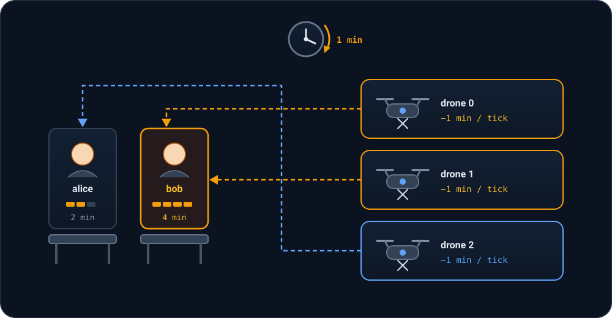

- **Amusement park.** A park has 3 attractions.
  Each visitor ranks all 3 attractions by preference,
  doesn't visit the same one back-to-back,
  and may visit attractions 4 times in total.
  Every tick finished visitors get off —
  or leave the park when their quota is used up —
  and visitors without a ride take the first free attraction from their preferences.
  If none is free, they wait until one becomes available.
  Simulate until everyone has used up their quota.

  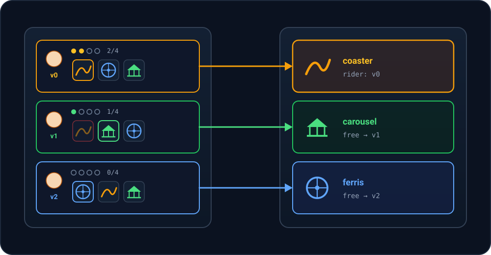

- **Truck trip.** A truck has to drive for a given number of hours.
  The list has 3 drivers.
  For each driver you know how long they can drive without rest
  and how much rest they need per hour of driving.
  Write a function that generates the trip's events:
  who drove by how much, and how much time the truck stayed idle.
  A driver drives up to their limit (or until the trip ends), then rests
  for hours driven × rate; another driver takes over while they rest,
  and after resting they are ready again.
  The truck idles only while every driver is resting at once,
  until the first of them finishes resting.

  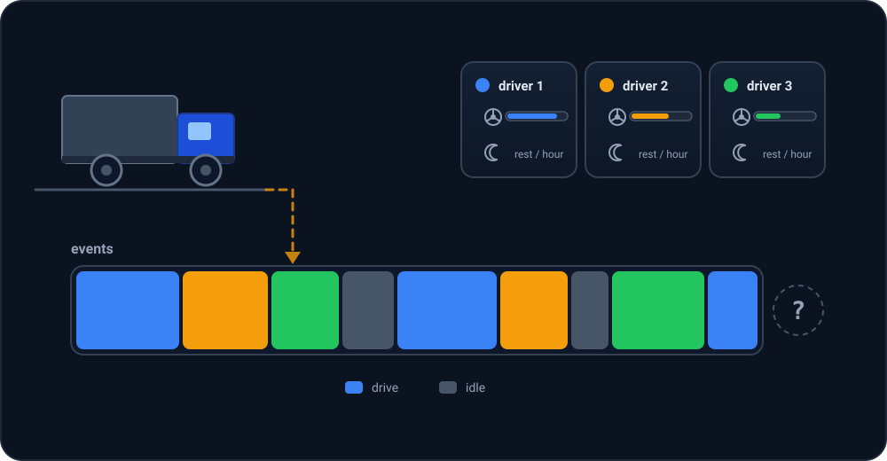

  <details>
  <summary>
  Possible solution
  </summary>

  The trip state is: how much driving is left, and how much rest each driver still owes.
  The owed rest lives in the driver itself, the same way a barbershop worker
  keeps the client they are cutting:

  ```cpp
  #include <array>
  #include <cassert>
  #include <iostream>
  #include <span>
  #include <string_view>

  struct Driver
  {
      std::string_view name;
      double maxDriveHours;    // how long the driver can drive without rest
      double restPerDriveHour; // rest owed for each hour of driving
      double restLeft{ 0.0 };  // rest this driver still owes
  };
  ```

  An event is a kind, a driver name, and a duration.
  An idle event has no driver, so the name stays empty:

  ```cpp
  enum class EventKind
  {
      Drive,
      Idle,
  };

  struct Event
  {
      EventKind kind;
      std::string_view driver; // empty for Idle
      double hours;
  };
  ```

  The generator loops while driving is left.
  First it looks for a driver whose rest has run out.
  Such a driver takes one leg — up to their limit, or the rest of the trip —
  while everyone else's rest shrinks by the same hours.
  Then the driver owes rest for what they drove.
  If nobody is ready, the truck idles until the first driver's rest runs out,
  which is the shortest outstanding rest; that much time is subtracted from every driver.
  Each step writes exactly one event.
  The assertions require at least one driver, a nonnegative trip duration and rest ratio,
  a positive driving limit, and room for each event.
  A zero driving limit would prevent the trip from progressing.
  If nobody is ready, the shortest remaining rest must be positive:

  ```cpp
  // Writes the trip's events into events, returns how many were written.
  size_t generate_events(
      std::span<Driver> drivers,
      double tripHours,
      std::span<Event> events)
  {
      assert(!drivers.empty()); // the truck always has at least one driver
      assert(tripHours >= 0.0); // a trip cannot take negative time
      for (const Driver& driver : drivers)
      {
          assert(driver.maxDriveHours > 0.0); // a driver who cannot drive stalls the trip
          assert(driver.restPerDriveHour >= 0.0);
      }
      size_t count{ 0 };
      while (tripHours > 0.0)
      {
          size_t freeIndex{ drivers.size() };
          for (size_t i{ 0 }; i < drivers.size(); i++)
          {
              if (drivers[i].restLeft <= 0.0)
              {
                  freeIndex = i;
                  break;
              }
          }

          if (freeIndex < drivers.size())
          {
              Driver& driver{ drivers[freeIndex] };
              double hours{ driver.maxDriveHours };
              if (hours > tripHours)
              {
                  hours = tripHours;
              }
              tripHours -= hours;

              // Everyone else rests while this driver is on the road.
              for (Driver& other : drivers)
              {
                  if (&other == &driver || other.restLeft <= 0.0)
                  {
                      continue;
                  }
                  other.restLeft -= hours;
                  if (other.restLeft < 0.0)
                  {
                      other.restLeft = 0.0;
                  }
              }
              driver.restLeft = driver.restPerDriveHour * hours;

              assert(count < events.size());
              events[count] = Event{ EventKind::Drive, driver.name, hours };
              count++;
              continue;
          }

          // Every driver is resting: the truck waits for the first free one.
          double idleHours{ drivers[0].restLeft };
          for (const Driver& driver : drivers)
          {
              if (driver.restLeft < idleHours)
              {
                  idleHours = driver.restLeft;
              }
          }
          assert(idleHours > 0.0); // otherwise some driver would be ready
          for (Driver& driver : drivers)
          {
              driver.restLeft -= idleHours;
          }

          assert(count < events.size());
          events[count] = Event{ EventKind::Idle, std::string_view{}, idleHours };
          count++;
      }
      return count;
  }
  ```

  Printing switches on the kind; an idle event has no name to print:

  ```cpp
  void print_event(const Event& event)
  {
      switch (event.kind)
      {
          case EventKind::Drive:
              std::cout << event.driver << " drove " << event.hours << " h" << std::endl;
              break;
          case EventKind::Idle:
              std::cout << "truck idle for " << event.hours << " h" << std::endl;
              break;
          default:
              assert(false); // every EventKind is handled above
              break;
      }
  }
  ```

  Usage from `main`:
  ```cpp
  int main()
  {
      std::array<Driver, 3> drivers{
          Driver{ .name = "alice", .maxDriveHours = 4.0, .restPerDriveHour = 0.5 },
          Driver{ .name = "bob", .maxDriveHours = 3.0, .restPerDriveHour = 1.0 },
          Driver{ .name = "cid", .maxDriveHours = 2.0, .restPerDriveHour = 2.0 },
      };

      std::array<Event, 32> events{};
      size_t count{ generate_events(drivers, 12.0, events) };
      for (size_t i{ 0 }; i < count; i++)
      {
          print_event(events[i]);
      }
  }
  ```

  alice drives her 4-hour limit and now owes 2 hours of rest.
  bob drives his 3-hour limit, which covers alice's 2 hours,
  so she is ready again. alice drives 4 more hours while bob rests,
  and bob drives the last hour. Nobody ever waits for the whole crew:

  ```text
  alice drove 4 h
  bob drove 3 h
  alice drove 4 h
  bob drove 1 h
  ```
  </details>

- **Family hugs.** A family has 5 people.
  Everybody wants to hug every other member exactly once.
  Each person stores pointers to the people they already hugged.
  Hug everyone.

  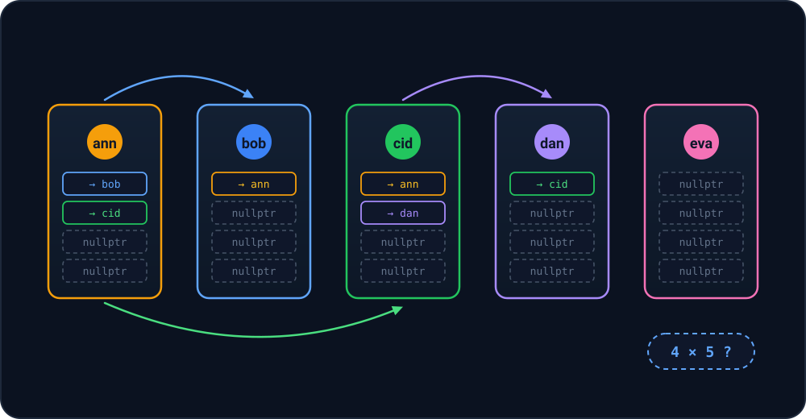

- **Family hugs with indices.** Same 5 people,
  but each person stores indices of the hugged members (`std::array<int, 4>`)
  instead of pointers —
  now the hugs only make sense together with the family array they index into.
  Hug everyone once.

  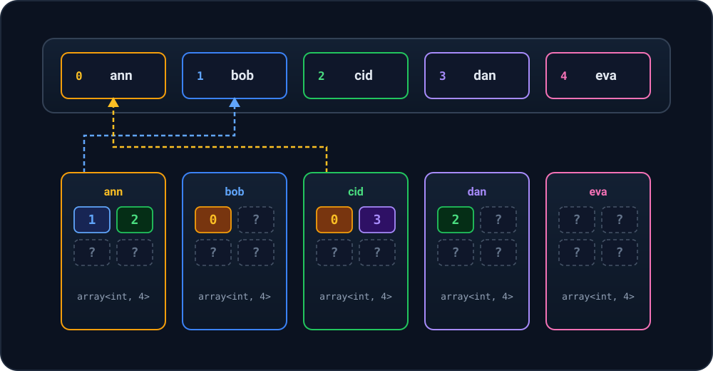

- **Family hugs with a bit set.** Same 5 people,
  but using a bit set of members they've hugged.
  Hug everyone once.

  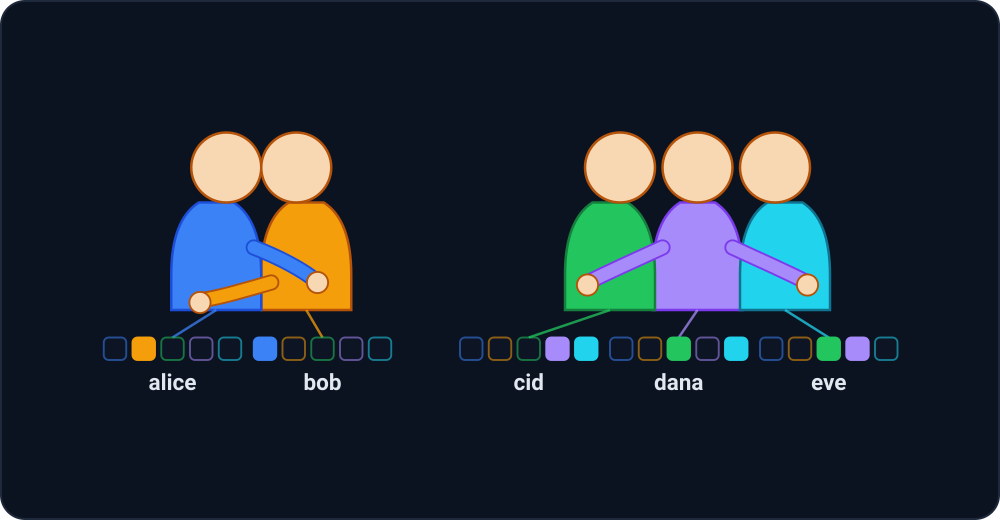

  <details>
  <summary>
  Possible solution
  </summary>

  Bit `i` means "hugged member `i`".
  Your own bit is never set, so a fully hugged person has 4 bits out of 5.
  `hug` needs two different members with indices from 0 to 4;
  its assertions catch a nonexistent member or an attempt to hug oneself.
  Hugging the same pair again is allowed: it returns `false` and changes nothing.

  ```cpp
  #include <array>
  #include <bitset>
  #include <cassert>
  #include <string_view>

  constexpr int familySize{ 5 };

  struct Person
  {
      std::string_view name;
      std::bitset<familySize> hugged{};
  };

  bool hug(std::array<Person, familySize>& family, int i, int j)
  {
      assert(i != j);
      assert(i >= 0 && i < familySize && j >= 0 && j < familySize);
      if (family[i].hugged.test(j))
      {
          return false; // already hugged: nothing new
      }
      family[i].hugged.set(j);
      family[j].hugged.set(i);
      return true;
  }

  bool all_hugged(const std::array<Person, familySize>& family)
  {
      for (const Person& person : family)
      {
          if (person.hugged.count() < familySize - 1) // everyone but yourself
          {
              return false;
          }
      }
      return true;
  }
  ```

  The final `assert` checks that the loop has covered every pair.

  ```cpp
  int main()
  {
      std::array<Person, familySize> family{
          Person{ .name = "ann" },
          Person{ .name = "bob" },
          Person{ .name = "cid" },
          Person{ .name = "dan" },
          Person{ .name = "eva" },
      };
      for (int i = 0; i < familySize; i++)
      {
          for (int j = i + 1; j < familySize; j++)
          {
              hug(family, i, j);
          }
      }
      assert(all_hugged(family));
  }
  ```
  </details>

## Modeling operation results

A `bool` says only whether the operation worked.
Often the caller needs to know *what* happened:
which snack was bought, how much change is left, why the machine refused.
Model the result as its own type and let the print react to it.

A vending machine has slots with a snack and a price:

```cpp
#include <array>
#include <cassert>
#include <iostream>
#include <optional>
#include <string_view>

enum class Snack
{
    Chips,
    Chocolate,
    Water,
};

std::string_view snack_name(Snack snack)
{
    switch (snack)
    {
        case Snack::Chips:
            return "chips";
        case Snack::Chocolate:
            return "chocolate";
        case Snack::Water:
            return "water";
    }
    assert(false); // every Snack is handled above
    return {};
}

struct VendingSlot
{
    std::optional<Snack> snack;
    int price;
};

struct VendingMachine
{
    std::array<VendingSlot, 3> slots;
};
```

Buying reports one of several outcomes.
The slot index and the coin count come from the customer,
so the function reports bad selections and payments as results.
A bad price is a mistake in the machine setup, so it is checked with `assert`:
a slot must have a positive price.
The success payload is its own struct,
so the result cannot carry half of a purchase:

```cpp
enum class PurchaseStatus
{
    Bought,
    InvalidSelection,
    InvalidPayment,
    EmptySlot,
    NotEnoughCoins,
};

struct BoughtSnack
{
    Snack snack;
    int change;
};

struct Purchase
{
    PurchaseStatus status;
    std::optional<BoughtSnack> bought{ std::nullopt }; // set exactly when status is Bought
};

Purchase buy_snack(VendingMachine& machine, size_t slotIndex, int coins)
{
    if (slotIndex >= machine.slots.size())
    {
        return Purchase{ .status = PurchaseStatus::InvalidSelection };
    }
    if (coins < 0)
    {
        return Purchase{ .status = PurchaseStatus::InvalidPayment };
    }

    VendingSlot& slot{ machine.slots[slotIndex] };
    assert(slot.price > 0); // every slot must have a positive price
    if (!slot.snack.has_value())
    {
        return Purchase{ .status = PurchaseStatus::EmptySlot };
    }
    if (coins < slot.price)
    {
        return Purchase{ .status = PurchaseStatus::NotEnoughCoins };
    }

    Purchase purchase{
        .status = PurchaseStatus::Bought,
        .bought = BoughtSnack{ .snack = *slot.snack, .change = coins - slot.price },
    };
    slot.snack.reset(); // the machine changes only after the purchase succeeds
    return purchase;
}
```

Printing switches on the purchase status.
A successful purchase must carry its snack and change; a failed one must not.
The first assertion catches a result assembled incorrectly.
The `default` assertion catches an unknown status instead of silently printing nothing:

```cpp
void print_purchase(const Purchase& purchase)
{
    // The payload is present exactly when the purchase succeeded.
    assert(purchase.bought.has_value() == (purchase.status == PurchaseStatus::Bought));
    switch (purchase.status)
    {
        case PurchaseStatus::Bought:
            std::cout << "bought " << snack_name(purchase.bought->snack)
                      << ", change " << purchase.bought->change << std::endl;
            break;
        case PurchaseStatus::InvalidSelection:
            std::cout << "no such slot" << std::endl;
            break;
        case PurchaseStatus::InvalidPayment:
            std::cout << "the payment is invalid" << std::endl;
            break;
        case PurchaseStatus::EmptySlot:
            std::cout << "the slot is empty" << std::endl;
            break;
        case PurchaseStatus::NotEnoughCoins:
            std::cout << "not enough coins" << std::endl;
            break;
        default:
            assert(false); // every PurchaseStatus is handled above
            break;
    }
}
```

Usage from `main`:

```cpp
VendingMachine machine{
    .slots = {
        VendingSlot{ .snack = Snack::Chips, .price = 3 },
        VendingSlot{ .snack = std::nullopt, .price = 2 },
        VendingSlot{ .snack = Snack::Water, .price = 2 },
    },
};

print_purchase(buy_snack(machine, 9, 5)); // no such slot
print_purchase(buy_snack(machine, 0, 5)); // bought chips, change 2
print_purchase(buy_snack(machine, 0, 5)); // the slot is empty
print_purchase(buy_snack(machine, 2, 1)); // not enough coins
```

The second call is the only one that changes the machine.
The other three leave every slot exactly as it was.

## Planning a mutation as a value

Another way to separate responsibilities is to make the change itself a value.
One function reads the current state and computes the change;
another prints what is about to happen;
a third applies the change.
The state is touched in one place, and the plan can be inspected before it is applied.

A garage repaints cars. The plan records which car, the new paint,
the estimated hours, and the price; computing it does not change anything.
Planning requires an existing car and recognized current and new paint values.
Applying checks the index and new paint again, because it can receive a separately built plan.
These assertions prevent an invalid paint from being stored even if the plan is never printed:

```cpp
#include <array>
#include <cassert>
#include <iostream>
#include <span>
#include <string_view>

enum class Paint
{
    Red,
    Blue,
    Green,
};

std::string_view paint_name(Paint paint)
{
    switch (paint)
    {
        case Paint::Red:
            return "red";
        case Paint::Blue:
            return "blue";
        case Paint::Green:
            return "green";
    }
    assert(false); // every Paint is handled above
    return {};
}

bool is_known_paint(Paint paint)
{
    switch (paint)
    {
        case Paint::Red:
        case Paint::Blue:
        case Paint::Green:
            return true;
    }
    return false;
}

struct Car
{
    std::string_view model;
    Paint paint;
};

struct Repaint
{
    size_t carIndex;
    Paint newPaint;
    int hours;
    int price;
};

Repaint plan_repaint(std::span<const Car> cars, size_t carIndex, Paint newPaint)
{
    assert(carIndex < cars.size());   // the plan must point at an existing car
    assert(is_known_paint(newPaint)); // the plan must name a real paint
    const Car& car{ cars[carIndex] };
    assert(is_known_paint(car.paint)); // the car's current paint must be real
    int hours{ car.paint == newPaint ? 1 : 3 };
    return Repaint{
        .carIndex = carIndex,
        .newPaint = newPaint,
        .hours = hours,
        .price = hours * 1000,
    };
}

void print_repaint(const Repaint& repaint)
{
    std::cout << "car " << repaint.carIndex << " will be repainted "
              << paint_name(repaint.newPaint) << " in " << repaint.hours
              << " h for " << repaint.price << std::endl;
}

void apply_repaint(std::span<Car> cars, const Repaint& repaint)
{
    assert(repaint.carIndex < cars.size()); // the plan must point at an existing car
    assert(is_known_paint(repaint.newPaint)); // the plan must name a real paint
    cars[repaint.carIndex].paint = repaint.newPaint;
}
```

Usage from `main`: the plan is printed before it is applied,
so the output shows exactly what is about to happen:

```cpp
std::array<Car, 3> cars{
    Car{ .model = "Supra", .paint = Paint::Red },
    Car{ .model = "Civic", .paint = Paint::Green },
    Car{ .model = "Miata", .paint = Paint::Red },
};

Repaint repaint{ plan_repaint(cars, 0, Paint::Blue) };
print_repaint(repaint);
apply_repaint(cars, repaint);
```

The functions accept a `span`, so they work the same on a vector or a plain array.
The plan stores only an index, which identifies the car in that same collection.
