<!-- course-site-backlink:start -->
[Этот урок на сайте](https://cpp.curmanschii.top/ru/cpp/labs/basic-practice/)
<!-- course-site-backlink:end -->
# Практика по простым задачам

## Что нужно развить в данной работе

В данном документе приведены задачи, которые я рекомендую 
к выполнению вручную, чтобы укрепить базовые навыки:
- Моделирование жизненных ситуаций и условий задач в программе;
- Анализ задач, продумывание шагов алгоритма решения;
- Определение интерфейса алгоритма для решения задачи;
- Реализация интерфейса функции согласно интерфейсу алгоритма, 
  выбор типов для параметров и возвращаемого значения;
- Реализация шагов алгоритма как инструкции программы;
- Разведеление определения данных в `main` и их использование в отдельной функции под алгоритм;
- Создание абстракций для группирования данных.

## Пример выполнения практического задания

### Задача

В холодильнике есть X яиц и Y мл кефира.
Для того, чтобы приготовить 8 панкейков, нужно 1 яйцо и 250мл кефира.
Необходимо определить, *сколько панкейков можно сделать из текущих ингредиентов*,
не теряя использованные ингредиенты (нельзя использовать пол яйца).
После чего, необходимо *извлечь* из холодильника эти ингредиенты.

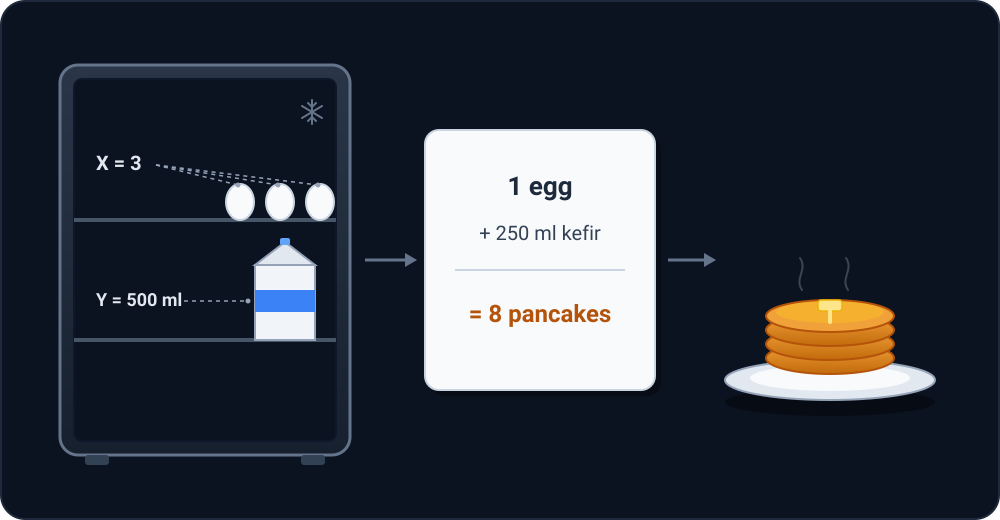

### 1. Продумывание алгоритма

Если например есть *3 яйца и 500мл кефира*, можно взять 1 яйцо и 250мл кефира 2 раза,
останется 1 яйцо, но его не на что использовать.

То есть мы пытались взять по 1 яйцу и 250мл кефира столько раз, сколько получается,
поскольку это минимальная норма для осуществления рецепта.
Остаточный счет оставили в холодильнике.

В случае с 3 яйцами и 500мл кефира, мы сделали 2 порции рецепта, 
несмотря на то, что яиц могло хватить на 3 порции.

Что будет, если взять *2 яйца и 750мл кефира*? 
Тогда яйца смогут быть полностью использованы, но останется лишние 250мл кефира.
Несмотря на то, что кефира осталось на еще 1 порцию, так как яиц не хватает,
мы его оставляем в холодильнике.

Что если у нас *1 яйцо и 300мл кефира*?
Обоих ингредиентов хватает на 1 порцию, после чего в холодильнике остается 50мл кефира.
Этого не хватит на еще одну порцию, но это не важно, 
поскольку мы все равно больше не будем делать рецепт.

Что если яиц и кефира нет?
Тогда их хватит на 0 порций.

<details>
<summary>
Итак, ключевой инсайт задачи
</summary>

Мы возмем максимально возможно одного из ингредиентов, на максимальное количество порций.

Выбираем максимум того ингредиента, которого меньше.
Иначе не хватит второго ингредиента.
</details>

### 2. Формальное определение шагов алгоритма

Находим, на сколько порций хватит яиц - $`a = X`$.

Находим, на сколько порций хватит кефира - $`b = floor(\frac{Y}{250})`$, $`250`$ - объем кефира на 1 порцию.
$`floor`$ игнорирует дробную часть результата, потому что мы считаем лишь полное использование ингредиента,
на что указывает целая часть результата. 
Например, для $`Y = 300`$, получим $`1`$ как целую часть,
потому что $`300`$ входит в $`250`$ один раз целиком, 
после чего от $`300`$ остается $`50`$, которые мы игнорируем, используя $`floor`$.

Находим минимум из $`a`$ и $`b`$, $`p`$. 
$`p`$ - это то, сколько порций мы сможем приготовить.

$`p * 8`$ - это ответ задачи ($`8`$ - количество панкейков с одной порции). 
Но нам все еще необходимо извлечь ингредиенты из холодильника.

Извлекаем из холодильника ингредиенты. Извлекаем $`p * 1`$ яиц и $`p * 250`$ мл кефира.

### 3. Формальное определение интерфейса алгоритма

Интерфейс - это то, от чего зависит алгоритм, и в каком виде он дает ответ.

Наш алгоритм зависит от состояния холодильника ($`X`$ и $`Y`$).
Если алгоритм немного обобщить, можно также ввести параметры для доли яйца и кефира,
необходимых для одной порции панкейков.

Ответ - это число в виде константы $`p * 8`$, и изменение состояния переданного холодильника.

### 4. Реализация интерфейса 

Функции, реализующей агоритм, нужно будет откуда-то получить холодильник.
Это должен будет контролировать **пользователь, вызывающий функцию**.
Поэтому холодильник - это будет параметр функции.

Функция будет использована с целью:
- Вычисления количества панкейков;
- Обновления холодильника.

Функция даст как ответ, или вернет, количество созданных панкейков.
Это **возвращаемое ей значение**.

Обновление холодильника - это **побочный эффект** функции на холодильник.
Если функция будет обновлять что-то где-то, а не только напрямую возвращать ответ,
это что-то должно прийти **как указатель** параметром.

Стандартный синтаксис функций:
```cpp
возвращаемый_тип имя(тип_параметра_1 имя_параметра_1, тип_параметра_2 имя_параметра_2)
```

Имя функции можно дать, например, `приготовить_панкейки`. 

**возвращаемый тип -> тип возращаемого значения -> тип "количества панкейков" -> `int`**

Одним параметром будет **холодильник** (описано выше почему).
Тип холодильника будет `Холодильник` (о нем позже).
Параметр назовем `считать_ингредиенты_холодильник`.

Вторым параметром будет тоже **холодильник**, в котором мы будем убирать ингредиенты.
Тип холодильника будет `Холодильник*`.
Указатель, поскольку мы будем менять данные в нем из функции.
Параметр назовем `вытащить_ингредиенты_холодильник`.

Первоначальная версия интерфейса:
```cpp
int приготовить_панкейки(
    Холодильник считать_ингредиенты_холодильник,
    Холодильник* вытащить_ингредиенты_холодильник)
```

Однако, логично будет ожидать, что *вытаскивать мы ингредиенты будем из того же холодильника,
который мы берем во внимание, для определения количества порций*.
Более того, передача другого холодильника вероятно будет логической ошибкой.
Взяв во внимание то, что **по указателю можно также считать данные**, а не только вписать новые,
можно передать только 1 параметр-указатель:

```cpp
int приготовить_панкейки(Холодильник* холодильник)
```

И переделаем имена на английский манер:

```cpp
int cook_pancakes(Fridge* fridge)
```

Помимо этого, мы могли бы добавить конфигурацию рецепта:
- Сколько панкейков получается из 1 порции рецепта;
- Сколько мг кефига нужно на 1 порцию рецепта.

Это мы можем передать как еще 2 параметра:
```cpp
int cook_pancakes(Fridge* fridge, int pancakesPerPortion, int kefirMlUsedPerPortion)
```

Это можно также представить одной абстракцией, включающую обе переменные.
Тогда мы сможем передать одним параметром все настройки.

```cpp
struct PancakesRecipeConfiguration
{
    int pancakesPerPortion;
    int kefirMlUsedPerPortion;
};
int cook_pancakes(Fridge* fridge, PancakesRecipeConfiguration config)
```

### 5. Моделирование задачи

Холодильника пока не существует.
Для него нужно создать структуру `Fridge`,
представляющую собой **абстракцию для состояния холодильника**.
Нас интересует только **количество ингредиентов каждого известного в задаче типа** в холодильнике,
остальные данные о холодильнике можем проигнорировать, потому что
они не имеют ценность для данной задачи.

Какой тип данных у количества яиц? Очевидно целое число. 
Проще всего использовать `int`, но можно использовать и другой тип, 
как `uint32_t`, `uint16_t`, `int16_t`, `size_t` и прочие.
Технически, с точки зрения безошибочного представления данных в программе,
правильнее будет использовать беззнаковый тип,
потому что количество яиц не может быть отрицательным.
Мы будем использовать `int`, потому что так проще.

Какой тип данных у кефира? Тут уже более спорная ситуация.
Логично было бы использовать `float`, потому что миллилитраж кефира может быть нецелым.
Однако, я буду использовать `int` для упрощения вычислений.
Будем считать, что кефир разливается всегда в единицах миллилитра.

```cpp
struct Fridge
{
    int eggCount;
    int kefirMl;
};
```

Такой же анализ можно провести для `PancakesRecipeConfiguration`,
представленного выше.
Я выбрал `int`-ы для упрощения.


Теперь необходимо представить своего рода схему взаимодействия с пользователем
и систему конфигурации.
```cpp
// Создаем основную функцию. 
int main()
{
    // В ней нужно будет создать холодильник, заполнить его продуктами,
    Fridge fridge{
        .eggCount = 3,
        .kefirMl = 500,
    };

    // после чего сделать панкейки.
    // Для этого необходимо также создать конфигурацию рецепта.
    PancakesRecipeConfiguration config{
        .pancakesPerPortion = 8;
        .kefirMlUsedPerPortion = 250;
    };
    // Готовим панкейки:
    int preparedPancakeCount{ cook_pancakes(&fridge, config) };

    // После приготовления панкейков, печатаем, сколько их приготовили и сколько осталось продуктов.
    std::cout 
        << "Cooked " 
        << preparedPancakeCount 
        << " pancakes" 
        << std::endl;
    std::cout 
        << "Left "
        << fridge.eggCount 
        << " eggs and " 
        << fridge.kefirMl
        << "ml of kefir in the fridge"
        << std::endl;
}
```

### 6. Реализация функции

Преобразуем формальные шаги алгоритма в иструкции функции:
1. $`a = X`$ - `int a { fridge->eggCount };`
2. $`b = floor(Y / 250)`$ - `int b { fridge->kefirMl / config.kefirMlUsedPerPortion };` 
   (использует деление `int`-ов, что округляет вниз)
3. $`p = min(a, b)`$ - `int p { min(a, b) };` 
   (`min` - это встроенная функия, без нее придется использовать `if`)
4. $` p * 8 `$ - это результат - `return p * config.pancakesPerPortion;`
5. Обновить холодильник - `fridge->eggCount -= p; fridge->kefirMl -= p * config.kefirMlUsedPerPortion;`

Обновление холодильника произойдет до `return`, 
поскольку `return` полностью завершает функцию.
Инструкции после него не выполнятся.
Это можно обойти создав временную переменную для результата, 
или обновив холодильник до `p * 8`.

```cpp
int cook_pancakes(Fridge* fridge, PancakesRecipeConfiguration config)
{
    int a { fridge->eggCount };
    int b { fridge->kefirMl / config.kefirMlUsedPerPortion };
    int p { min(a, b) };
    int result { p * config.pancakesPerPortion };
    fridge->eggCount -= p; 
    fridge->kefirMl -= p * config.kefirMlUsedPerPortion;
    return result;
}
```

### 7. Полная программа

Помимо описанного кода, нужно будет подключить пару хедеров, 
чтобы получить доступ к `min` и `std::cout <<`.
Это `#include <cmath>` и `#include <iostream>` соответственно.

```cpp
#include <cmath>
#include <iostream>

struct Fridge
{
    int eggCount;
    int kefirMl;
};

struct PancakesRecipeConfiguration
{
    int pancakesPerPortion;
    int kefirMlUsedPerPortion;
};

int cook_pancakes(Fridge* fridge, PancakesRecipeConfiguration config)
{
    int a { fridge->eggCount };
    int b { fridge->kefirMl / config.kefirMlUsedPerPortion };
    int p { min(a, b) };
    int result { p * config.pancakesPerPortion };
    fridge->eggCount -= p; 
    fridge->kefirMl -= p * config.kefirMlUsedPerPortion;
    return result;
}

int main()
{
    Fridge fridge{
        .eggCount = 3,
        .kefirMl = 500,
    };

    PancakesRecipeConfiguration config{
        .pancakesPerPortion = 8;
        .kefirMlUsedPerPortion = 250;
    };
    int preparedPancakeCount{ cook_pancakes(&fridge, config) };

    std::cout 
        << "Cooked " 
        << preparedPancakeCount 
        << " pancakes" 
        << std::endl;
    std::cout 
        << "Left "
        << fridge.eggCount 
        << " eggs and " 
        << fridge.kefirMl
        << "ml of kefir in the fridge"
        << std::endl;
}
```

## Задачи для практики

- **Заряд батареи.** У телефона есть заряд в процентах. 
  Каждая минута на зарядке добавляет 1%, но заряд не может стать больше 100. 
  Сделайте функцию зарядки, которая ничего не возвращает - 
  ее единственный результат это изменение состояния батареи.

  

  <details>
  <summary>
  Возможное решение
  </summary>

  ```cpp
  struct Battery
  {
      int chargePercent;
  };

  void charge(Battery* battery, int minutes)
  {
      battery->chargePercent = std::min(100, battery->chargePercent + minutes);
  }
  ```

  Возвращаемый тип `void`, потому что алгоритму нечего возвращать как результат:
  результат функции - это побочный эффект, обновление батареи по указателю.
  `std::min` ограничивает заряд сверху, даже если `chargePercent + minutes` даст число больше 100.

  Использование из `main`:
  ```cpp
  Battery battery{ .chargePercent = 40 };
  charge(&battery, 90);
  std::cout << battery.chargePercent << std::endl; // 100
  ```
  </details>

- **Нормализация времени.** 
  Время записалось в программу как 4 часа 138 минут 250 секунд - 
  так хранить время неудобно: в минуте не может быть больше 60 секунд, а в часе - 60 минут.
  Сделайте функцию, возвращающую то же время в нормализованном виде.
  Оригинальное время при этом меняться не должно.

  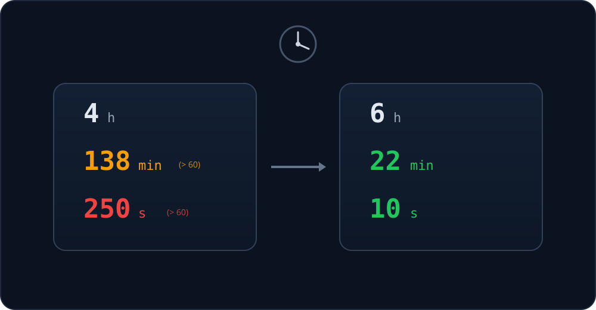

  <details>
  <summary>
  Возможное решение
  </summary>

  ```cpp
  struct Time
  {
      int hours;
      int minutes;
      int seconds;
  };

  Time normalized(Time time)
  {
      int totalSeconds{ time.hours * 3600 + time.minutes * 60 + time.seconds };
      return Time{
          .hours = totalSeconds / 3600,
          .minutes = totalSeconds / 60 % 60,
          .seconds = totalSeconds % 60,
      };
  }
  ```

  Возвращаемый тип - структура, потому что ответ задачи состоит из трех чисел.
  Параметр приходит копией, поэтому функция не меняет оригинал из `main` - 
  она ничего не перезаписывает, а вычисляет и возвращает новое значение.
  Деление и остаток выделяют полные единицы и то, что в них не влезло:
  для времени 4 часа 138 минут 250 секунд функция даст 6 часов 22 минуты 10 секунд.
  </details>

- **Переливание воды.** 
  Есть две бутылки, у каждой свой объем и текущее количество воды.
  Нужно перелить воду из первой бутылки во вторую: 
  во вторую нельзя налить больше, чем в ней свободного места, 
  а из первой нельзя вылить больше, чем в ней есть.
  После вызова функции должно быть известно, сколько миллилитров удалось перелить, 
  а количество воды в обеих бутылках должно обновиться.

  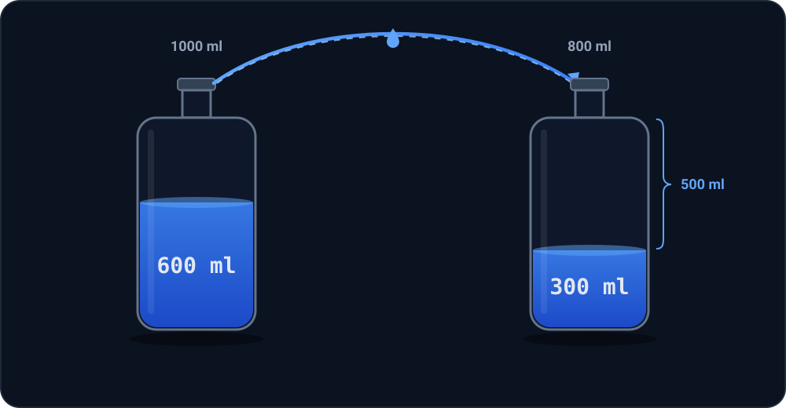

  <details>
  <summary>
  Возможное решение
  </summary>

  ```cpp
  struct Bottle
  {
      int capacityMl;
      int ml;
  };

  int free_space(Bottle bottle)
  {
      return bottle.capacityMl - bottle.ml;
  }

  int pour(Bottle* from, Bottle* to)
  {
      int transferredMl{ std::min(from->ml, free_space(*to)) };
      from->ml -= transferredMl;
      to->ml += transferredMl;
      return transferredMl;
  }
  ```

  Алгоритм реализован двумя функциями: маленькая `free_space` считает свободное место, 
  большая `pour` использует ее внутри себя.
  `pour` получает **два указателя**, потому что меняет **две разные переменные** -
  и при этом возвращает ответ, поскольку помимо побочного эффекта у нее есть и результат.
  `free_space` же ничего не меняет, поэтому ей достаточно копии бутылки.
  </details>

- **Рычаг.** У рычага 2 позиции: 0 и 1.
  Сделайте функции переключения рычага на 0 или на 1.
  Если он уже на 0 или 1, ничего не произойдет.
  Также сделайте функцию переключения на обратное значение.

  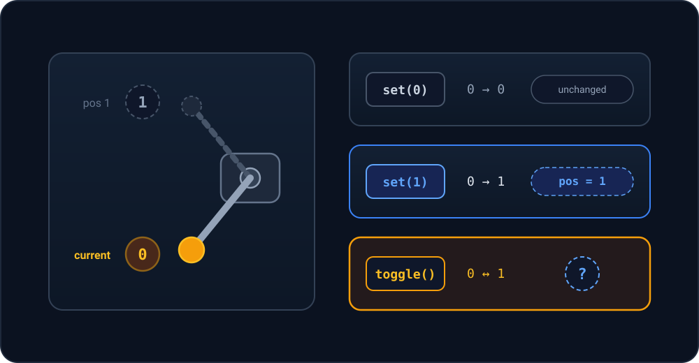

- **Максимум из трех.** Встроенный `std::max` принимает лишь два числа. 
  Сделайте функцию, возвращающую наибольшее из трех чисел.

  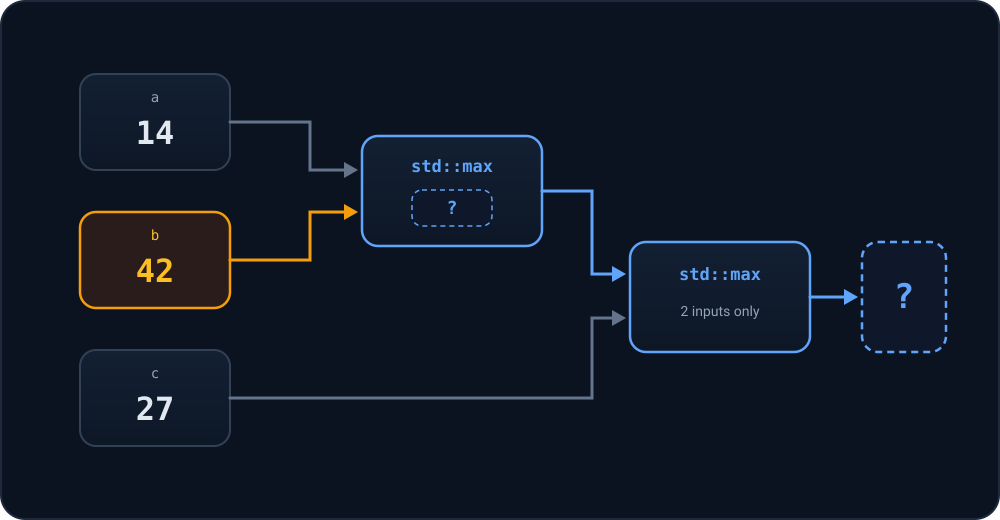

- **Калорийность блюда.** 
  В блюде известно количество граммов белков, жиров и углеводов.
  Калорийность: 4 ккал на грамм белков, 9 - на грамм жиров, 4 - на грамм углеводов.
  Посчитайте калорийность блюда.

  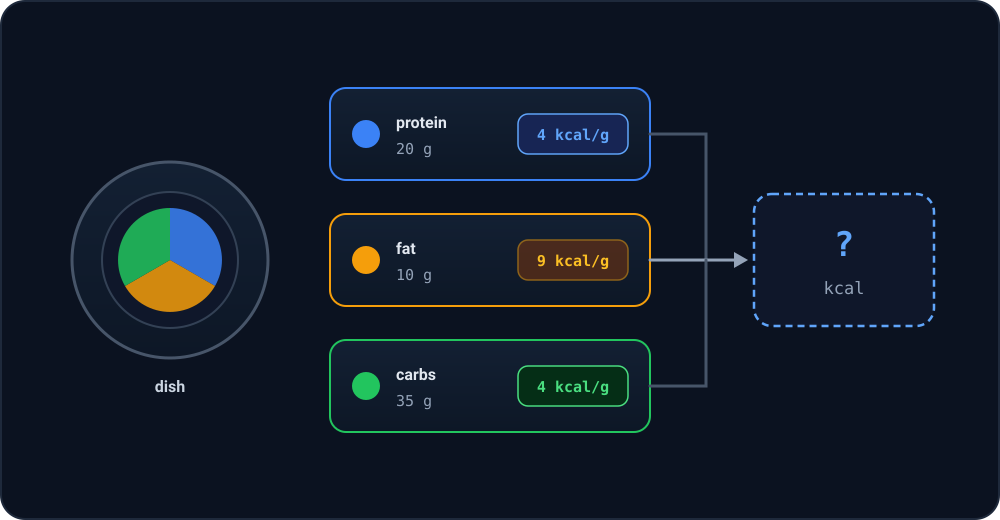

- **Средняя температура.** 
  Датчик за сутки дал два показания. 
  Посчитайте среднюю температуру - она может оказаться дробной.
  Осторожно: если просто поделить два `int` друг на друга, 
  дробная часть пропадет еще до записи в результат.

  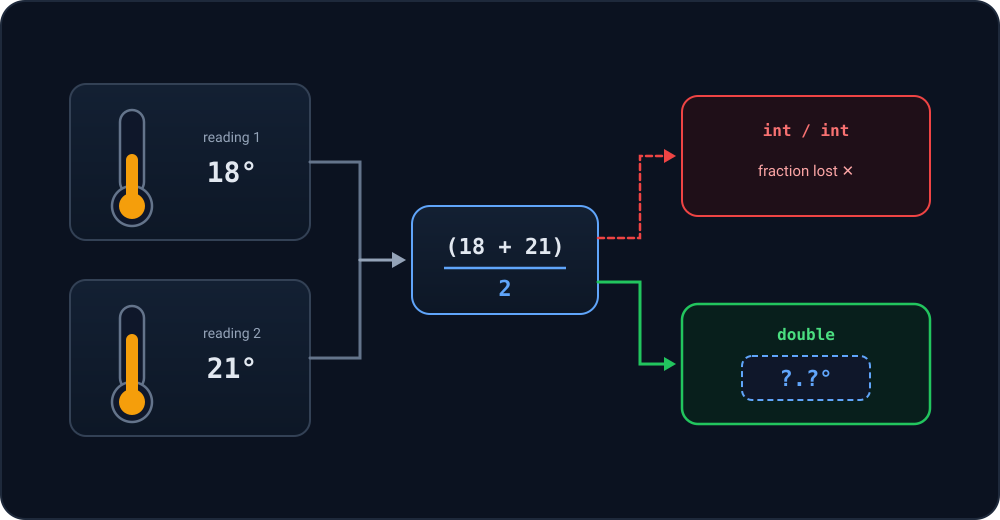

- **Упаковка коробок.** 
  На складе X одинаковых товаров, в одну коробку влезает Y штук.
  Посчитайте, сколько получится полных коробок и сколько товаров останется без коробки.

  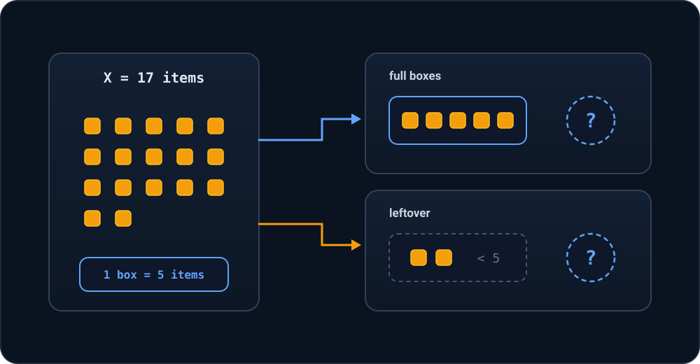

- **Урон герою.** 
  У героя игры есть текущее и максимальное здоровье.
  Получение урона уменьшает текущее здоровье, но не может сделать его меньше нуля.
  Сделайте функцию получения урона.

  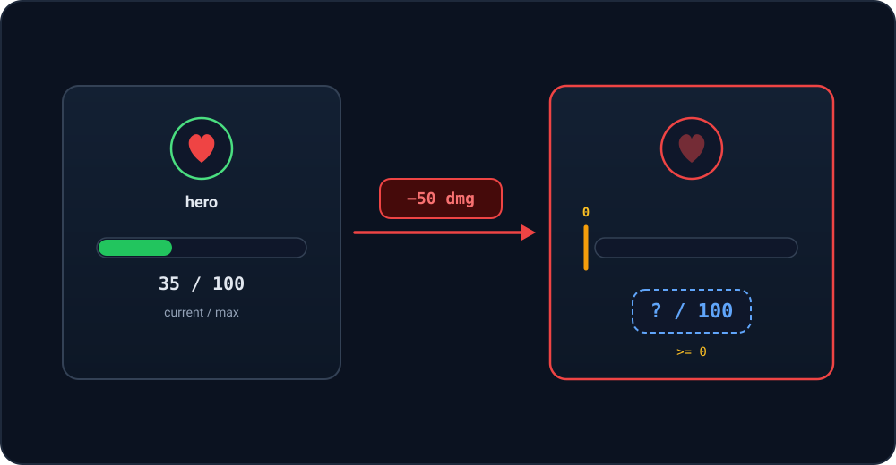

- **Повышение уровня.** 
  Тот же герой: при повышении уровня максимальное здоровье растет на 10, 
  а текущее восстанавливается до максимума.
  Сделайте функцию повышения уровня.

  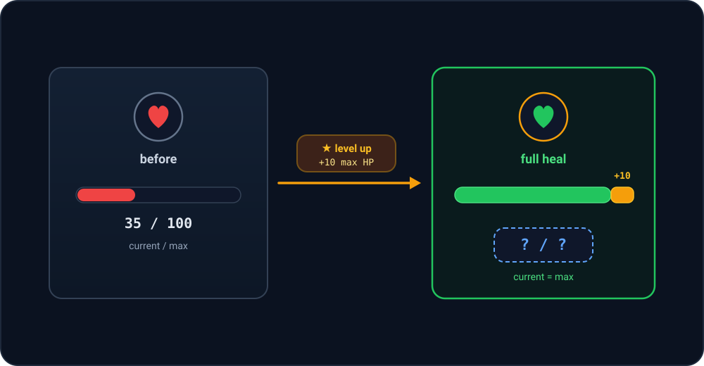

- **Копилка.** 
  В копилке X рублей и Y копеек, в нее добавляют еще A рублей и B копеек.
  Копеек в копилке не может быть больше 99 - все лишние переходят в рубли.
  Сделайте функцию пополнения копилки.

  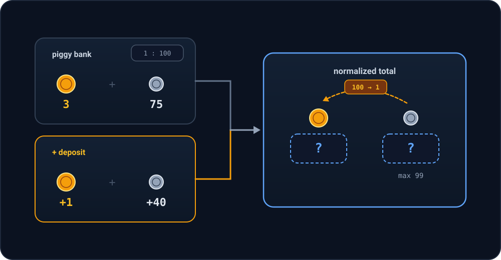

- **Тюнинг машины.** 
  У машины есть двигатель с мощностью и цена.
  После тюнинга мощность двигателя увеличивается на заданное количество лошадиных сил, 
  а цена машины - на 1000 за каждую добавленную лошадиную силу.
  Сделайте функцию тюнинга машины.

  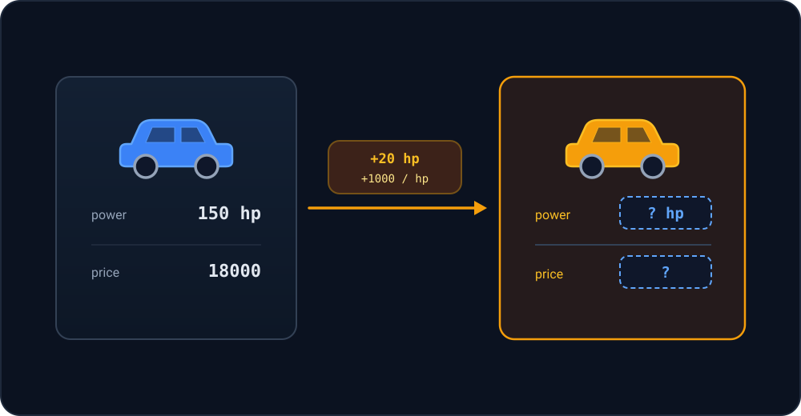

- **Обмен значений.** 
  Поменяйте местами значения двух переменных из `main` средствами функции.
  Вспомните пример с обменом значениями из лабы про переменные: 
  без временной переменной не обойтись.

  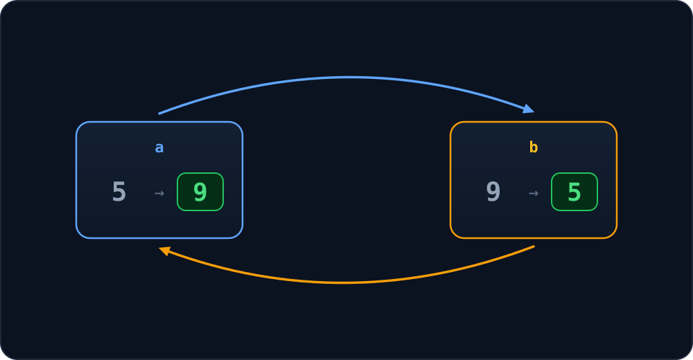

- **Дележ конфет.** 
  N конфет делятся между M детьми поровну, остаток отдается самому младшему.
  Посчитайте, сколько конфет получит каждый ребенок, и сколько достанется младшему.

  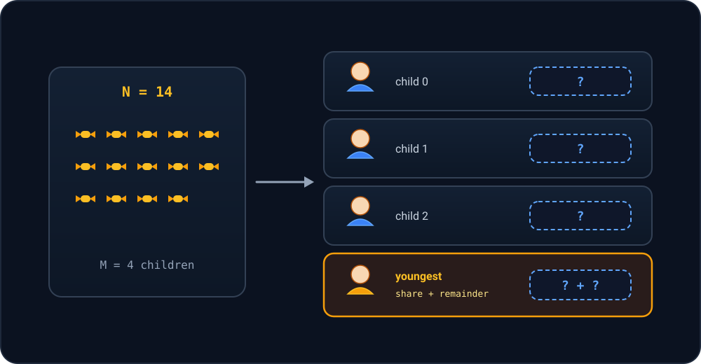

- **Ограничение диапазоном.** 
  У параметра есть допустимый диапазон значений - от low до high.
  Сделайте функцию, приводящую любое значение параметра к допустимому.
  Сам диапазон при этом меняться не должен.

  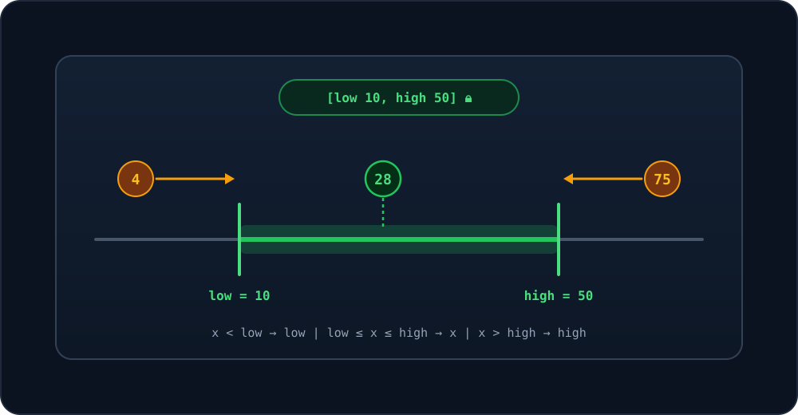

- **Печать анкеты.** 
  У студента известны номер зачетки, курс и средний балл.
  Сделайте функцию, печатающую все данные студента на экран.
  Данные студента функция не меняет.

  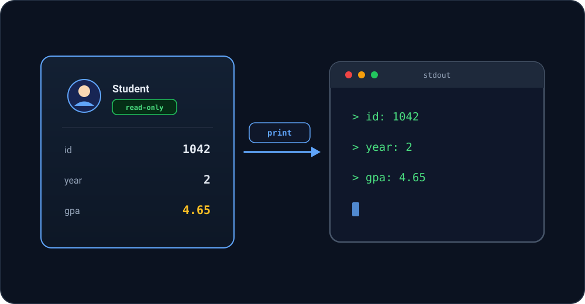

- **Три по возрастанию.** 
  Даны три числа. Получите те же числа, но по возрастанию.
  Подсказка: наименьшее и наибольшее даются вложенными `std::min` и `std::max`, 
  а среднее - суммой всех трех минус крайние.

  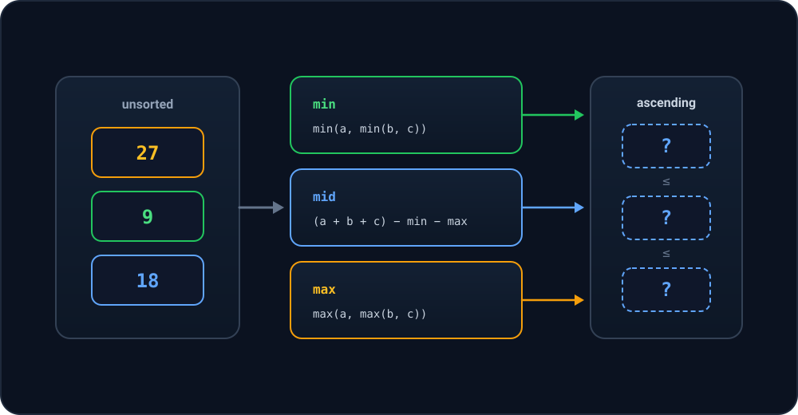

- **Клетки доски.** 
  Клетки доски 8×8 пронумерованы от 0 до 63 слева направо, сверху вниз.
  Сделайте функции, переводящие номер клетки в ее строку и столбец, 
  и обратно - из строки и столбца в номер.

  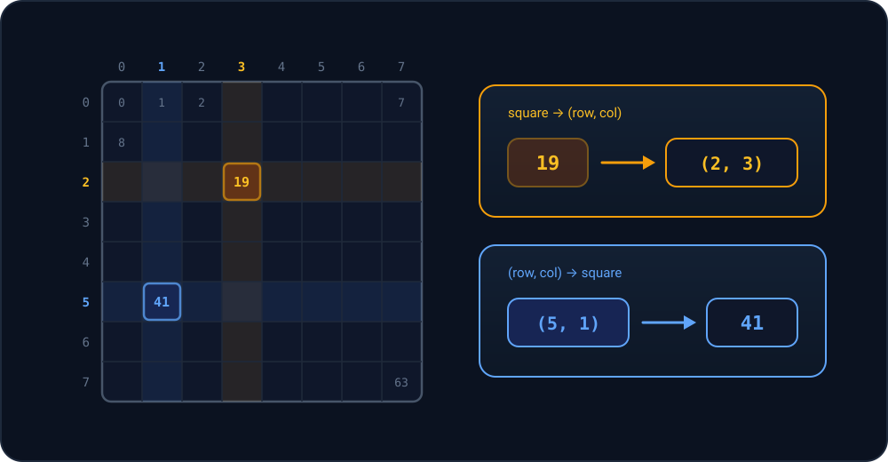

- **Длительность в секундах.** 
  Переведите длительность, заданную часами, минутами и секундами, 
  в общее количество секунд.

  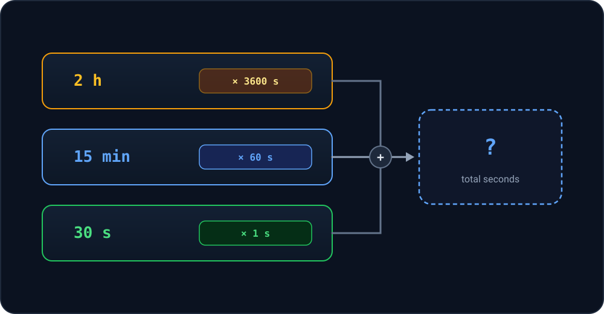

- **Покраска комнаты.** 
  Комната имеет длину, ширину и высоту.
  Посчитайте площадь всех четырех стен комнаты (пол и потолок красить не нужно) 
  и стоимость покраски по заданной цене за квадратный метр.

  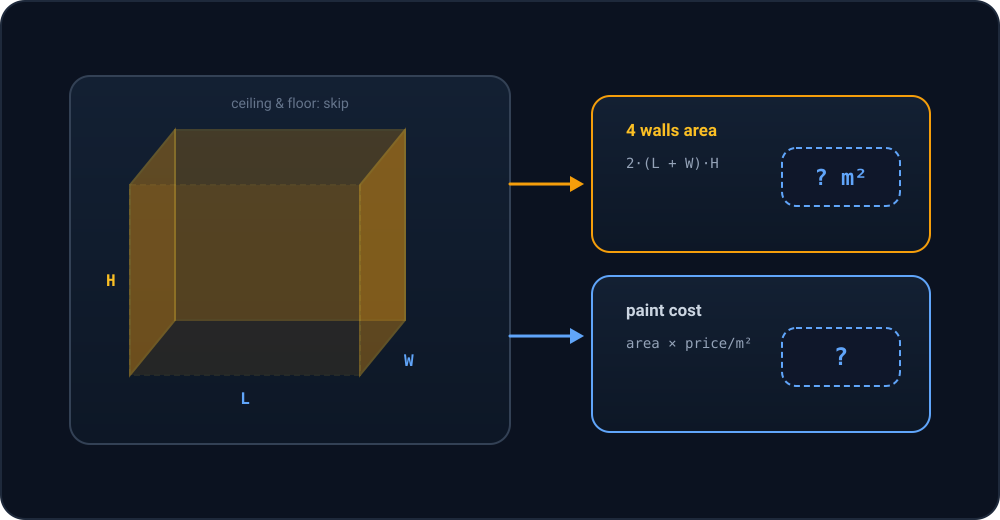

- **Подписка со скидкой.** 
  План подписки задается ценой за месяц и скидкой в процентах.
  Посчитайте стоимость подписки на заданное количество месяцев по такому плану.

  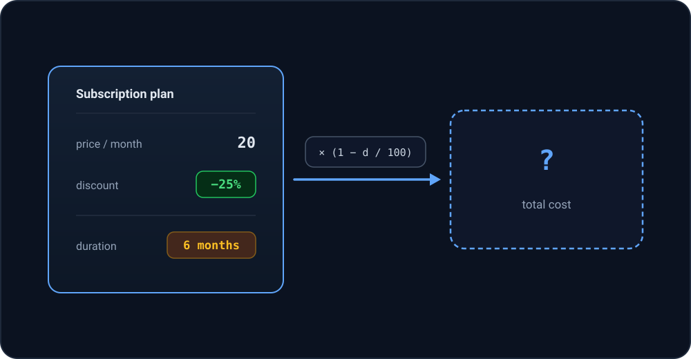

- **Стоимость поездки.** 
  Заданы расстояние поездки, расход топлива машины на 100 км, цена литра топлива, 
  количество ночей в гостинице и цена за ночь. Машина едет туда и обратно.
  Посчитайте полную стоимость поездки.

  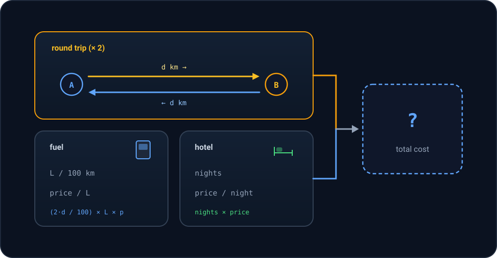

- **Поездки лифта.** 
  В лифт влезает K человек, на этаже ждут N человек.
  Посчитайте, сколько рейсов сделает лифт, 
  если последний рейс может быть неполным.

  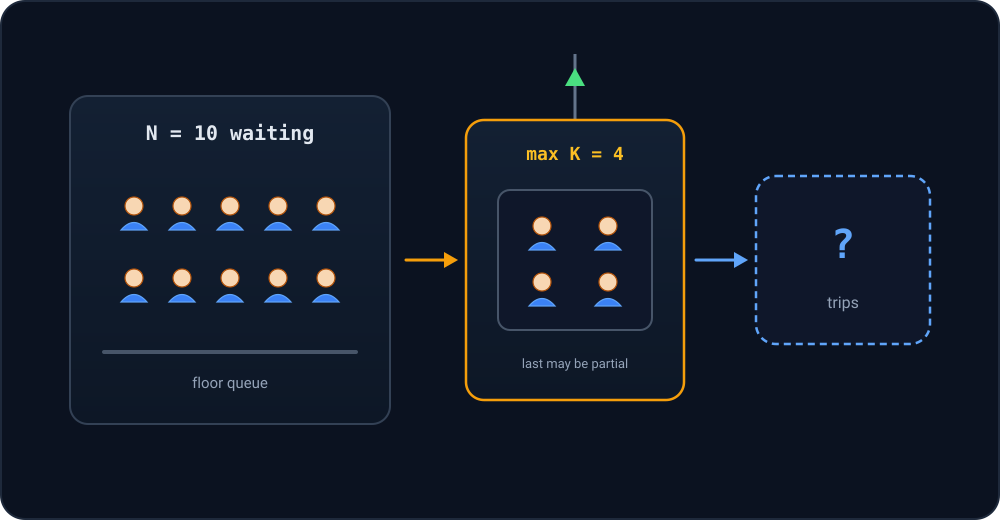

- **Расстояние между точками.** 
  Даны две точки на плоскости с целочисленными координатами.
  Посчитайте расстояние между ними - корень из суммы квадратов разностей координат.

  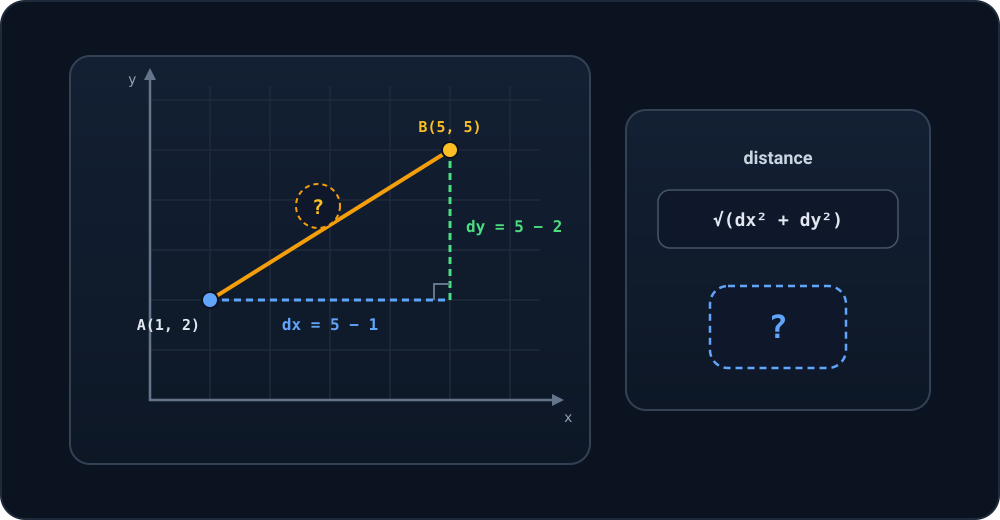

- **Длина вектора.**
  У двумерного вектора есть координаты `x` и `y`.
  Представьте его структурой и напишите функцию, возвращающую длину: квадратный корень из `x * x + y * y`.
  Можно использовать `std::sqrt` из `<cmath>`.
  Проверьте вектор `(3, 4)` и нулевой вектор.

  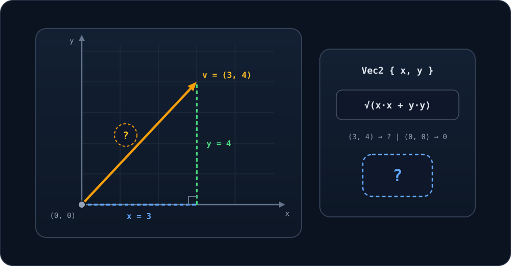
