<!-- course-site-backlink:start -->
[Этот урок на сайте](https://AntonC9018.github.io/uniCourse_dataStructuresAndAlgorithms/ru/cpp/labs/advanced-practice/)
<!-- course-site-backlink:end -->
# Продвинутая практика

> Это продолжение [Практики по простым задачам](08_basic_practice.md).

## Что нужно развить в данной работе

- Более продвинутое моделирование предметной области;
- Хранение фиксированного количества элементов в `std::array`, включая массив внутри структуры;
- Использование `std::optional`;
- Идея владения;
- Задание названий через `std::string_view`;
- Изменение объектов через указатели и ссылки, а чтение — через `const`-ссылки и `std::span`;
- Написание маленьких функций, возвращающих `bool` или количество, с использованием `if` с ранними возвратами (guard clauses) и `switch` по `enum`;
- Различение предусловий и обычных результатов: первые проверяются `assert`, вторые возвращаются;
- Моделирование результата операции и планирование мутации как значений;
- Перебор объектов в цикле, подсчет пустых мест, поиск первого пустого места.

## Инструменты, которые понадобятся

- `std::string_view` — это что-то вроде константной строки.
  Используйте его для названий и имен.

  Минимальный пример:
  ```cpp
  std::string_view s{ "Hello, world!" };
  std::cout << s << std::endl;
  ```

- `std::optional<T>` либо хранит `T`, либо пуст.

  Минимальный пример:
  ```cpp
  std::optional<int> slot{ std::nullopt };
  slot = 42;
  bool taken{ slot.has_value() };
  slot.reset();
  ```

## Предусловия и результаты

Операция может не удаться по двум совершенно разным причинам.

**Нарушенное предусловие** означает, что вызывающий код нарушил контракт:
индекс за пределами массива, когда контракт требует допустимый индекс,
`nullptr` там, где его быть не может,
значение `enum`, которое не обрабатывает ни одна ветка.
В программе ошибка, поэтому осмысленного значения для возврата нет.
`assert` останавливает программу ровно там, где произошла ошибка.
`assert` — инструмент отладки: если определён `NDEBUG`, проверки не компилируются.
Обязательства вызывающего кода никуда не исчезают,
и `assert` никогда не заменяет проверку пользовательского ввода.

**Обычный результат** означает, что данные говорят «нет»:
слот уже занят, очередь полна, пиццы нет в холодильнике.
С программой всё в порядке, поэтому функция сообщает, что произошло,
а вызывающий код решает, что делать дальше.

Не превращайте нарушенное предусловие в возвращённый `false`.
Вызывающий код, который проигнорирует результат, продолжит работать
с некорректным состоянием, и ошибка проявится дальше от своего источника.
Не проверяйте через `assert` и обычные данные: занятая полка — не ошибка.

При проектировании функции решают, к какой категории относится проверка.
Функции книжной полки ниже требуют допустимого индекса,
поэтому неверный индекс — нарушенный контракт.
Торговый автомат ниже принимает любой выбор покупателя,
поэтому неверный выбор — обычные данные, о которых он сообщает.

| Ситуация | Вид | Реакция |
| --- | --- | --- |
| индекс вне массива, когда контракт требует допустимый индекс | нарушенное предусловие | `assert` |
| `nullptr` там, где он недопустим | нарушенное предусловие | `assert` |
| значение `enum` без подходящей ветки | нарушенное предусловие | `assert` |
| неверный выбор, который функция обязана проверить | обычный результат | вернуть его |
| слот уже занят | обычный результат | вернуть его |
| очередь полна | обычный результат | вернуть его |
| элемент не найден | обычный результат | вернуть его |

Все решения ниже следуют этому правилу.

## Задачи для практики

- **Книжная полка.** Полка вмещает 5 книг. У каждой книги есть название.
  Положите «Атлас» в слот 2 и уберите книгу из слота 0.
  Посчитайте, сколько слотов пустует.

  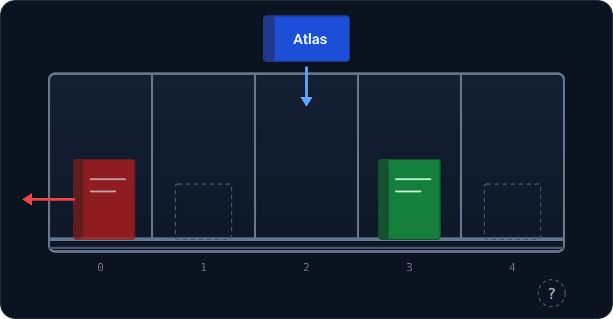

  <details>
  <summary>
  Возможное решение
  </summary>

  Слот полки либо хранит книгу, либо пуст, поэтому тип слота —
  `std::optional<Book>` — пустой слот — это `std::nullopt`.
  Сами структуры нужны лишь для группировки, как в прошлой работе:

  ```cpp
  #include <array>
  #include <optional>
  #include <string_view>

  struct Book
  {
      std::string_view title;
  };

  struct Bookshelf
  {
      std::array<std::optional<Book>, 5> slots;
  };
  ```

  Допустим, слоты 0 и 3 хранят книги, а остальные пусты.
  Чтобы положить «Атлас» в слот 2, нужны две проверки.
  Индекс должен быть в пределах массива — это контракт с вызывающим кодом,
  поэтому нарушение контракта ловит `assert`, а не возвращаемое значение.
  В слоте 2 не должно быть значения — это обычные данные,
  поэтому занятый слот сообщается через `false`.
  Указатель на полку никогда не должен быть `nullptr` — это ещё один контракт,
  поэтому его тоже проверяет `assert`.
  В слоте 0 слот занят, поэтому книгу не кладём и ничего не меняем:

  ```cpp
  #include <cassert>

  bool shelve_book(Bookshelf* shelf, size_t index, Book book)
  {
      assert(shelf != nullptr);            // shelve_book ожидает, что shelf никогда не nullptr
      assert(index < shelf->slots.size()); // и что index внутри полки
      if (shelf->slots[index].has_value())
      {
          return false;
      }
      shelf->slots[index] = book;
      return true;
  }
  ```

  Ссылка не может быть `nullptr`, поэтому передача полки по `&` вместо `*`
  гарантирует, что она никогда не `nullptr`. Остальные примеры используют ссылки по этой причине.

  Взятие книги — зеркальный случай: индекс снова контракт,
  в слоте 0 есть книга, поэтому очищаем его через `reset()` и возвращаем `true`;
  пустой слот — это обычные данные, поэтому возвращаем `false`:

  ```cpp
  bool take_book(Bookshelf& shelf, size_t index)
  {
      assert(index < shelf.slots.size());
      if (!shelf.slots[index].has_value())
      {
          return false;
      }
      shelf.slots[index].reset();
      return true;
  }
  ```

  Чтобы посчитать пустые, просто обходим каждый слот по очереди в цикле range-based `for` и прибавляем 1 за каждый слот без значения:

  ```cpp
  int empty_count(const Bookshelf& shelf)
  {
      int count{ 0 };
      for (const auto& slot : shelf.slots)
      {
          if (!slot.has_value())
          {
              count++;
          }
      }
      return count;
  }
  ```

  Использование из `main`:
  ```cpp
  Bookshelf shelf{};
  shelve_book(&shelf, 2, Book{ .title = "Atlas" });
  take_book(shelf, 0);
  int free{ empty_count(shelf) };
  ```
  </details>

- **Из холодильника в морозилку.** Холодильник вмещает 3 продукта, морозилка вмещает 2 продукта.
  У каждого продукта есть название.
  Переместите пиццу с полки 1 холодильника на полку 0 морозилки.
  Старое место при этом освобождается.

  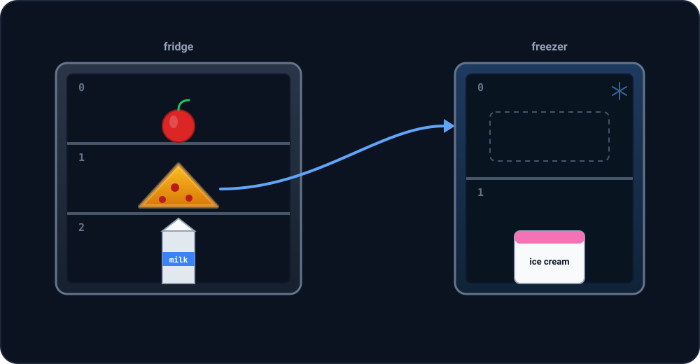

  <details>
  <summary>
  Возможное решение
  </summary>

  Тот же принцип с полками, только контейнеров два: у холодильника 3 полки, у морозилки 2,
  каждая полка либо хранит продукт, либо пуста:

  ```cpp
  #include <array>
  #include <cassert>
  #include <optional>
  #include <string_view>

  struct Food
  {
      std::string_view name;
  };

  struct Fridge
  {
      std::array<std::optional<Food>, 3> shelves;
  };

  struct Freezer
  {
      std::array<std::optional<Food>, 2> shelves;
  };
  ```

  Допустим, на полке 1 холодильника лежит пицца, а полка 0 морозилки пуста.
  Оба индекса — это контракт с вызывающим кодом, поэтому их проверяет `assert`.
  Есть ли продукт в источнике и свободна ли цель — это обычные данные,
  поэтому эти проверки возвращают `false`.
  Затем два шага: копируем продукт на полку 0 морозилки,
  очищаем полку 1 холодильника через `reset()`.
  С этого момента пицца живет ровно в одном месте — в этом и состоит идея владения.
  Неудачная проверка данных возвращает `false` и ничего не трогает:

  ```cpp
  bool move_food(Fridge& from, size_t fromIndex, Freezer& to, size_t toIndex)
  {
      assert(fromIndex < from.shelves.size());
      assert(toIndex < to.shelves.size());
      if (!from.shelves[fromIndex].has_value())
      {
          return false;
      }
      if (to.shelves[toIndex].has_value())
      {
          return false;
      }
      to.shelves[toIndex] = from.shelves[fromIndex];
      from.shelves[fromIndex].reset();
      return true;
  }
  ```

  Использование из `main`:
  ```cpp
  Fridge fridge{};
  fridge.shelves[1] = Food{ .name = "pizza" };
  Freezer freezer{};
  bool moved{ move_food(fridge, 1, freezer, 0) };
  ```
  </details>

- **Разогрев супа.** Микроволновка либо вмещает одно блюдо, либо пуста.
  У каждого блюда есть название и состояние нагрева: холодное или горячее.
  Положите холодный суп внутрь, разогрейте до горячего состояния, затем достаньте.

  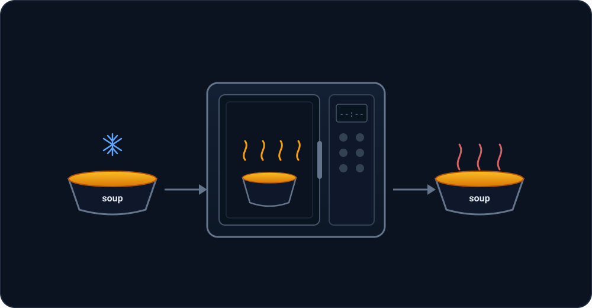

  <details>
  <summary>
  Возможное решение
  </summary>

  Здесь всего один слот — поддон — плюс новый параметр, за которым нужно следить:
  состояние нагрева, которое бывает холодным или горячим:

  ```cpp
  #include <optional>
  #include <string_view>

  enum class Warmth
  {
      Cold,
      Hot,
  };

  struct Meal
  {
      std::string_view name;
      Warmth warmth;
  };

  struct Microwave
  {
      std::optional<Meal> tray;
  };
  ```

  Поддон изначально пуст. Когда кладем холодный суп внутрь, поддон свободен,
  поэтому сохраняем блюдо и возвращаем `true`;
  при второй попытке поддон уже занят, поэтому возвращаем `false`:

  ```cpp
  bool put_meal(Microwave& m, Meal meal)
  {
      if (m.tray.has_value())
      {
          return false;
      }
      m.tray = meal;
      return true;
  }
  ```

  При разогреве внутри есть блюдо, поэтому меняем его состояние на горячее.
  При разогреве пустой микроволновки внутри ничего нет, поэтому возвращаем `false`:

  ```cpp
  bool heat_meal(Microwave& m)
  {
      if (!m.tray.has_value())
      {
          return false;
      }
      m.tray->warmth = Warmth::Hot;
      return true;
  }
  ```

  При доставании копируем горячий суп для вызывающей стороны,
  очищаем поддон и возвращаем копию:

  ```cpp
  std::optional<Meal> take_meal(Microwave& m)
  {
      if (!m.tray.has_value())
      {
          return std::nullopt;
      }
      std::optional<Meal> result{ m.tray };
      m.tray.reset();
      return result;
  }
  ```

  Использование из `main`:
  ```cpp
  Microwave mw{};
  put_meal(mw, Meal{ .name = "soup", .warmth = Warmth::Cold });
  heat_meal(mw);
  std::optional<Meal> lunch{ take_meal(mw) };
  ```
  </details>

- **Выпить зелье.** У героя есть здоровье и щит.
  Зелье бывает красным, синим или испорченным.
  Дайте герою 1 красное зелье.
  Красное добавляет 20 здоровья, синее добавляет 10 щита, испорченное ничего не делает.

  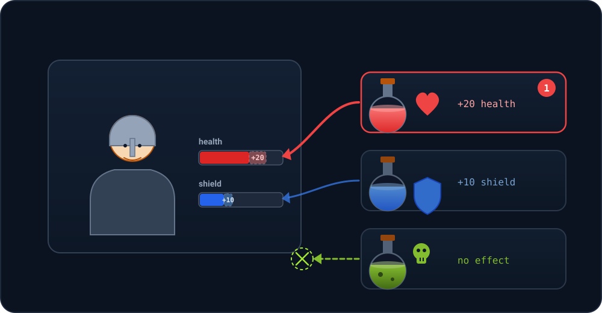

  <details>
  <summary>
  Возможное решение
  </summary>

  Вид зелья определяет эффект, поэтому оформляем его как `enum`.
  Герой и зелье — обычные структуры, нужные лишь для группировки данных:

  ```cpp
  #include <cassert>

  enum class PotionKind
  {
      Red,
      Blue,
      Spoiled,
  };

  struct Potion
  {
      PotionKind kind;
  };

  struct Hero
  {
      int health;
      int shield;
  };
  ```

  Разберем случай красного зелья для героя с 50 единицами здоровья и 0 щита:
  ветка `switch` для `Red` добавляет 20 здоровья
  и возвращает `true` — теперь у героя 70 здоровья.
  Синее зелье идет в следующую ветку и добавляет 10 щита.
  Испорченное зелье идет в последнюю ветку и возвращает `false`,
  не меняя героя.
  Все значения `PotionKind` обработаны, поэтому выход из `switch`
  означает испорченное значение — его ловит `assert`:

  ```cpp
  bool drink_potion(Hero& hero, Potion potion)
  {
      switch (potion.kind)
      {
          case PotionKind::Red:
              hero.health += 20;
              return true;
          case PotionKind::Blue:
              hero.shield += 10;
              return true;
          case PotionKind::Spoiled:
              return false;
      }
      assert(false); // все значения PotionKind обработаны выше
      return false;  // недостижимо
  }
  ```

  Использование из `main`:
  ```cpp
  Hero hero{ .health = 50, .shield = 0 };
  drink_potion(hero, Potion{ .kind = PotionKind::Red });
  ```
  </details>

- **Замачивание белья.** Корзина вмещает 3 вещи.
  В прачечной 2 корзины.
  У каждой вещи есть метка и состояние: грязная, замоченная или чистая.
  Достаньте каждую чистую рубашку из корзины 0, затем замочите каждую грязную рубашку в корзине 0.
  Посчитайте, сколько достали и сколько замочили.

  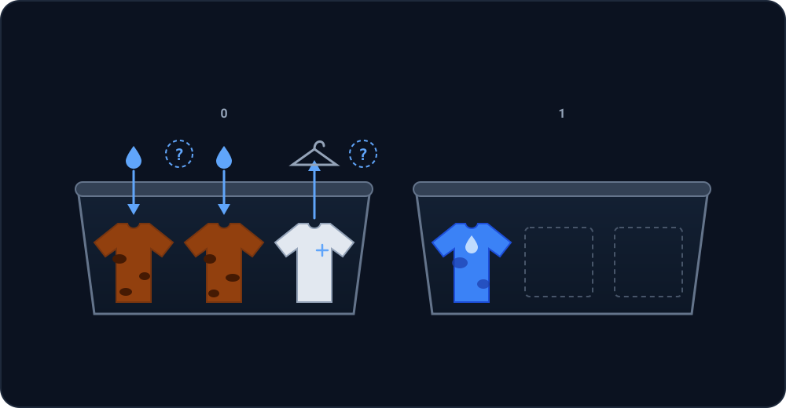

  <details>
  <summary>
  Возможное решение
  </summary>

  Новая идея здесь — вложенность: `Basket` хранит массив,
  а `Laundry` хранит корзины:

  ```cpp
  #include <array>
  #include <optional>
  #include <string_view>

  enum class ClothState
  {
      Dirty,
      Soaked,
      Clean,
  };

  struct Cloth
  {
      std::string_view label;
      ClothState state;
  };

  struct Basket
  {
      std::array<std::optional<Cloth>, 3> slots;
  };

  struct Laundry
  {
      std::array<Basket, 2> baskets;
  };
  ```

  Допустим, слоты 0 и 1 корзины 0 хранят грязные рубашки, а слот 2 хранит чистую рубашку.
  Сначала достаем чистые: цикл перебирает слоты по очереди по ссылке
  и очищает каждый слот с чистой вещью, увеличивая счётчик на 1 (в примере счётчик станет равен 1).
  Затем замачиваем грязные: второй цикл по тем же слотам
  помечает каждую грязную вещь замоченной, увеличивая счётчик на 1 (в примере счётчик дойдёт до 2).
  Пустой слот пропускается в обоих циклах.

  ```cpp
  int take_clean_shirts(Basket& basket)
  {
      int taken{ 0 };
      for (auto& slot : basket.slots)
      {
          if (!slot.has_value())
          {
              continue;
          }
          if (slot->state != ClothState::Clean)
          {
              continue;
          }
          slot.reset();
          taken++;
      }
      return taken;
  }

  int soak_basket(Basket& basket)
  {
      int soaked{ 0 };
      for (auto& slot : basket.slots)
      {
          if (!slot.has_value())
          {
              continue;
          }
          if (slot->state != ClothState::Dirty)
          {
              continue;
          }
          slot->state = ClothState::Soaked;
          soaked++;
      }
      return soaked;
  }
  ```

  Использование из `main`:
  ```cpp
  Laundry laundry{};
  laundry.baskets[0].slots[0] = Cloth{
      .label = "shirt",
      .state = ClothState::Dirty,
  };
  int taken{ take_clean_shirts(laundry.baskets[0]) };
  int n{ soak_basket(laundry.baskets[0]) };
  ```
  </details>

- **Тюнинг машины.** Гараж вмещает 4 машины. У каждой машины есть модель, мощность и цена.
  Тюнингуйте машину 2: увеличьте мощность на 10, а цену — на 1000 за каждую добавленную единицу мощности.

  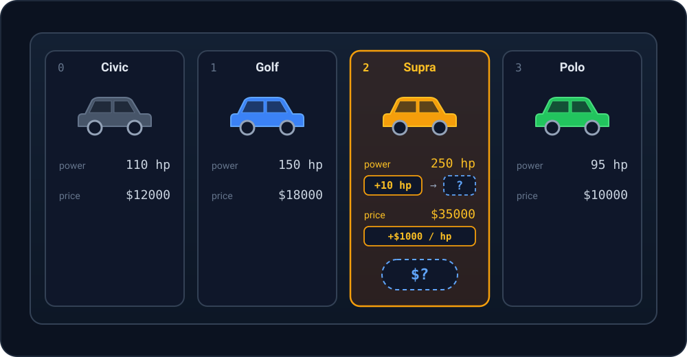

- **Мойка машин.** Мойка вмещает 3 машины. Каждая машина бывает чистой или грязной.
  Помойте каждую грязную машину. Посчитайте, сколько было помыто.

  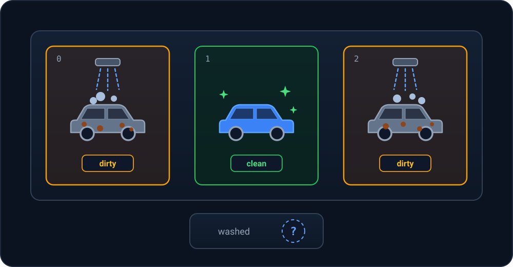

- **Парковка.** На парковке 2 этажа по 4 места.
  Каждое место либо хранит машину, либо пусто.
  Поставьте новую машину на первое пустое место. Пройдите по местам с помощью арифметики указателей.

  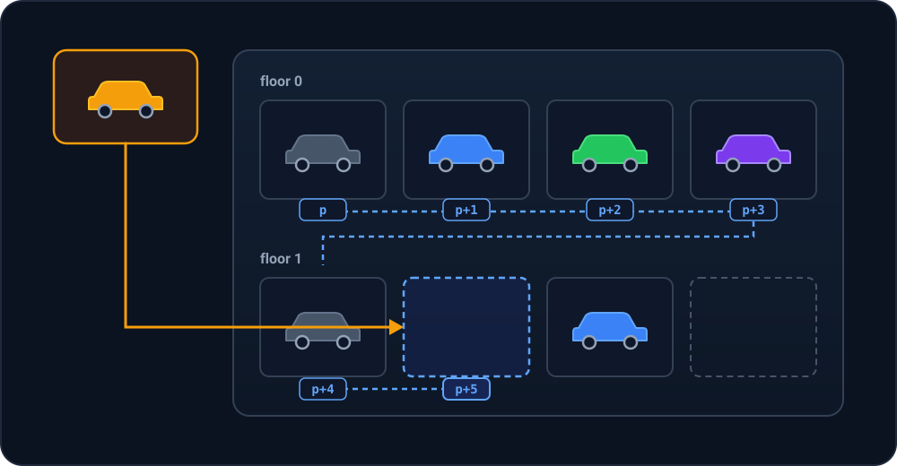

- **Двигатель машины.** В гараже 4 машины. У каждой машины свой двигатель. У двигателя есть износ от 0 до 100.
  Проверьте двигатель через машину 1 и отремонтируйте двигатель машины 1 до износа 0.

  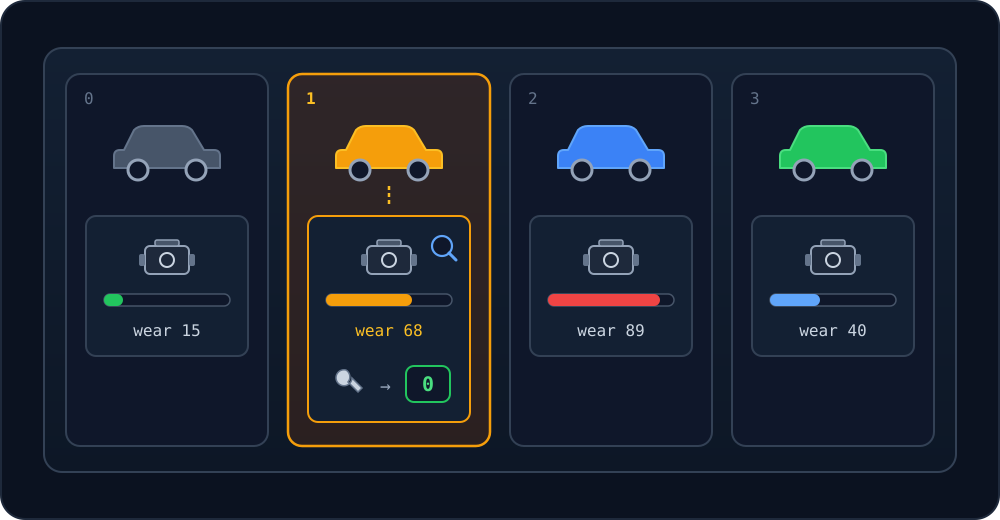

- **Рейлинг для чашек.** Рейлинг рассчитан на 4 чашки. Некоторые крючки пусты.
  Повесьте новую чашку на первый пустой крючок и снимите чашку с крючка 1.
  При перемещении владение передаётся: скопируйте ее, затем очистите старое место.

  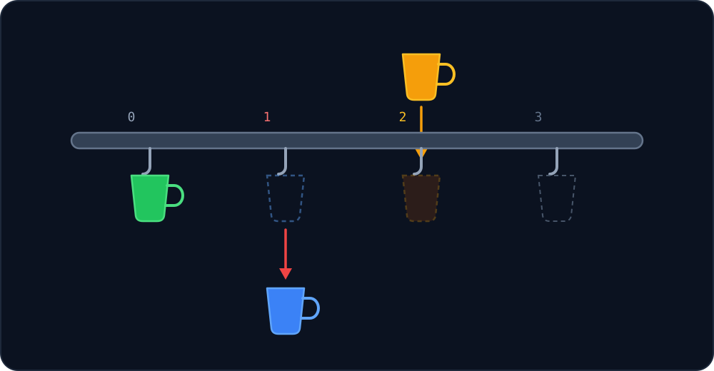

- **Отряд героев.** Отряд вмещает 3 героев. У каждого героя есть здоровье и щит.
  Полечите героя 1 на 20 единиц здоровья. Посчитайте, скольким героям все еще нужно лечение.

  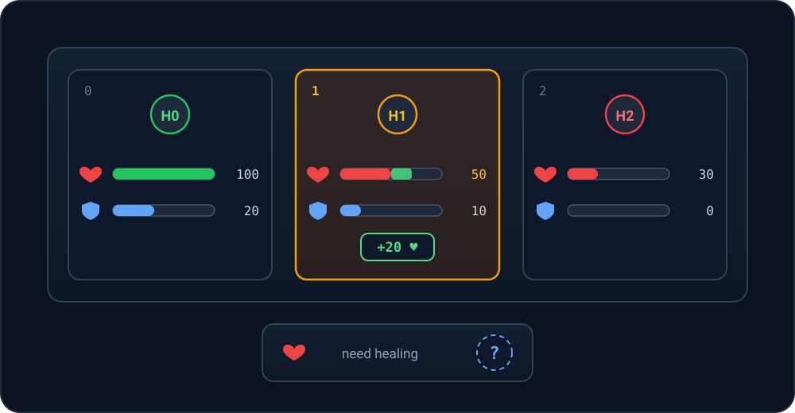

- **Активный бафф.** Игрок хранит указатель на активный бафф. Отсутствие баффа означает пустой указатель.
  Дайте игроку 1 бафф на щит до боя и заберите его после боя.

  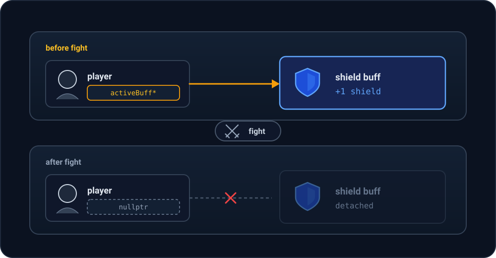

- **Класс.** В комнате 2 ряда по 3 парты. Каждая парта либо хранит ученика, либо пуста.
  Посчитайте пустые парты. Посадите новичка за первую пустую парту.

  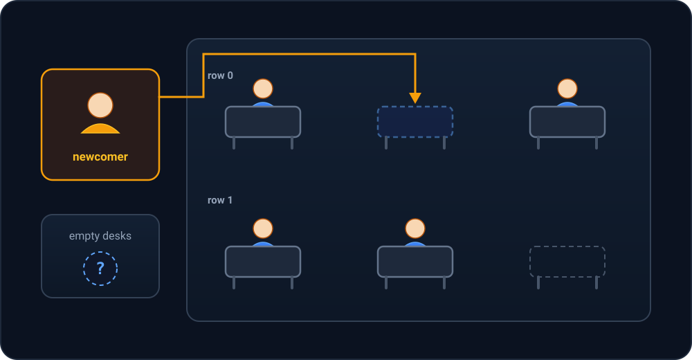

- **Найти пиццу.** Холодильник вмещает 3 продукта с названиями.
  Найдите пиццу и переместите ее на полку 1 морозилки. Верните признак, была ли она найдена.
  Обращайтесь к полкам через `std::span`.

  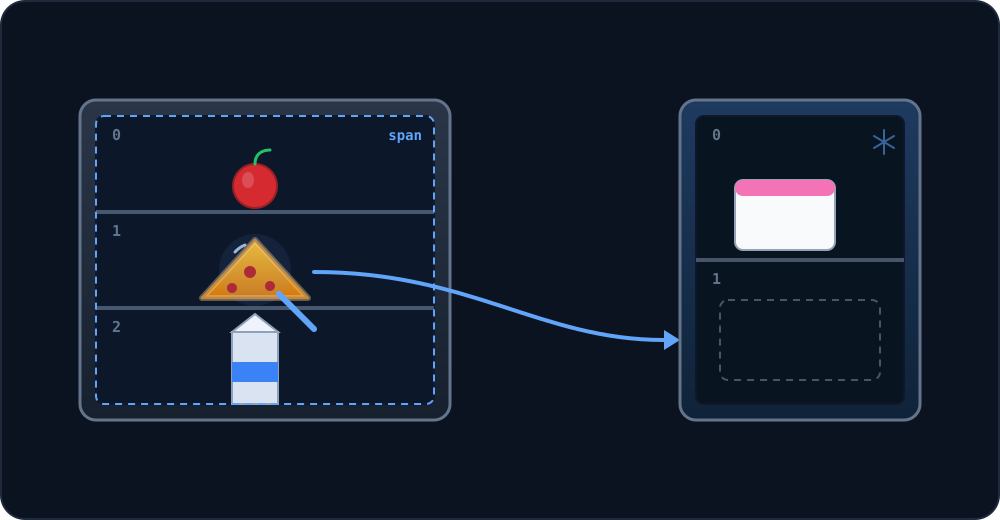

  <details>
  <summary>
  Возможное решение
  </summary>

  Те же холодильник и морозилка, что и раньше, но поиск выполняется через `span` — представление массива полок, а не сам массив.
  Имя — то же, что у предыдущего `move_food`, но параметры другие (перегрузка): параметры «что найти» и «куда положить» сгруппированы в отдельную структуру запроса:

  ```cpp
  #include <array>
  #include <cassert>
  #include <optional>
  #include <span>
  #include <string_view>

  struct Food
  {
      std::string_view name;
  };

  struct Fridge
  {
      std::array<std::optional<Food>, 3> shelves;
  };

  struct Freezer
  {
      std::array<std::optional<Food>, 2> shelves;
  };

  struct FoodMove
  {
      std::string_view name;
      size_t toIndex;
  };
  ```

  Допустим, на полке 1 холодильника лежит пицца, а полка 1 морозилки пуста.
  Вызывающий код упаковывает `"pizza"` и `1` в `FoodMove`.
  Функции не нужен весь холодильник — только вид на его полки,
  поэтому она принимает `std::span` из них. Та же функция может переносить еду
  из любого непрерывного массива полок, не только из этого холодильника.
  Целевой индекс — это контракт, поэтому его проверяет `assert`;
  свободна ли целевая полка — это обычные данные, поэтому проверка возвращает `false`.
  Цикл по `span` перебирает слоты полки по очереди: в слоте 0 пиццы нет, поэтому пропускаем его;
  в слоте 1 есть пицца, поэтому копируем ее в морозилку и очищаем старый слот,
  затем сигнализируем об успехе, возвращая `true`.
  Если ни в одном слоте нет продукта с таким именем, возвращаем `false` и ничего не меняем:

  ```cpp
  bool move_food(
      std::span<std::optional<Food>> shelves,
      Freezer& to,
      FoodMove move)
  {
      assert(move.toIndex < to.shelves.size());
      if (to.shelves[move.toIndex].has_value())
      {
          return false;
      }
      for (auto& slot : shelves)
      {
          if (!slot.has_value())
          {
              continue;
          }
          if (slot->name != move.name)
          {
              continue;
          }
          to.shelves[move.toIndex] = slot;
          slot.reset();
          return true;
      }
      return false;
  }
  ```

  Изменения через `span` отражаются в самом холодильнике, потому что `span`
  хранит адрес полок, а не их копию.

  Использование из `main`:
  ```cpp
  Fridge fridge{};
  fridge.shelves[1] = Food{
      .name = "pizza",
  };
  Freezer freezer{};
  bool moved{ move_food(fridge.shelves, freezer, FoodMove{
      .name = "pizza",
      .toIndex = 1,
  }) };
  ```
  </details>

- **Замочить посуду.** На кухне 2 сушилки по 3 тарелки. Каждая тарелка бывает грязной или замоченной.
  Замочите каждую грязную тарелку в сушилке 0.

  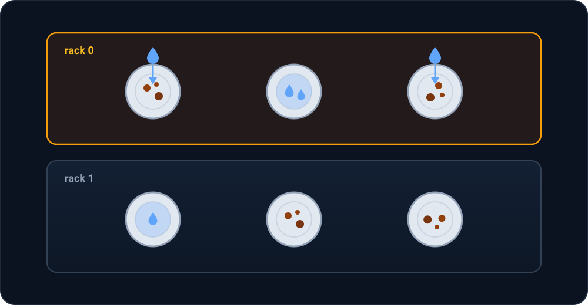

- **Комнаты библиотеки.** В библиотеке 2 комнаты по 3 слота. Каждый слот либо хранит книгу, либо пуст.
  Положите «Атлас» в первый пустой слот комнаты 1.

  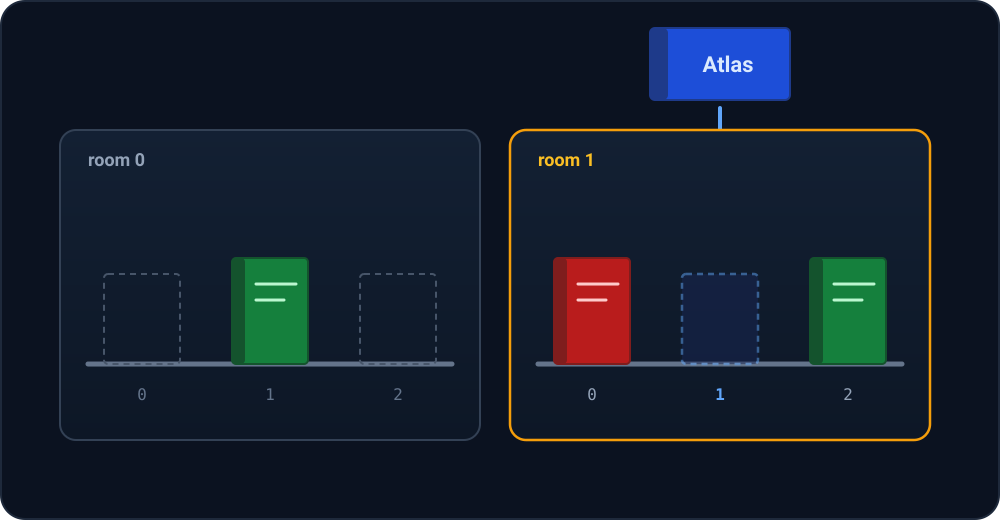

- **Светофор.** На перекрестке 3 светофора. Каждый светофор бывает красным, желтым или зеленым.
  Переключите светофор 2 на следующий цвет через `switch`.

  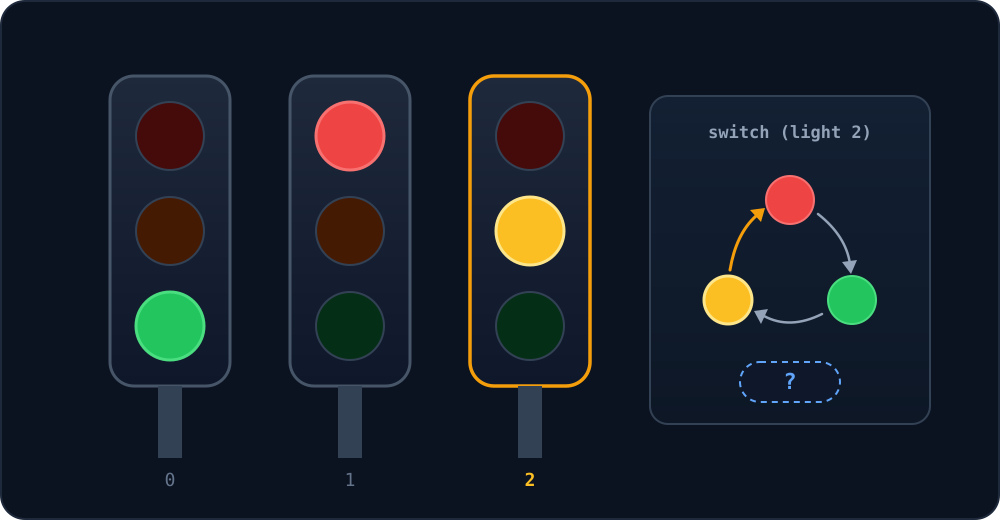

- **Аптечка.** Шкафчик вмещает 4 коробки. Каждая коробка бывает свежей или просроченной.
  Верните признак, можно ли использовать коробку 1. Выбросите коробку 1, если она просрочена.

  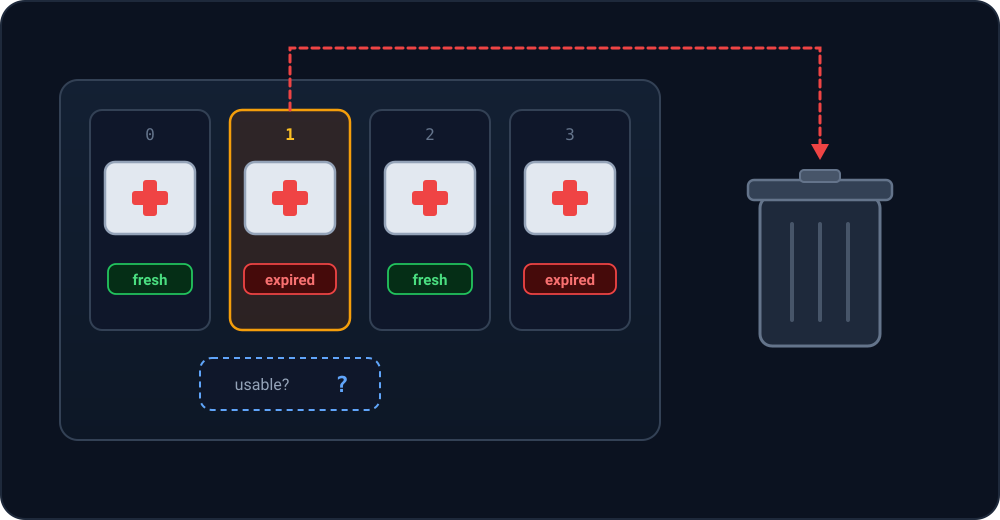

- **Столовая.** Столовая хранит 3 супа и 3 хлеба.
  Подайте суп 1 с хлебом 1. При подаче оба забираются.

  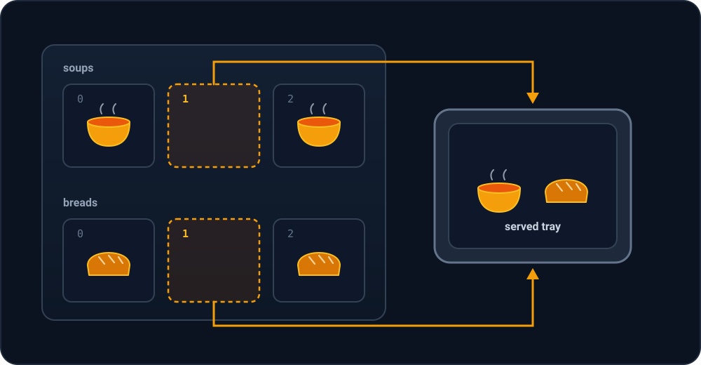

- **Горячая цепочка.** На кухне есть холодильник, морозилка и микроволновка.
  Положите пиццу с полки 0 холодильника в микроволновку, разогрейте ее,
  затем переместите на полку 1 морозилки. Каждый шаг возвращает признак, получилось ли его выполнить.

  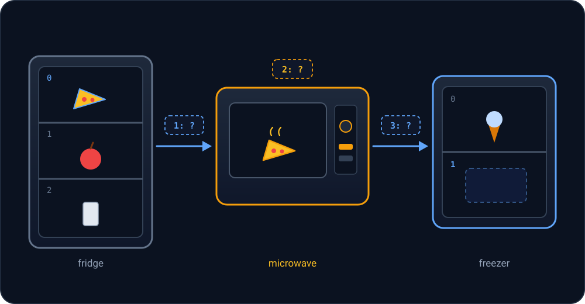

- **Барбершоп.** В салоне есть место для 4 ожидающих клиента и 2 мастера.
  У каждого клиента есть метка и остаток стрижки в минутах — сколько ещё нужно состричь.
  Клиенты создаются отдельно в `main`, а салон их только заимствует.
  Добавьте каждого клиента на первое свободное место в очереди.
  Назначьте свободных мастеров ожидающим клиентам.
  Каждый тик каждый занятый мастер состригает 1 минуту.
  Когда клиент полностью пострижен, мастер освобождается.
  Симулируйте через цикл `while`, пока все клиенты не будут обслужены.

  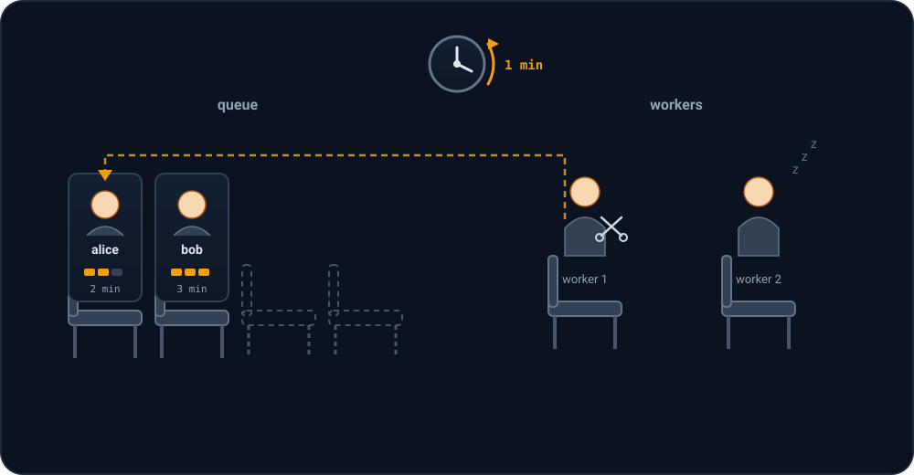

  <details>
  <summary>
  Возможное решение
  </summary>

  Клиенты живут в `main`, а салон их только заимствует —
  поэтому и очередь, и мастера хранят указатели, а не копии.
  Изменения через указатель отражаются на самом клиенте: один и тот же клиент сначала доступен через очередь, затем через мастера.

  ```cpp
  #include <array>
  #include <cassert>
  #include <string_view>

  struct MinutesLeft
  {
      int value;
  };

  struct Client
  {
      std::string_view label;
      MinutesLeft hairCompletion;
  };

  struct Worker
  {
      Client* assignedClient{ nullptr };
  };

  struct Shop
  {
      std::array<Client*, 4> queue{};
      std::array<Worker, 2> workers{};
  };
  ```

  Добавление кладет указатель на первое свободное место в очереди.
  Поиск этого места это отдельная функция:
  она отдает указатель на слот или `nullptr`, когда очередь полна.
  Добавление просто заполняет этот слот.
  Клиент никогда не должен быть `nullptr`, поэтому это проверяется через assert;
  переполненная очередь — это штатная ситуация, о ней сообщается возвращаемым значением:

  ```cpp
  enum class AddClientResult
  {
      Added,
      FailedQueueFull,
  };

  Client** find_free_slot(Shop& shop)
  {
      for (auto& slot : shop.queue)
      {
          if (slot == nullptr)
          {
              return &slot;
          }
      }
      return nullptr;
  }

  AddClientResult add_client(Shop& shop, Client* client)
  {
      assert(client != nullptr); // add_client ожидает, что client никогда не nullptr
      Client** slot{ find_free_slot(shop) };
      if (slot == nullptr)
      {
          return AddClientResult::FailedQueueFull;
      }
      *slot = client;
      return AddClientResult::Added;
  }
  ```

  Взятие первого ожидающего клиента это отдельная функция:
  поиск первого занятого места отдает указатель на слот,
  взятие очищает этот слот и отдает указатель на клиента.
  Назначение просто раздает каждому свободному мастеру то, что вернет эта функция —
  результат `nullptr` просто оставляет мастера свободным:

  ```cpp
  Client** find_taken_slot(Shop& shop)
  {
      for (auto& slot : shop.queue)
      {
          if (slot != nullptr)
          {
              return &slot;
          }
      }
      return nullptr;
  }

  Client* take_first_waiting(Shop& shop)
  {
      Client** slot{ find_taken_slot(shop) };
      if (slot == nullptr)
      {
          return nullptr;
      }
      Client* found{ *slot };
      *slot = nullptr;
      return found;
  }

  void assign_workers(Shop& shop)
  {
      for (auto& worker : shop.workers)
      {
          if (worker.assignedClient != nullptr)
          {
              continue;
          }
          worker.assignedClient = take_first_waiting(shop);
      }
  }
  ```

  Проверка готовности клиента это тоже отдельная функция:

  ```cpp
  void cut_one_minute(MinutesLeft* minutes)
  {
      assert(minutes != nullptr);
      assert(minutes->value > 0);
      *minutes = MinutesLeft{ minutes->value - 1 };
  }

  bool client_done(const Client& client)
  {
      return client.hairCompletion.value == 0;
  }

  enum class TickResult
  {
      Unassigned,
      StillWorking,
      Done,
  };

  TickResult tick_worker(Worker& worker)
  {
      Client* client{ worker.assignedClient };
      if (client == nullptr)
      {
          return TickResult::Unassigned;
      }
      assert(client->hairCompletion.value >= 0); // длительность стрижки не может быть отрицательной
      if (client->hairCompletion.value > 0)
      {
          cut_one_minute(&client->hairCompletion);
      }
      if (client_done(*client))
      {
          worker.assignedClient = nullptr;
          return TickResult::Done;
      }
      return TickResult::StillWorking;
  }

  void tick_all_workers(Shop& shop)
  {
      for (auto& worker : shop.workers)
      {
          tick_worker(worker);
      }
  }

  bool has_waiting_clients(const Shop& shop)
  {
      for (const auto& slot : shop.queue)
      {
          if (slot != nullptr)
          {
              return true;
          }
      }
      return false;
  }

  bool has_busy_workers(const Shop& shop)
  {
      for (const auto& worker : shop.workers)
      {
          if (worker.assignedClient != nullptr)
          {
              return true;
          }
      }
      return false;
  }

  bool shop_done(const Shop& shop)
  {
      return !has_waiting_clients(shop) && !has_busy_workers(shop);
  }
  ```

  Симуляция — это обычный цикл `while`: сначала назначаем мастеров, затем вызываем тик всех мастеров, пока все клиенты не будут обслужены.
  Клиенты должны существовать дольше салона, потому что салон их никогда не копирует:

  ```cpp
  int main()
  {
      Client alice{
          .label = "alice",
          .hairCompletion = { 2 },
      };
      Client bob{
          .label = "bob",
          .hairCompletion = { 3 },
      };

      Shop shop{};
      add_client(shop, &alice);
      add_client(shop, &bob);

      while (!shop_done(shop))
      {
          assign_workers(shop);
          tick_all_workers(shop);
      }
  }
  ```
  </details>

- **Дроны-барберы.** Работники теперь дроны-автоматы:
  несколько дронов могут обрабатывать одного клиента одновременно,
  каждый состригает по 1 минуте за тик.
  Когда клиент полностью пострижен, освобождается каждый занятый им дрон.
  Симулируйте, пока все клиенты не будут обслужены.

  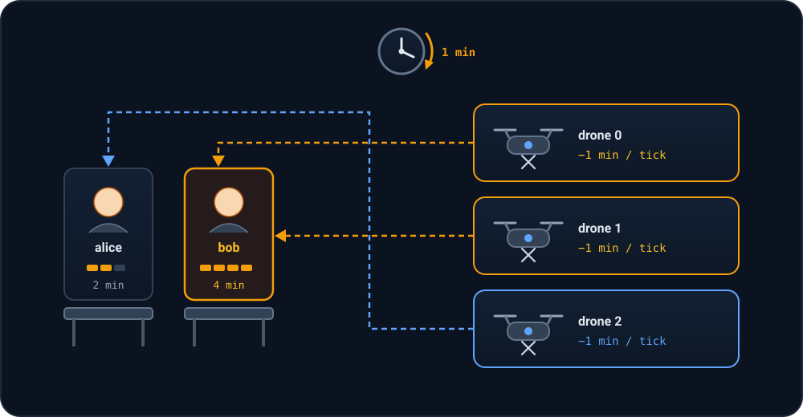

- **Парк аттракционов.** В парке 3 аттракциона.
  Каждый посетитель упорядочивает все 3 аттракциона по предпочтению,
  не посещает один и тот же аттракцион дважды подряд
  и может посетить аттракционы всего 4 раза.
  Каждый тик обслуженные посетители сходят с аттракциона —
  или покидают парк, когда квота исчерпана —
  а посетители без места занимают первый свободный аттракцион в порядке своих предпочтений.
  Если всё занято, они ждут, пока что-нибудь освободится.
  Симулируйте, пока все не исчерпают квоту.

  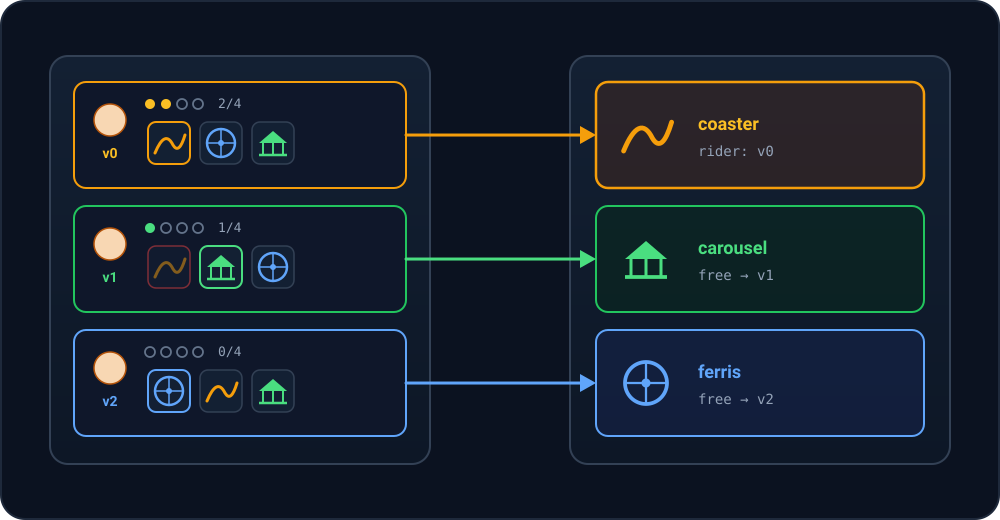

- **Рейс грузовика.** Грузовик должен проехать заданное количество часов.
  В списке 3 водителя.
  Про каждого известно, сколько он может ехать без отдыха
  и сколько отдыха ему нужно за час езды.
  Напишите функцию, которая генерирует события рейса:
  кто сколько ехал и сколько времени грузовик простоял.
  Водитель едет до своего лимита (или пока не закончится рейс), а затем отдыхает
  по формуле «часы езды × норма отдыха». Пока он отдыхает,
  за руль садится другой водитель, а после отдыха он снова готов ехать.
  Грузовик простаивает, только когда отдыхают все водители одновременно,
  и ждёт, пока первый из них не отдохнёт.

  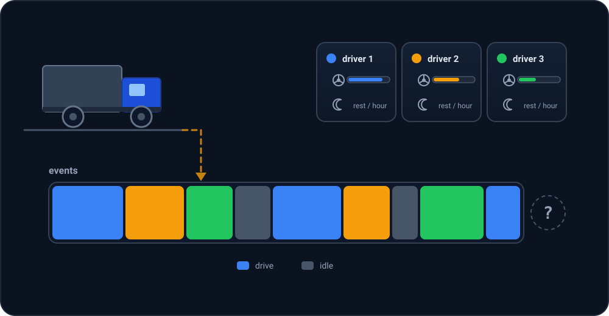

  <details>
  <summary>
  Возможное решение
  </summary>

  Состояние рейса — это сколько ещё осталось ехать
  и сколько ещё осталось отдохнуть каждому водителю.
  Оставшийся отдых хранится в самом водителе — так же,
  как в барбершопе мастер хранит клиента, которого стрижёт:

  ```cpp
  #include <array>
  #include <cassert>
  #include <iostream>
  #include <span>
  #include <string_view>

  struct Driver
  {
      std::string_view name;
      double maxDriveHours;    // сколько водитель может ехать без отдыха
      double restPerDriveHour; // сколько отдыха нужно за час езды
      double restLeft{ 0.0 };  // сколько отдыха ещё осталось
  };
  ```

  Событие — это вид, имя водителя и длительность.
  У события простоя нет водителя, поэтому имя остаётся пустым:

  ```cpp
  enum class EventKind
  {
      Drive,
      Idle,
  };

  struct Event
  {
      EventKind kind;
      std::string_view driver; // у события Idle имя пустое
      double hours;
  };
  ```

  Генератор работает, пока не закончится рейс.
  Сначала он ищет водителя, у которого отдых уже закончился.
  Такой водитель проезжает один отрезок пути — до своего лимита или до конца рейса —
  а отдых всех остальных за эти часы сокращается.
  Затем водитель должен отдохнуть столько, сколько ему положено за часы езды.
  Если никто не готов, грузовик простаивает, пока не закончится самый короткий
  оставшийся отдых; это время вычитается из остатка отдыха у всех водителей.
  Каждый шаг записывает ровно одно событие:

  ```cpp
  // Записывает события рейса в events, возвращает их количество.
  size_t generate_events(
      std::span<Driver> drivers,
      double tripHours,
      std::span<Event> events)
  {
      assert(!drivers.empty()); // у грузовика всегда есть хотя бы один водитель
      assert(tripHours >= 0.0); // рейс не может длиться отрицательное время
      for (const Driver& driver : drivers)
      {
          assert(driver.maxDriveHours > 0.0); // водитель без запаса хода остановит рейс
          assert(driver.restPerDriveHour >= 0.0);
      }
      size_t count{ 0 };
      while (tripHours > 0.0)
      {
          size_t freeIndex{ drivers.size() };
          for (size_t i{ 0 }; i < drivers.size(); i++)
          {
              if (drivers[i].restLeft <= 0.0)
              {
                  freeIndex = i;
                  break;
              }
          }

          if (freeIndex < drivers.size())
          {
              Driver& driver{ drivers[freeIndex] };
              double hours{ driver.maxDriveHours };
              if (hours > tripHours)
              {
                  hours = tripHours;
              }
              tripHours -= hours;

              // Пока один водитель едет, остальные отдыхают.
              for (Driver& other : drivers)
              {
                  if (&other == &driver || other.restLeft <= 0.0)
                  {
                      continue;
                  }
                  other.restLeft -= hours;
                  if (other.restLeft < 0.0)
                  {
                      other.restLeft = 0.0;
                  }
              }
              driver.restLeft = driver.restPerDriveHour * hours;

              assert(count < events.size());
              events[count] = Event{ EventKind::Drive, driver.name, hours };
              count++;
              continue;
          }

          // Все отдыхают: грузовик ждёт первого, кто освободится.
          double idleHours{ drivers[0].restLeft };
          for (const Driver& driver : drivers)
          {
              if (driver.restLeft < idleHours)
              {
                  idleHours = driver.restLeft;
              }
          }
          assert(idleHours > 0.0); // иначе кто-то из водителей был бы готов
          for (Driver& driver : drivers)
          {
              driver.restLeft -= idleHours;
          }

          assert(count < events.size());
          events[count] = Event{ EventKind::Idle, std::string_view{}, idleHours };
          count++;
      }
      return count;
  }
  ```

  При печати `switch` выбирает ветку по виду события, а у события простоя нет имени:

  ```cpp
  void print_event(const Event& event)
  {
      switch (event.kind)
      {
          case EventKind::Drive:
              std::cout << event.driver << " drove " << event.hours << " h" << std::endl;
              break;
          case EventKind::Idle:
              std::cout << "truck idle for " << event.hours << " h" << std::endl;
              break;
          default:
              assert(false); // все значения EventKind обработаны выше
              break;
      }
  }
  ```

  Использование из `main`:
  ```cpp
  int main()
  {
      std::array<Driver, 3> drivers{
          Driver{ .name = "alice", .maxDriveHours = 4.0, .restPerDriveHour = 0.5 },
          Driver{ .name = "bob", .maxDriveHours = 3.0, .restPerDriveHour = 1.0 },
          Driver{ .name = "cid", .maxDriveHours = 2.0, .restPerDriveHour = 2.0 },
      };

      std::array<Event, 32> events{};
      size_t count{ generate_events(drivers, 12.0, events) };
      for (size_t i{ 0 }; i < count; i++)
      {
          print_event(events[i]);
      }
  }
  ```

  alice проезжает свои 4 часа, затем ей положено 2 часа отдыха.
  bob едет 3 часа — за это время alice успевает отдохнуть и снова готова ехать.
  alice проезжает ещё 4 часа, пока bob отдыхает, а последний час едет bob.
  Грузовику не приходится простаивать:

  ```text
  alice drove 4 h
  bob drove 3 h
  alice drove 4 h
  bob drove 1 h
  ```
  </details>

- **Объятия в семье.** В семье 5 человек.
  Каждый хочет обнять каждого другого ровно один раз.
  Каждый человек хранит указатели на тех, кого уже обнял.
  Обнимите всех.

  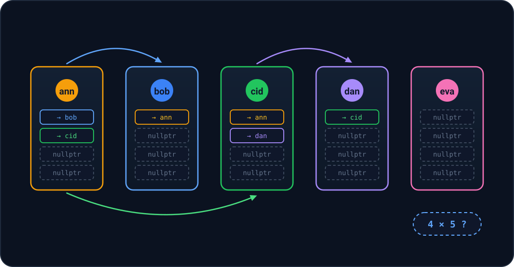

- **Объятия в семье по индексам.** Те же 5 человек,
  но каждый хранит индексы обнятых (`std::array<int, 4>`) вместо указателей —
  теперь объятия имеют смысл только вместе с массивом семьи, на который указывают индексы.
  Обнимите всех по разу.

  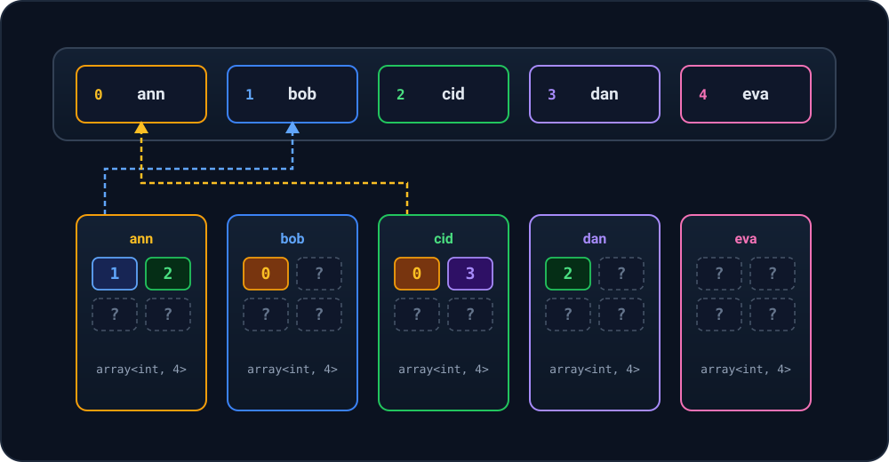

- **Объятия в семье с битовым множеством.** Те же 5 человек,
  но с битовым множеством обнятых.
  Обнимите всех по разу.

  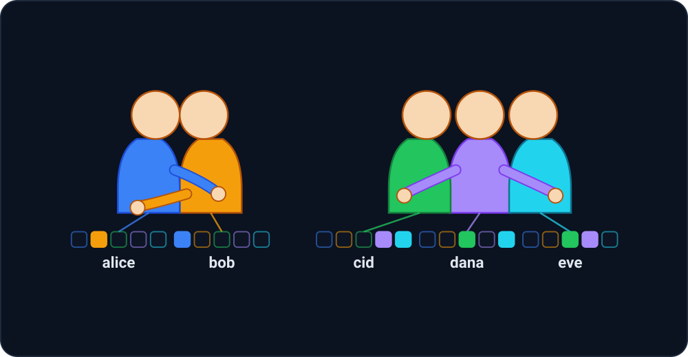

  <details>
  <summary>
  Возможное решение
  </summary>

  Бит `i` значит "обнял члена `i`".
  Свой бит никогда не ставится, поэтому у полностью обнявшегося 4 бита из 5.
  Те же десять пар, что и раньше, — меняется только хранение:

  ```cpp
  #include <array>
  #include <bitset>
  #include <cassert>
  #include <string_view>

  constexpr int familySize{ 5 };

  struct Person
  {
      std::string_view name;
      std::bitset<familySize> hugged{};
  };

  bool hug(std::array<Person, familySize>& family, int i, int j)
  {
      assert(i != j);
      assert(i >= 0 && i < familySize && j >= 0 && j < familySize);
      if (family[i].hugged.test(j))
      {
          return false; // уже обнимались: ничего нового
      }
      family[i].hugged.set(j);
      family[j].hugged.set(i);
      return true;
  }

  bool all_hugged(const std::array<Person, familySize>& family)
  {
      for (const Person& person : family)
      {
          if (person.hugged.count() < familySize - 1) // все, кроме себя
          {
              return false;
          }
      }
      return true;
  }
  ```

  Использование из `main`:
  ```cpp
  int main()
  {
      std::array<Person, familySize> family{
          Person{ .name = "ann" },
          Person{ .name = "bob" },
          Person{ .name = "cid" },
          Person{ .name = "dan" },
          Person{ .name = "eva" },
      };
      for (int i = 0; i < familySize; i++)
      {
          for (int j = i + 1; j < familySize; j++)
          {
              hug(family, i, j);
          }
      }
      assert(all_hugged(family));
  }
  ```
  </details>

## Моделирование результатов операций

`bool` говорит только, получилось ли выполнить операцию.
Часто вызывающему коду нужно знать, *что* произошло:
какой снек куплен, сколько осталось сдачи, почему автомат отказал.
Оформите результат отдельным типом, а печать пусть реагирует на него.

В автомате со снеками есть слоты со снеком и ценой:

```cpp
#include <array>
#include <cassert>
#include <iostream>
#include <optional>
#include <string_view>

enum class Snack
{
    Chips,
    Chocolate,
    Water,
};

std::string_view snack_name(Snack snack)
{
    switch (snack)
    {
        case Snack::Chips:
            return "chips";
        case Snack::Chocolate:
            return "chocolate";
        case Snack::Water:
            return "water";
    }
    assert(false); // все значения Snack обработаны выше
    return {};
}

struct VendingSlot
{
    std::optional<Snack> snack;
    int price;
};

struct VendingMachine
{
    std::array<VendingSlot, 3> slots;
};
```

Покупка сообщает один из нескольких исходов.
Индекс слота и число монет приходят от покупателя,
поэтому неверное значение — это обычный результат, а не нарушенное предусловие:
контракт принимает любой ввод и сообщает, что произошло.
Единственное утверждение касается состояния самого автомата:
у слота должна быть положительная цена.
Успешный результат — отдельная структура,
поэтому результат не может содержать половину покупки:

```cpp
enum class PurchaseStatus
{
    Bought,
    InvalidSelection,
    InvalidPayment,
    EmptySlot,
    NotEnoughCoins,
};

struct BoughtSnack
{
    Snack snack;
    int change;
};

struct Purchase
{
    PurchaseStatus status;
    std::optional<BoughtSnack> bought{ std::nullopt }; // есть ровно при status == Bought
};

Purchase buy_snack(VendingMachine& machine, size_t slotIndex, int coins)
{
    if (slotIndex >= machine.slots.size())
    {
        return Purchase{ .status = PurchaseStatus::InvalidSelection };
    }
    if (coins < 0)
    {
        return Purchase{ .status = PurchaseStatus::InvalidPayment };
    }

    VendingSlot& slot{ machine.slots[slotIndex] };
    assert(slot.price > 0); // у каждого слота должна быть положительная цена
    if (!slot.snack.has_value())
    {
        return Purchase{ .status = PurchaseStatus::EmptySlot };
    }
    if (coins < slot.price)
    {
        return Purchase{ .status = PurchaseStatus::NotEnoughCoins };
    }

    Purchase purchase{
        .status = PurchaseStatus::Bought,
        .bought = BoughtSnack{ .snack = *slot.snack, .change = coins - slot.price },
    };
    slot.snack.reset(); // автомат меняется только после успешной покупки
    return purchase;
}
```

Печать выбирает ветку по статусу и реагирует на то, что покупка действительно сделала:

```cpp
void print_purchase(const Purchase& purchase)
{
    // Данные о покупке есть тогда и только тогда, когда она успешна.
    assert(purchase.bought.has_value() == (purchase.status == PurchaseStatus::Bought));
    switch (purchase.status)
    {
        case PurchaseStatus::Bought:
            std::cout << "bought " << snack_name(purchase.bought->snack)
                      << ", change " << purchase.bought->change << std::endl;
            break;
        case PurchaseStatus::InvalidSelection:
            std::cout << "no such slot" << std::endl;
            break;
        case PurchaseStatus::InvalidPayment:
            std::cout << "the payment is invalid" << std::endl;
            break;
        case PurchaseStatus::EmptySlot:
            std::cout << "the slot is empty" << std::endl;
            break;
        case PurchaseStatus::NotEnoughCoins:
            std::cout << "not enough coins" << std::endl;
            break;
        default:
            assert(false); // все значения PurchaseStatus обработаны выше
            break;
    }
}
```

Использование из `main`:

```cpp
VendingMachine machine{
    .slots = {
        VendingSlot{ .snack = Snack::Chips, .price = 3 },
        VendingSlot{ .snack = std::nullopt, .price = 2 },
        VendingSlot{ .snack = Snack::Water, .price = 2 },
    },
};

print_purchase(buy_snack(machine, 9, 5)); // no such slot
print_purchase(buy_snack(machine, 0, 5)); // bought chips, change 2
print_purchase(buy_snack(machine, 0, 5)); // the slot is empty
print_purchase(buy_snack(machine, 2, 1)); // not enough coins
```

Второй вызов — единственный, который меняет автомат.
Остальные три оставляют все слоты точно такими, какими они были.

## Планирование мутации как значения

Ещё один способ разделить обязанности — сделать изменение самостоятельным значением.
Одна функция читает текущее состояние и вычисляет изменение;
другая печатает, что сейчас произойдёт;
третья применяет изменение.
Состояние меняется в одном месте, а план можно рассмотреть до применения.

В гараже перекрашивают машины. План хранит, какую машину красят, новый цвет,
оценку времени и цену; его вычисление ничего не меняет:

```cpp
#include <array>
#include <cassert>
#include <iostream>
#include <span>
#include <string_view>

enum class Paint
{
    Red,
    Blue,
    Green,
};

std::string_view paint_name(Paint paint)
{
    switch (paint)
    {
        case Paint::Red:
            return "red";
        case Paint::Blue:
            return "blue";
        case Paint::Green:
            return "green";
    }
    assert(false); // все значения Paint обработаны выше
    return {};
}

bool is_known_paint(Paint paint)
{
    switch (paint)
    {
        case Paint::Red:
        case Paint::Blue:
        case Paint::Green:
            return true;
    }
    return false;
}

struct Car
{
    std::string_view model;
    Paint paint;
};

struct Repaint
{
    size_t carIndex;
    Paint newPaint;
    int hours;
    int price;
};

Repaint plan_repaint(std::span<const Car> cars, size_t carIndex, Paint newPaint)
{
    assert(carIndex < cars.size());   // план должен указывать на существующую машину
    assert(is_known_paint(newPaint)); // новый цвет должен быть допустимым значением Paint
    const Car& car{ cars[carIndex] };
    assert(is_known_paint(car.paint)); // текущий цвет должен быть допустимым значением Paint
    int hours{ car.paint == newPaint ? 1 : 3 };
    return Repaint{
        .carIndex = carIndex,
        .newPaint = newPaint,
        .hours = hours,
        .price = hours * 1000,
    };
}

void print_repaint(const Repaint& repaint)
{
    std::cout << "car " << repaint.carIndex << " will be repainted "
              << paint_name(repaint.newPaint) << " in " << repaint.hours
              << " h for " << repaint.price << std::endl;
}

void apply_repaint(std::span<Car> cars, const Repaint& repaint)
{
    assert(repaint.carIndex < cars.size()); // план должен указывать на существующую машину
    assert(is_known_paint(repaint.newPaint)); // новый цвет должен быть допустимым значением Paint
    cars[repaint.carIndex].paint = repaint.newPaint;
}
```

Использование из `main`: план печатается до применения,
поэтому вывод показывает, что именно сейчас произойдёт:

```cpp
std::array<Car, 3> cars{
    Car{ .model = "Supra", .paint = Paint::Red },
    Car{ .model = "Civic", .paint = Paint::Green },
    Car{ .model = "Miata", .paint = Paint::Red },
};

Repaint repaint{ plan_repaint(cars, 0, Paint::Blue) };
print_repaint(repaint);
apply_repaint(cars, repaint);
```

Функции принимают `span`, поэтому одинаково работают
с `std::vector` или обычным массивом.
План хранит только индекс, который указывает на машину в этой же коллекции.
